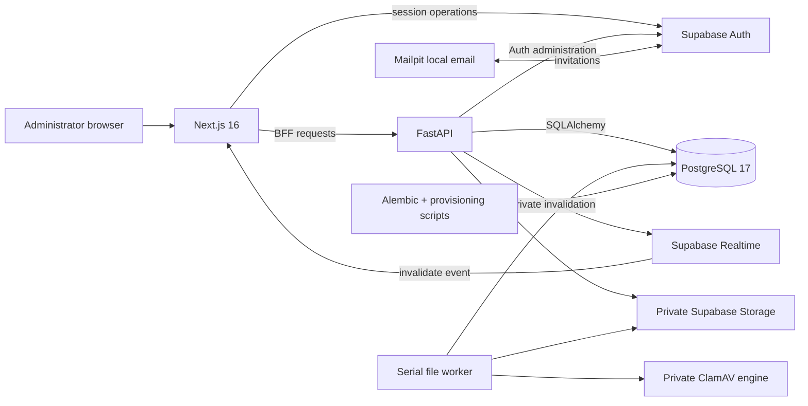

# System Overview

> **Scope:** OpenSlate's implemented purpose, major components, boundaries, and current capability state.
> **Audience:** New developers who need a first map of the whole system.
> **Related documents:** [System context](02-system-context.md), [Domain architecture](03-domain-architecture.md), [Runtime flows](13-runtime-flows.md), [Glossary](21-glossary.md)

## What OpenSlate is

OpenSlate is a self-hosted foundation for configurable business operations. An administrator defines departments, modules, typed fields, records, and record relationships, then manages those entities through a Next.js workspace and a FastAPI API. Domain reads and writes use flat resource capabilities; the literal `admin` role is implicitly granted all of them, while users with other roles receive only explicitly granted capabilities.

The repository is a multi-component application rather than a package monorepo. The root coordinates a Python backend, a TypeScript frontend, Alembic migrations, local Supabase services, standalone image recipes, and verification workflows.

## Capability status

| Capability                                              | State                         | Current behavior                                                                                                       |
| ------------------------------------------------------- | ----------------------------- | ---------------------------------------------------------------------------------------------------------------------- |
| Configurable departments, modules, fields, and records  | **Implemented**               | Administrators build schemas, accept them, and create validated JSONB-backed records.                                  |
| Directed record relationships                           | **Implemented**               | Relationship fields define target modules and cardinality; edges are stored separately from record JSON.               |
| Close, reopen, and purge lifecycle                      | **Implemented / gated**       | Close and reopen are operational. Physical purge exists but is disabled by default and requires confirmation controls. |
| Supabase identity and invitation flow                   | **Implemented**               | Supabase Auth owns identities and passwords; the application owns local profiles and roles.                            |
| Transactional ORM audit                                 | **Implemented**               | Normal audited ORM mutations create minimal before/after logs in the same transaction.                                 |
| Private Realtime invalidation                           | **Implemented, best effort**  | Commits may broadcast an opaque invalidation; clients refetch through FastAPI.                                         |
| Workspace profile and regional settings                 | **Implemented**               | One deployment-wide profile provides organization identity, IANA timezone, locale, optimistic revisioning, and an optional current logo. |
| Record queries, saved views, and CSV export             | **Implemented**               | Typed single-module query definitions power interactive results, personal/shared saved views, and bounded literal-admin CSV export. |
| Private files and document library                      | **Implemented / fail closed** | FastAPI owns private metadata and transfer; a durable serial worker uses the configured private ClamAV engine. Unavailable, stale or uncertain scanning keeps files quarantined. |
| Aggregate reports/charts and businesses tenancy          | **Absent**                    | There is no aggregate reporting or chart builder, and the `businesses` package remains a tenancy placeholder.          |
| Hosted production deployment                            | **Unknown**                   | Images exist, but no target platform, ingress, TLS, secret delivery, backup, or deployment workflow is defined.        |

Sources: `backend/app/main.py:create_app`, `backend/app/systems/`, `frontend/src/app/`, migrations `20260819_0010_supabase_cutover.py`, `e42d4f1e6b41_workspace_profile.py`, `709412f53ee5_saved_record_views.py`, `17cf3df01f7a_private_file_inventory.py`, `c8a1056a0758_workspace_logo_reference.py`, and `infra/docker/`.

## Major components

The browser uses Next.js session route handlers and a catch-all backend-for-frontend (BFF). The BFF converts HttpOnly cookie state into an access-token authorization header for FastAPI. FastAPI verifies the Supabase JWT, reloads the local user and role, executes SQLAlchemy work, and commits audit entries with the domain change. Realtime carries no row data; it only asks the browser to refetch.

### Component ownership

| Component         | Responsibility                                                                     | Primary evidence                                                         |
| ----------------- | ---------------------------------------------------------------------------------- | ------------------------------------------------------------------------ |
| Next.js frontend  | Pages, client state, session cookies, BFF, security headers, Realtime subscription | `frontend/src/app/`, `frontend/src/components/`, `frontend/src/proxy.ts` |
| FastAPI backend   | Canonical application API, authorization, validation, domain operations            | `backend/app/main.py`, `backend/app/systems/`                            |
| PostgreSQL        | Application schema, constraints, JSONB state, RLS, audit and lifecycle persistence | `backend/app/**/models.py`, `backend/migrations/`                        |
| Supabase Auth     | Identity, password, invitation delivery, access/refresh tokens                     | `supabase/config.toml`, `backend/app/core/integrations/supabase.py`      |
| Supabase Realtime | Private Broadcast invalidation only                                                | migration `0010`, `audit/listeners.py`, `realtime-provider.tsx`          |
| Supabase Storage  | Private objects addressed only by FastAPI metadata and transfer services          | `backend/app/systems/platform/files/`, migrations `17cf3df01f7a` and `c8a1056a0758` |
| Alembic/scripts   | Schema delivery, runtime DB login, first administrator, sample data                | `backend/migrations/`, `backend/scripts/`                                |
| GitHub Actions    | Backend and frontend verification, not deployment                                  | `.github/workflows/`                                                     |

## Observed architectural principles

These are evidenced technical effects, not aspirational claims:

1. **FastAPI is the application data boundary.** The Supabase Data API does not expose the application schema (`supabase/config.toml`).
2. **Alembic owns application schema evolution.** Supabase migrations and seeds are disabled.
3. **Capabilities own backend domain behavior.** Runtime packages under `app/systems/` hold models, schemas, routers, validation, and selected services.
4. **Mutations use audited ORM sessions.** Bulk/raw ORM mutation statements are rejected by audit listeners.
5. **Supabase Auth owns credentials.** The application stores no local password hash.
6. **Lifecycle is soft by default.** Most principal entities carry `is_deleted` and `deleted_at`; physical purge is explicit and gated.
7. **Realtime is invalidation, not replication.** Payloads contain no record snapshots.

The repository shows these designs, but it does not contain the original historical rationale for each one. [Architecture decisions](19-architecture-decisions.md) records their verified effects without inventing intent.

## Boundaries and constraints

- The supported local topology is Supabase CLI plus host-run frontend and backend processes. There is no root Compose stack.
- Domain APIs use matching `.read` and `.write` capabilities for departments, modules, fields, records, and relationships. Users, roles, invitations, audit, and lifecycle purge remain literal-`admin` operations; FastAPI is authoritative and direct database access bypasses RBAC.
- Direct SQL, Studio, Auth operations, Alembic, and external clients are outside application audit capture.
- PostgreSQL-specific JSONB, RLS, checks, and migrations are part of the architecture; SQLite is not an equivalent verification target.
- The checked-in Supabase configuration is local-only. Each deployment is one trust domain; no tenant key or tenant/RLS isolation is implemented.
- Scanner container configuration, a durable worker and operator maintenance/recovery
  procedures are present. Unconfigured scanning retains quarantine; these artifacts
  do not establish a running production deployment.
- General scheduled jobs, caches and a reverse proxy are absent.

## Where to start changing behavior

| Change                    | Start here                                                                    |
| ------------------------- | ----------------------------------------------------------------------------- |
| Domain model or invariant | Matching `backend/app/systems/<page>/<capability>/` package and Alembic migration    |
| API request/response      | Capability router/schema plus `frontend/src/lib/api.ts`                       |
| Page workflow             | Matching `frontend/src/app/**/page.tsx` and shared component                  |
| Login/session behavior    | `frontend/src/app/session/`, `frontend/src/app/bff/`, backend auth dependency |
| Close/reopen/purge        | `backend/app/systems/sandbox/lifecycle/` and `frontend/src/components/lifecycle-*`    |
| Audit behavior            | `backend/app/systems/manage/audit/`                                                  |
| Local platform            | `supabase/config.toml`, `.env.example`, root `README.md`                      |
| Schema delivery           | `backend/migrations/` and provisioning scripts                                |
