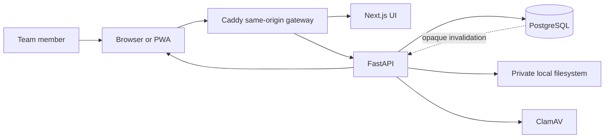

# System Context

> **Scope:** Actors, process boundaries, and trust boundaries in the current local architecture.

Team members use one canonical browser origin. Caddy forwards `/api` and `/api/events` to FastAPI and serves the interface from Next.js. FastAPI is the only application process allowed to read or mutate PostgreSQL application rows and private file bytes.

The browser is untrusted. Access and refresh tokens are HttpOnly cookies for browser sessions; state-changing browser requests require an allowed Origin and CSRF token. CLI clients use bearer tokens. PostgreSQL credentials, JWT signing material, scanner paths, and storage roots remain server-only.

Each deployment is one organization trust domain. Cross-organization tenancy and a managed hosted service are not current product guarantees. Native Windows/macOS packaging and LAN/TLS operation remain pending deployment work.
