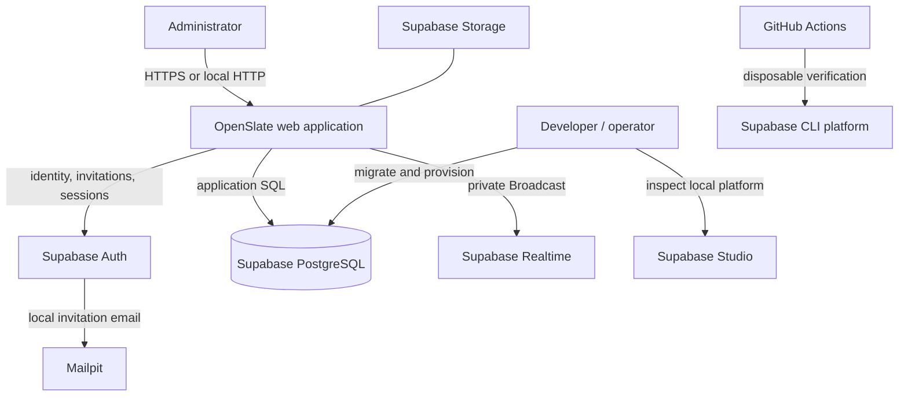
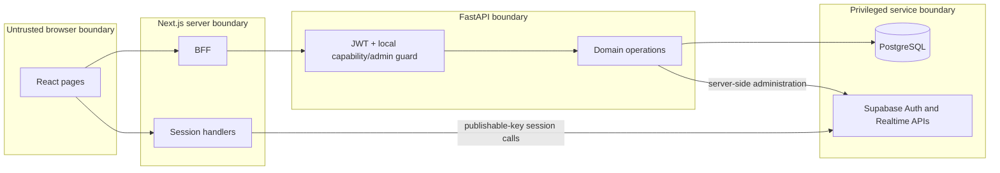

# System Context

> **Scope:** Actors, external systems, and trust boundaries around the OpenSlate application.
> **Audience:** New developers and operators tracing which component owns each responsibility.
> **Related documents:** [System overview](01-system-overview.md), [Authentication and authorization](08-authentication-authorization.md), [Infrastructure](11-infrastructure.md), [Security architecture](14-security-architecture.md)

## Context summary

OpenSlate consists of a browser-facing Next.js process and a FastAPI process backed by a Supabase local platform. Human application actors may be administrators or active users with role capabilities; users, roles, invitations, audit, and purge remain administrator-only. Supabase is external to the application processes but, in local development, is created by the repository's CLI configuration.

The line to Storage denotes a **Partially Implemented** foundation: the migration creates a private bucket, but application upload/download behavior is absent.

## Actors

| Actor                    | State                   | Access and responsibility                                                                                                                            |
| ------------------------ | ----------------------- | ---------------------------------------------------------------------------------------------------------------------------------------------------- |
| Administrator            | **Implemented**         | Invited Supabase identity with an active local profile and active `admin` role; can use all domain routes.                                           |
| Member/custom-role user  | **Implemented**         | Can possess a valid session and use domain routes covered by explicitly granted capabilities; management and purge routes remain administrator-only. |
| Anonymous visitor        | **Implemented**         | Can view public frontend pages and health/API documentation surfaces; cannot use domain APIs.                                                        |
| Developer/operator       | **Implemented locally** | Starts Supabase, applies Alembic, provisions the runtime role, bootstraps the first admin, and runs services.                                        |
| Hosted platform operator | **Unknown**             | No provider, deployment procedure, or production trust model is checked in.                                                                          |

## External systems and relationships

### Supabase Auth — Implemented

Auth owns identity records, passwords, invitations, access tokens, refresh tokens, and email delivery. FastAPI uses the server secret for administrative operations; Next.js uses the publishable key for user session exchanges. An Auth trigger from migration `0010` creates a pending `public.users` profile for each invited identity.

Evidence: `backend/app/core/integrations/supabase.py`, `backend/app/core/security/supabase.py`, `frontend/src/app/session/`, `backend/migrations/versions/20260819_0010_supabase_cutover.py`.

### PostgreSQL — Implemented

PostgreSQL 17 stores application, audit, and lifecycle state. Normal FastAPI requests use the provisioned `openslate_runtime` login; Alembic and role provisioning require an owner-capable connection. FastAPI, not Supabase's Data API, is the supported application read/write interface.

### Supabase Realtime — Implemented, narrow

The backend sends private Broadcast invalidation after an audited commit. Authenticated frontend clients subscribe to one private topic and then refetch through the BFF. No application table is added to the Realtime publication.

### Mailpit — Implemented locally

Local Supabase Auth delivers invitations to Mailpit. No production email provider is configured by this repository.

### Supabase Storage — Partially Implemented

Migration `0010` creates a private `openslate-files` bucket and local Supabase enables Storage. There are no object policies, file routes, services, or frontend workflows.

### Supabase Studio — Operator-only local surface

Studio is enabled locally for inspection. Operations made there are direct database operations and are outside application authorization and audit capture.

### GitHub Actions — Implemented verification

Backend CI starts a disposable Supabase platform, migrates, checks drift, provisions a runtime role, and runs checks/tests. Frontend CI builds and runs Playwright. Neither workflow deploys.

## Trust boundaries

1. Browser code cannot read HttpOnly session cookies, but it can request a short-lived Realtime access token.
2. Next.js converts cookie sessions into backend authorization headers and performs same-origin checks for mutations.
3. FastAPI revalidates the JWT and local profile/role for each protected request.
4. PostgreSQL credentials and the Supabase server secret are privileged server material. Direct use bypasses parts of the application boundary.
5. The database owner and migration principal remain trusted and are outside RLS/audit guarantees.

## Explicitly outside the current system

- Each deployment is one trust domain. No tenant key or tenant/RLS isolation exists on users or domain rows; a shared-tenant deployment is not supported by the current architecture.
- Hosted ingress, TLS, DNS, network policy, secret delivery, and backup systems are **Unknown**.
- Workers, queues, schedulers, caches, analytics, and external business APIs are **Absent**.
- Files, reports, and views are **Planned / Documented Only** package scaffolds, not external integrations.
