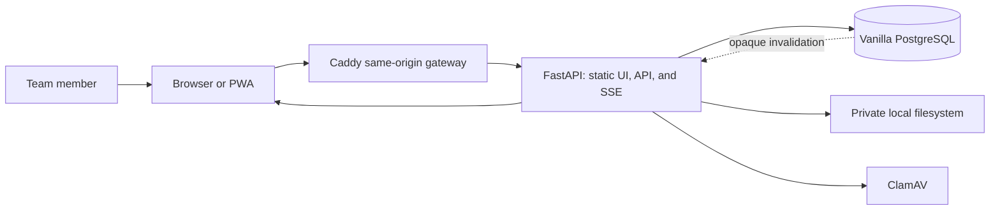

# System Context

> **Scope:** Actors, process boundaries, and trust boundaries in the FastAPI-only production architecture.

Team members use one canonical browser origin. In production, Caddy has one FastAPI upstream; FastAPI serves exact static UI exports, `/api`, and `/api/events`. FastAPI is the only application process allowed to read or mutate PostgreSQL application rows and private file bytes. Node.js does not run on the production server.

Daily development opens `next dev` directly for hot reload. Next's
development-only `/api` proxy sends API and SSE traffic to loopback FastAPI;
Caddy and TLS are absent from daily startup. The installed `gateway` profile
remains disabled until an operator starts a manually prepared production preview.
The Next process does not own identity, data, files, or production server-side
browser behavior. Caddy is used for production previews and production-level
acceptance, where it has one FastAPI upstream.

The browser is untrusted. Access and refresh tokens are HttpOnly cookies for browser sessions; state-changing browser requests require an allowed Origin and CSRF token. CLI clients use bearer tokens. PostgreSQL credentials, JWT signing material, scanner paths, storage roots, and `WEB_ASSETS_ROOT` remain server-only.

Each deployment is one organization trust domain. Cross-organization tenancy and a managed hosted service are not current product guarantees. Native Windows/macOS packaging and LAN/TLS operation remain pending deployment work.
