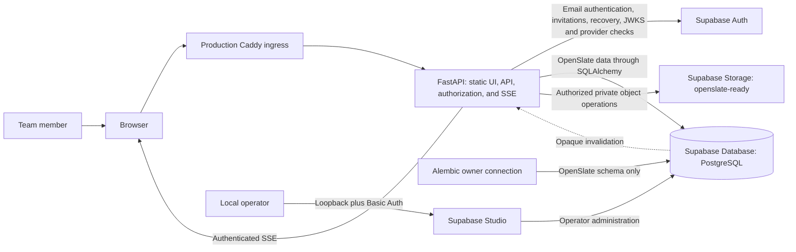

# System Context

> **Scope:** Actors, Compose services, process boundaries, and trust boundaries for one OpenSlate installation.

The diagram shows the core HTTP, identity and organization-file Storage paths;
the private Realtime paths are described below.

Each client has a separate self-hosted Compose installation. Supabase owns its Auth, Storage, and other provider schemas and services; OpenSlate uses the same PostgreSQL server for its application schema. Linux is the primary container host, and Windows uses Linux containers through Docker Desktop and WSL2. The Windows path is a selected target whose startup, restart, persistence, and restore acceptance remains pending. macOS remains usable for workstation development but is not a server target.

In production, Caddy is the public HTTPS ingress with one FastAPI application upstream and a separate Realtime WebSocket route. FastAPI serves the exact static UI export, `/api`, and `/api/events`; production has no Node.js frontend process. The browser does not access application tables or private Storage directly. Content requests pass through FastAPI so it can check local sign-in sessions, organization membership, roles, groups, permissions, file state, and domain-specific authorization before returning data or bytes. Studio replaces the former pgweb console in this Compose topology; it is a separate operator surface, bound to loopback and protected by gateway Basic Auth, with elevated database and provider visibility. It is not part of the application authorization path.

Supabase Auth owns email/password authentication, provider JWT issuance, invitation email, and password recovery. FastAPI verifies the JWT signature, issuer, audience, expiry, subject, and provider session ID against the configured public JWKS. It then resolves the provider subject through an explicit `users.supabase_user_id` binding, checks the local revocable `identity_sessions` row and current local user eligibility, and reads current application authorization state. Provider roles or editable metadata never grant OpenSlate access. Provider session deletion is checked with a narrow read of `auth.sessions`; the `openslate_runtime` role receives only the `id` and `user_id` column reads via the operator-provisioned `openslate_session_liveness` policy for `openslate_app`.

Browser access tokens and the opaque refresh handle use HttpOnly cookies; state-changing cookie requests require CSRF validation and a permitted Origin. The browser submits email-action token hashes only after an explicit confirmation form. CLI clients use bearer credentials admitted through the same provider and local-session checks. Provider secret keys, database credentials, session-encryption material, Storage keys, and deployment paths stay server-side. Supabase Data API access to OpenSlate application tables is blocked; browser clients do not use a privileged provider key.

FastAPI uses direct PostgreSQL connections for application transactions, provider-session liveness and the LISTEN subscriber. Authenticated SSE emits opaque invalidations for other application pages and reauthorizes during the stream. OpenComms uses private Realtime conversation topics backed by FastAPI's expiring access projection, own-user topics and organization presence. Browser subscriptions are read-only; content and presence/typing commands use authorized HTTP routes. Caddy admits the exact-origin `/realtime/v1/websocket` upgrade and injects the gateway key server-side. FastAPI publishes opaque private envelopes through a separate authenticated listener, not the public WebSocket route. See [infrastructure](11-infrastructure.md#events-and-readiness) and [runtime flows](13-runtime-flows.md#opencomms-commands-private-events-and-jobs).

The current organization is selected by `X-Org`, otherwise the sign-in session's
active organization. Server transactions, resource reads and event audiences are
bound to that organization. Browser identity/cache context is keyed by verified
account and organization in [`AppPage`](../../frontend/src/components/app-page.tsx),
but cached views and join projections do not authorize content. An administrator
does not gain ordinary membership in a private conversation merely from that role.
Report-bound actions return report metadata only; private export uses a distinct
exact-admin/password/reason purpose with captured and current-source checks.
Neither grants ordinary private readability. The source boundaries are
[`comms/access.py`](../../backend/app/systems/comms/access.py),
[`jobs/export_service.py`](../../backend/app/systems/comms/jobs/export_service.py)
and the [API purpose contract](07-api-architecture.md#ordinary-private-reads-versus-privileged-purposes).

Daily development uses the pinned Supabase Compose services with loopback-only database/gateway/publisher ports and Mailpit. FastAPI and Next.js run as host processes. The frontend launcher proxies HTTP `/api` to loopback FastAPI and the exact-origin Realtime WebSocket upgrade to the provider gateway; it is not a production Node.js service. The production Compose overlay adds the unified FastAPI/static-UI image and Caddy. Production TLS, native-host startup/reboot, backup/restore and release acceptance remain separate operator requirements. `/api/ready` reports Database, Auth, Storage and SMTP configuration, not end-to-end Realtime or mail delivery.

Each deployment is one client-controlled installation, which can hold several
organizations. One account can have a different membership/role in each, and an
organization administrator has no authority over another organization's data.
Organizations share the installation's infrastructure/operator boundary; this is
not a managed hosted SaaS tenancy service.
