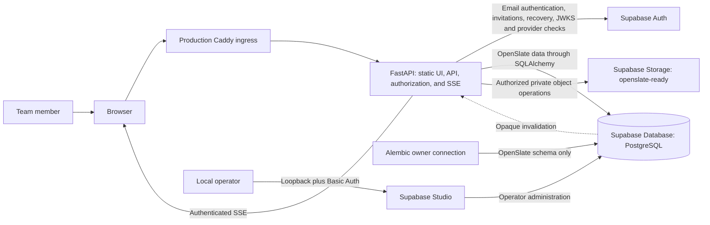

# System Context

> **Scope:** Actors, Compose services, process boundaries, and trust boundaries for one OpenSlate installation.

Each client has a separate self-hosted Compose installation. Supabase owns its Auth, Storage, and other provider schemas and services; OpenSlate uses the same PostgreSQL server for its application schema. Linux is the primary container host, and Windows uses Linux containers through Docker Desktop and WSL2. The Windows path is a selected target whose startup, restart, persistence, and restore acceptance remains pending. macOS remains usable for workstation development but is not a server target.

In production, Caddy is the public HTTPS ingress and has one FastAPI upstream. FastAPI serves the exact static UI export, `/api`, and `/api/events`. The browser does not access application tables or private Storage directly. Product requests pass through FastAPI so it can check local application sessions, roles, groups, permissions, file state, and domain-specific authorization before returning data or bytes. Studio replaces the former pgweb console in this Compose topology; it is a separate operator surface, bound to loopback and protected by gateway Basic Auth, with elevated database and provider visibility. It is not part of the application authorization path.

Supabase Auth owns email/password authentication, provider JWT issuance, invitation email, and password recovery. FastAPI verifies the JWT signature, issuer, audience, expiry, subject, and provider session ID against the configured public JWKS. It then resolves the provider subject through an explicit `users.supabase_user_id` binding, checks the local revocable `identity_sessions` row and current local user eligibility, and reads current application authorization state. Provider roles or editable metadata never grant OpenSlate access. Provider session deletion is checked with a narrow read of `auth.sessions`; the `openslate_runtime` role receives only the `id` and `user_id` column reads via the operator-provisioned `openslate_session_liveness` policy for `openslate_app`.

Browser access tokens and the opaque refresh handle use HttpOnly cookies; state-changing cookie requests require CSRF validation and a permitted Origin. The browser submits email-action token hashes only after an explicit confirmation form. CLI clients use bearer credentials admitted through the same provider and local-session checks. Provider secret keys, database credentials, session-encryption material, Storage keys, and deployment paths stay server-side. Supabase Data API access to OpenSlate application tables is blocked; browser clients do not use a privileged provider key.

FastAPI uses direct PostgreSQL connections for application transactions, Auth-session liveness, and the LISTEN subscriber. Authenticated SSE emits opaque invalidation signals and requires reauthorization during the stream. Supabase Realtime is not the application's event transport; a future integration requires a separately defined audience and admission contract.

Daily development uses the pinned Supabase Compose services with loopback-only database/gateway ports and the development Mailpit overlay. FastAPI and `next dev` can run as host processes. The production Compose overlay adds the unified FastAPI/static-UI image and Caddy; production TLS, reboot, backup/restore, and final release acceptance remain separate operator work. `/api/ready` reports Database, Auth, Storage, and SMTP configuration components, all required.

Each deployment is one organization trust domain. Cross-organization tenancy and a managed hosted service are not current product guarantees.
