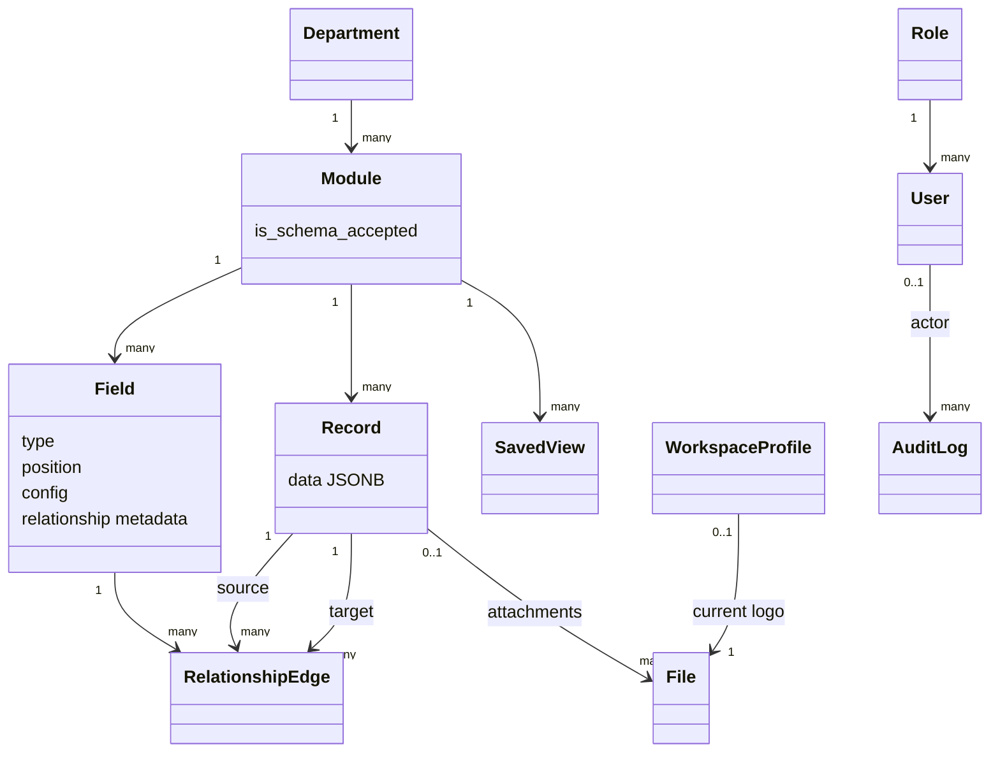

# Domain Architecture

> **Scope:** OpenSlate's implemented domain concepts, relationships, invariants, and mutation ownership.
> **Audience:** Developers changing business behavior or tracing an entity from UI to persistence.
> **Related documents:** [Data architecture](06-data-architecture.md), [Lifecycle and state management](09-lifecycle-and-state-management.md), [API architecture](07-api-architecture.md), [Glossary](21-glossary.md), [Dynamic-field validation test plan](../dynamic-field-validation-test-plan.md)

## Domain model

OpenSlate models a configurable hierarchy: a department contains modules; a module defines ordered fields and stores records; relationship fields connect records through separate directed edges. Users have roles, and every ordinary domain mutation can produce an audit log.

## Entity catalog

| Concept                        | Meaning and key state                                                              | Mutation owner                                | State                                            |
| ------------------------------ | ---------------------------------------------------------------------------------- | --------------------------------------------- | ------------------------------------------------ |
| Role                           | Named local authorization category plus JSON permissions metadata                  | `users` router/service                        | **Implemented**, with flat capability evaluation |
| User                           | Local profile keyed by the Supabase Auth UUID; email, username, status, role       | `users` service plus Supabase Auth            | **Implemented**                                  |
| Department                     | Top-level organizational container identified by active-unique name                | departments router and lifecycle              | **Implemented**                                  |
| Module                         | Configurable record type inside a department; has schema acceptance state          | modules/fields routers and lifecycle          | **Implemented**                                  |
| Field                          | Ordered typed module definition; primitive/select/relationship behavior            | fields router/validation and lifecycle        | **Implemented**                                  |
| Record                         | Module instance whose primitive values are JSONB keyed by field UUID               | records router/validation and lifecycle purge | **Implemented**                                  |
| Relationship edge              | Directed link from source record to target record governed by a relationship field | relationships service/router                  | **Implemented**                                  |
| Audit log                      | Immutable application record of one ORM entity mutation                            | audit listeners only                          | **Implemented**                                  |
| Lifecycle challenge/rate state | Short-lived confirmation and password-failure state for close/purge                | lifecycle service                             | **Implemented**                                  |
| Workspace profile              | One deployment-wide organization identity, timezone, locale, revision, and optional current logo | workspace router | **Implemented** |
| Saved view                     | Versioned query definition owned by a user and private or published to the deployment | views router | **Implemented** |
| File                           | Private metadata for a record attachment, administrator document, or workspace logo | files router/service | **Implemented / scanner fail closed** |

Persistence definitions: `backend/app/systems/*/models.py`. API schemas and mutation rules live beside each capability.

## Hierarchy and ownership rules

### Department and module

- Active department names are unique.
- Active module names are unique within a department.
- A module cannot be reassigned to another department by the update route.
- Direct department and module deletion returns `409 close_required`; lifecycle close is the supported cascading state transition.
- Reopen checks for name conflicts before making rows active again.

Evidence: `departments/router.py`, `modules/router.py`, lifecycle planner/service, partial unique indexes in the matching models.

### Field and schema

Supported field types are `text`, `number`, `decimal`, `int`, `boolean`, `date`, `datetime`, `select`, and `relationship`. Active field names and positions are unique within a module, and positions form a zero-based contiguous sequence when a schema is accepted.

Only field creation, an effective API field update, or a reorder that changes positions invalidates `Module.is_schema_accepted`. Lifecycle close and reopen do not themselves invalidate acceptance. Acceptance is backend-authoritative and validates the effective active schema. A module requires at least one active valid field.

Type-specific value behavior is:

| Type           | Validation and storage behavior                                                                                                                  |
| -------------- | ------------------------------------------------------------------------------------------------------------------------------------------------ |
| `text`         | String; required values cannot be empty; optional `minLength`/`maxLength` bounds count code points.                                              |
| `number`       | Finite JSON number; booleans are rejected; optional inclusive numeric bounds apply.                                                               |
| `decimal`      | Non-null values and bounds are canonical decimal strings with no exponent, plus sign, or leading-zero syntax; at most 58 characters, 38 integer and 18 fractional digits; trailing zeros normalize; bounds are inclusive. |
| `int`          | Integer JSON number; booleans are rejected; optional inclusive numeric bounds apply.                                                             |
| `boolean`      | JSON boolean only.                                                                                                                                |
| `date`         | String exactly matching `YYYY-MM-DD` and a valid calendar date; the string is stored as supplied.                                                 |
| `datetime`     | String matching `YYYY-MM-DDTHH:MM:SS`, an optional 1–6 digit fraction, and a required `Z` or `±HH:MM` offset; valid and stored as supplied.       |
| `select`       | String exactly equal to one configured option; options are non-empty, unique strings and are not trimmed for matching.                            |
| `relationship` | No record-data value; it requires same-department target/cardinality metadata, is never required, and uses an empty config. Edges are separate.   |

Optional primitive values may be `null`; required nulls are rejected, and required text also rejects the empty string. Migration `0015` preserves legacy explicit JSON-null decimal bound keys, but current runtime schema acceptance rejects those keys; this compatibility mismatch remains documented rather than treated as valid runtime configuration.

Relationship fields differ from primitive fields:

- They name a target module in the same department.
- They define whether one source can target many records and whether one target can have many sources.
- They cannot be required and cannot carry primitive configuration.
- Their values are not stored in `Record.data`.

Evidence: `fields/models.py`, `fields/schemas.py`, `fields/validation.py`, `fields/router.py`, `modules/router.py:accept_module_schema`.

### Record data

Record JSON uses field UUID strings as keys. Creation requires an active module with an accepted schema; update does not use schema acceptance as a gate. Validation enforces active/known keys, required fields, type-specific values and bounds, select options, and exclusion of relationship fields.

Update behavior replaces active field data rather than deep-merging it. Values belonging to closed fields are retained; clients cannot change them. This preserves historical data across field closure while allowing the active schema to evolve.

Field close/reopen invalidates parent schema acceptance inside existing module locks. Record creation also rejects already-stale accepted modules with zero active fields; existing records are preserved and updates retain their existing behavior.

Evidence: `records/router.py:validate_record_mutation`, record schemas, `fields/validation.py`.

### Query definitions and saved views

Record query definitions are versioned, single-module requests with up to 100 primitive columns, 10 AND-connected predicates, and 3 sort keys. The records query compiler validates stable field IDs and expected types before applying typed JSONB comparisons, standard offset pagination, and a UUID tie-breaker. The same definition is used for interactive results and CSV export; export ignores page offset/limit, runs in a repeatable-read snapshot, and bounds output to 10,000 rows and 8 MiB.

A saved view retains its definition, owner, name, revision, and either `private` or `workspace` visibility. A private view is visible only to its owner. Only the literal `admin` role may create or modify a workspace-visible view; publishing creates a separate shared definition. View execution still requires current `records.read`, so a saved definition never grants record access. Incompatible field/type/select changes fail with `view_invalid` rather than removing predicates.

### Workspace profile and files

`WorkspaceProfile` is a non-deletable singleton seeded as `OpenSlate`, `UTC`, and `en-US`. All eligible users may read it; only the literal `admin` role may change it with its revision. The timezone controls frontend date-time entry/display and CSV instant formatting; date-only values remain calendar dates.

`File` has an immutable purpose: `record_attachment` requires a record parent, while `library_document` and `workspace_logo` do not. Attachments follow `records.read`/`records.write`; the document library and logo administration require literal admin. Metadata tracks immutable object identity, digest, processing state, scanner provenance, archive state, scan requester, attempts and next-attempt time. Successful upload schedules the serial worker; unconfigured or unavailable scanning retains quarantine. Claims and publication recheck requester authority, parent state and byte identity. Uncertain execution halts admission until operator recovery. Archiving retains authorized download of ready bytes; purge is a separate administrator/lifecycle flow that records external deletion state. Only the profile's current clean logo is exposed through the workspace-logo route.

### Relationships

A relationship edge has one field, source record, and target record. The service checks:

- field type and source/target module alignment;
- same-department modules;
- distinct source and target records;
- active dependency state for new links;
- configured source and target cardinality;
- active-edge uniqueness.

Edges remain physically present when a dependency is closed. API responses derive visibility and hidden reasons from field/module/record state; department close affects them indirectly by closing descendants. Reopening dependencies can make the edge visible without mutating the edge.

Evidence: `relationships/models.py`, `relationships/service.py`, `relationships/router.py`.

## User and role rules

Supabase Auth owns the identity and password. The local `User` must be active, not soft-deleted, and assigned an active role. Domain reads and writes use the matching flat capabilities for departments, modules, fields, records, and relationships. The exact `admin` role is implicitly granted all ten capabilities; other roles must have an explicitly true capability in a valid flat boolean document, with omitted capabilities denied and no capability implication. Lifecycle close/reopen uses the target resource's write capability. Users, roles, invitations, audit, and purge remain literal-admin-only.

User invitation is a cross-system operation: Auth creates an identity, a database trigger creates a pending member profile, and the users service finalizes the requested profile. Disable/enable ordering is designed to fail closed, but an external failure can temporarily leave Auth and local state divergent.

Evidence: `common/dependencies/auth.py`, `systems/users/`, migration `0010`.

## Lifecycle model

Principal entities use open/closed state represented by `is_deleted` and `deleted_at`; they do not have a separate archived table. Close hides an entity from default lists and can cascade through a planned hierarchy. Reopen performs conflict/schema/data preflight. Purge is a physical deletion operation and is disabled by default.

Records still expose direct soft-delete/restore routes; departments, modules, and fields use lifecycle close/reopen. Relationship edges expose unlink behavior and may also be purged as dependencies during lifecycle purge.

See [Lifecycle and state management](09-lifecycle-and-state-management.md) for transition details.

## Invariant enforcement split

| Invariant                                         | Database               | Application                                     |
| ------------------------------------------------- | ---------------------- | ----------------------------------------------- |
| Foreign-key shape and delete action               | Yes                    | Uses ordered operations                         |
| Active name/position uniqueness                   | Partial unique indexes | Preflight conflict messages                     |
| Supported field types/relationship metadata shape | Checks                 | Rich schema/config validation                   |
| Record JSON shape and field semantics             | No                     | Yes                                             |
| Same-department relationships/cardinality         | No                     | Yes                                             |
| Active parents and accepted schema                | No                     | Yes                                             |
| At least one administrator                        | No                     | Count check, with a documented concurrency risk |
| `is_deleted` consistent with `deleted_at`         | No trigger/check       | Router/service conventions                      |
| Audit capture                                     | No database trigger    | SQLAlchemy `AuditSession` listeners             |

Direct database writers can bypass application-only invariants and audit capture. That boundary is intentional in the current code and is assessed in [Architecture risks](20-architecture-risks.md).

## Domain capabilities not present

- A tenant/business ownership key is **Absent** from current entities; each deployment is one trust domain, with no tenant/RLS isolation.
- Aggregate reports/charts are absent. Saved views, typed record querying, bounded CSV export, and private file metadata/transfer are implemented; the `businesses` package remains a tenancy placeholder.
- Resource ownership checks are **Absent**; authorization is global capability/role based within the deployment, and direct database writers bypass FastAPI RBAC.
