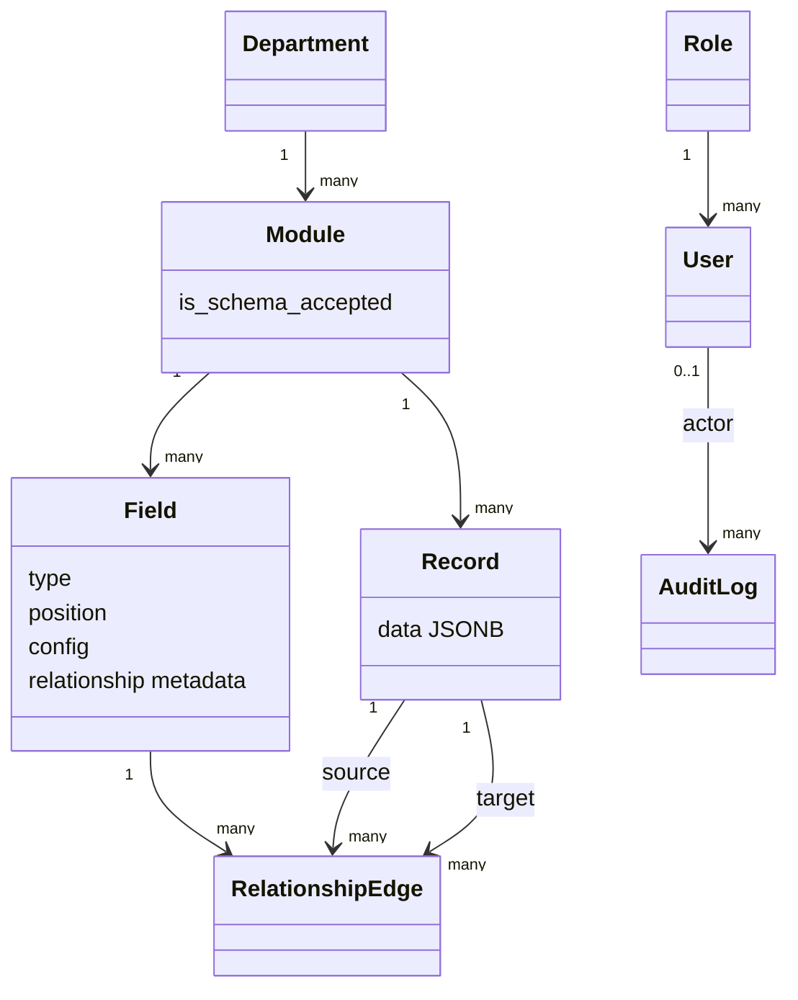

# Domain Architecture

> **Scope:** OpenSlate's implemented domain concepts, relationships, invariants, and mutation ownership.
> **Audience:** Developers changing business behavior or tracing an entity from UI to persistence.
> **Related documents:** [Data architecture](06-data-architecture.md), [Lifecycle and state management](09-lifecycle-and-state-management.md), [API architecture](07-api-architecture.md), [Glossary](21-glossary.md)

## Domain model

OpenSlate models a configurable hierarchy: a department contains modules; a module defines ordered fields and stores records; relationship fields connect records through separate directed edges. Users have roles, and every ordinary domain mutation can produce an audit log.

## Entity catalog

| Concept                        | Meaning and key state                                                              | Mutation owner                                | State                                                     |
| ------------------------------ | ---------------------------------------------------------------------------------- | --------------------------------------------- | --------------------------------------------------------- |
| Role                           | Named local authorization category plus JSON permissions metadata                  | `users` router/service                        | **Implemented**, but permissions evaluation is **Absent** |
| User                           | Local profile keyed by the Supabase Auth UUID; email, username, status, role       | `users` service plus Supabase Auth            | **Implemented**                                           |
| Department                     | Top-level organizational container identified by active-unique name                | departments router and lifecycle              | **Implemented**                                           |
| Module                         | Configurable record type inside a department; has schema acceptance state          | modules/fields routers and lifecycle          | **Implemented**                                           |
| Field                          | Ordered typed module definition; primitive/select/relationship behavior            | fields router/validation and lifecycle        | **Implemented**                                           |
| Record                         | Module instance whose primitive values are JSONB keyed by field UUID               | records router/validation and lifecycle purge | **Implemented**                                           |
| Relationship edge              | Directed link from source record to target record governed by a relationship field | relationships service/router                  | **Implemented**                                           |
| Audit log                      | Immutable application record of one ORM entity mutation                            | audit listeners only                          | **Implemented**                                           |
| Lifecycle challenge/rate state | Short-lived confirmation and password-failure state for close/purge                | lifecycle service                             | **Implemented**                                           |

Persistence definitions: `backend/app/systems/*/models.py`. API schemas and mutation rules live beside each capability.

## Hierarchy and ownership rules

### Department and module

- Active department names are unique.
- Active module names are unique within a department.
- A module cannot be reassigned to another department by the update route.
- Direct department and module deletion returns `409 close_required`; lifecycle close is the supported cascading state transition.
- Reopen checks for name conflicts before making rows active again.

Evidence: `departments/router.py`, `modules/router.py`, lifecycle planner/service, partial unique indexes in the matching models.

### Field and schema

Supported field types are `text`, `number`, `decimal`, `int`, `boolean`, `date`, `datetime`, `select`, and `relationship`. Active field names and positions are unique within a module, and positions form a zero-based contiguous sequence when a schema is accepted.

Field creation, update, close, restore, or reorder can invalidate `Module.is_schema_accepted`. Acceptance is backend-authoritative and validates the effective active schema. A module requires at least one active valid field.

Relationship fields differ from primitive fields:

- They name a target module in the same department.
- They define whether one source can target many records and whether one target can have many sources.
- They cannot be required and cannot carry primitive configuration.
- Their values are not stored in `Record.data`.

Evidence: `fields/models.py`, `fields/schemas.py`, `fields/validation.py`, `fields/router.py`, `modules/router.py:accept_module_schema`.

### Record data

Record JSON uses field UUID strings as keys. Creation requires an active module with an accepted schema. Validation enforces active/known keys, required fields, type-specific values and bounds, select options, and exclusion of relationship fields.

Update behavior is replacement-like for active fields rather than a deep merge. Values belonging to closed fields are retained; clients cannot change them. This preserves historical data across field closure while allowing the active schema to evolve.

Evidence: `records/router.py:_validate_data`, record schemas, `fields/validation.py`.

### Relationships

A relationship edge has one field, source record, and target record. The service checks:

- field type and source/target module alignment;
- same-department modules;
- distinct source and target records;
- active dependency state for new links;
- configured source and target cardinality;
- active-edge uniqueness.

Edges remain physically present when a dependency is closed. API responses derive visibility and hidden reasons from field/module/record state; department close affects them indirectly by closing descendants. Reopening dependencies can make the edge visible without mutating the edge.

Evidence: `relationships/models.py`, `relationships/service.py`, `relationships/router.py`.

## User and role rules

Supabase Auth owns the identity and password. The local `User` must be active, not soft-deleted, and assigned an active role. All domain routers currently require role name `admin`. `Role.permissions` is persisted and editable but has no effect on authorization; member/custom roles therefore fail closed for domain work.

User invitation is a cross-system operation: Auth creates an identity, a database trigger creates a pending member profile, and the users service finalizes the requested profile. Disable/enable ordering is designed to fail closed, but an external failure can temporarily leave Auth and local state divergent.

Evidence: `common/dependencies/auth.py`, `systems/users/`, migration `0010`.

## Lifecycle model

Principal entities use open/closed state represented by `is_deleted` and `deleted_at`; they do not have a separate archived table. Close hides an entity from default lists and can cascade through a planned hierarchy. Reopen performs conflict/schema/data preflight. Purge is a physical deletion operation and is disabled by default.

Records still expose direct soft-delete/restore routes; departments, modules, and fields use lifecycle close/reopen. Relationship edges expose unlink behavior and may also be purged as dependencies during lifecycle purge.

See [Lifecycle and state management](09-lifecycle-and-state-management.md) for transition details.

## Invariant enforcement split

| Invariant                                         | Database               | Application                                     |
| ------------------------------------------------- | ---------------------- | ----------------------------------------------- |
| Foreign-key shape and delete action               | Yes                    | Uses ordered operations                         |
| Active name/position uniqueness                   | Partial unique indexes | Preflight conflict messages                     |
| Supported field types/relationship metadata shape | Checks                 | Rich schema/config validation                   |
| Record JSON shape and field semantics             | No                     | Yes                                             |
| Same-department relationships/cardinality         | No                     | Yes                                             |
| Active parents and accepted schema                | No                     | Yes                                             |
| At least one administrator                        | No                     | Count check, with a documented concurrency risk |
| `is_deleted` consistent with `deleted_at`         | No trigger/check       | Router/service conventions                      |
| Audit capture                                     | No database trigger    | SQLAlchemy `AuditSession` listeners             |

Direct database writers can bypass application-only invariants and audit capture. That boundary is intentional in the current code and is assessed in [Architecture risks](20-architecture-risks.md).

## Domain capabilities not present

- A tenant/business ownership key is **Absent** from current entities; shared-tenancy intent is **Unknown**.
- Reports, saved views, and files have package placeholders but no domain model or operational behavior.
- Fine-grained permissions and resource ownership checks are **Absent**; authorization is global role-name based.
