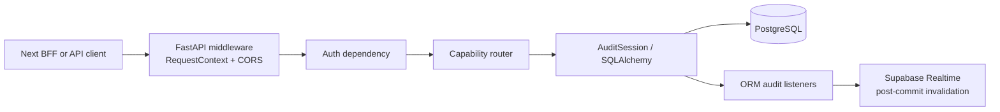

# Backend Architecture

> **Scope:** The implemented Python backend runtime, capability packages, persistence-facing code, and outbound Supabase integration.
> **Audience:** Backend engineers, reviewers, and operators tracing an API request through the application.
> **Related documents:** [API architecture](07-api-architecture.md), [Authentication and authorization](08-authentication-authorization.md), [Audit and history](10-audit-and-history.md), [Error handling and recovery](15-error-handling-and-recovery.md)

## Status summary

| Area                              | Status                    | Evidence-based state                                                                                                                                                           |
| --------------------------------- | ------------------------- | ------------------------------------------------------------------------------------------------------------------------------------------------------------------------------ |
| FastAPI application assembly      | **Implemented**           | `backend/app/main.py:create_app` creates the application, middleware, routers, and health endpoint.                                                                            |
| Domain capability packages        | **Implemented**           | `auth`, `users`, `departments`, `modules`, `fields`, `records`, `relationships`, `lifecycle`, and `audit` have registered runtime behavior.                                    |
| Additional capabilities           | **Implemented / placeholders** | Workspace, files and views have registered routes. `reports`, `businesses` and `admin` remain placeholders. |
| Page-domain grouping              | **Implemented / reserved** | Existing capabilities are nested under `access`, `sandbox`, `manage`, `openview`, and `platform`. `boards` and `comms` remain reserved without backend behavior; grouping creates no frontend integration. |
| ORM transaction and audit session | **Implemented**           | `backend/app/core/database/session.py:AuditSession` and `get_db` provide the request-scoped SQLAlchemy session used by the routers and audit listeners.                        |
| Background processing             | **Implemented for files** | `app.systems.platform.files.worker` owns serial scan processing, PostgreSQL leadership and audited reservation expiry; there is no general scheduler or broker. |

## Runtime assembly

The backend is a host-run FastAPI application. The module-level `app` in `backend/app/main.py` is created by `create_app()` and is the Uvicorn import target. `create_app()`:

1. Loads `Settings` through `app.core.config:get_settings`.
2. Creates a FastAPI application titled from `settings.app_name` and versioned as `0.1.0`.
3. Installs permissive method/header CORS configuration for the configured origins, with credentials enabled.
4. Installs HTTP middleware that creates a `RequestContext` containing a UUIDv7 request ID, method, and path, then adds `X-Request-ID` to a response that returns normally.
5. Registers the application routers under `/api`.
6. Registers `GET /api/health`, which returns `{"status": "ok", "service": "openslate-api"}`.

`application_lifespan` closes readiness and database resources on shutdown. Application creation and lifespan configure structured observability logging, and the request middleware records HTTP outcomes. There is no global exception-handler registration or automatic migration, database-role provisioning, or administrator bootstrap at import/startup.

The diagram represents the application path evidenced by `backend/app/main.py:create_app`, `backend/app/core/middleware/request_context.py:RequestContext`, `backend/app/common/dependencies/auth.py:get_current_user`, `backend/app/core/database/session.py:get_db`, and `backend/app/systems/manage/audit/listeners.py`.

## Product-domain package layout

The application keeps infrastructure in `app/core`, shared request/listing concerns in `app/common`, and capability packages in `app/systems/<page>/<capability>`. `sandbox` holds organization structure and lifecycle, `access` holds identity and roles, `manage` holds workspace settings and audit, `openview` holds saved views, and `platform` holds files. The physical grouping does not restrict cross-domain use of audit, lifecycle, or files. The following are the runtime ownership boundaries visible from router registration and imports:

| Capability      | Application responsibility                                                                                                    | Main symbols                                                                                 |
| --------------- | ----------------------------------------------------------------------------------------------------------------------------- | -------------------------------------------------------------------------------------------- |
| `auth`          | Current-user response and administrator invitation entry points; includes the users and roles routers in the exported router. | `backend/app/systems/access/auth/router.py:router`, `auth_router`, `invite`, `me`                   |
| `users`         | Local profiles, roles, role assignment, invitation acceptance, user lifecycle, and Supabase Auth invitation/enable/disable coordination. | `backend/app/systems/access/users/router.py`, `backend/app/systems/access/users/roles_router.py`, `backend/app/systems/access/users/service.py`, `backend/app/systems/access/users/acceptance.py`, `backend/app/systems/access/users/account_operations.py`, `backend/app/systems/access/users/coordination.py`, `backend/app/systems/access/users/reconciliation.py` |
| `departments`   | Department CRUD-shaped routes, soft-delete compatibility route, and lifecycle restore delegation.                             | `backend/app/systems/sandbox/departments/router.py`                                                  |
| `modules`       | Module routes, schema acceptance, module deletion compatibility route, and restore delegation.                                | `backend/app/systems/sandbox/modules/router.py:accept_module_schema`                                 |
| `fields`        | Field definition, validation, ordering, relationship metadata, schema invalidation, and restore delegation.                   | `backend/app/systems/sandbox/fields/router.py`, `validation.py`                                      |
| `records`       | JSONB record data validation, replacement-like update behavior, soft delete, and restore.                                     | `backend/app/systems/sandbox/records/router.py`                                                      |
| `relationships` | Directed record-edge creation, assignment, unlinking, cardinality checks, visibility, and locking.                            | `backend/app/systems/sandbox/relationships/router.py`, `backend/app/systems/sandbox/relationships/service.py`, `backend/app/systems/sandbox/relationships/locking.py`, `backend/app/systems/sandbox/relationships/mutations.py`, `backend/app/systems/sandbox/relationships/projection.py` |
| `lifecycle`     | Close, reopen, purge planning, confirmation challenges, step-up password verification, locking, and execution.                | `backend/app/systems/sandbox/lifecycle/router.py`, `planning_scope.py`, `planning.py`, `planning_preflight.py`, `challenge_store.py`, `challenge_verification.py`, `execution.py` (with compatibility exports from `planner.py` and `service.py`) |
| `audit`         | ORM mutation capture, redacted snapshots, immutable log reads, and post-commit invalidation.                                  | `backend/app/systems/manage/audit/listeners.py`, `snapshots.py`, `router.py`                        |

Routers commonly query and mutate SQLAlchemy models directly. `users` separates transport routes from role routes, account transitions, provider reconciliation, invitation acceptance, and lock/count coordination. `relationships` separates locking, mutations, and response projection around its service/router boundary. `lifecycle` separates scope loading, plan construction, preflight blockers, challenge storage/verification, and locked execution while retaining compatibility exports from `planner.py` and `service.py`. No repository abstraction is present in the reviewed backend source.

## Persistence and state conventions

`backend/app/core/base_model.py:BaseModel` supplies the common columns for the principal domain entities:

- UUIDv7 primary key `id`.
- UTC lifecycle timestamps `created_at` and `updated_at`.
- Soft-delete state `is_deleted` and nullable `deleted_at`.
- Nullable `performed_by`, referencing the local user identity with `SET NULL` behavior.

`Department`, `Module`, `Field`, `Record`, `RelationshipEdge`, `Role`, and `User` inherit `BaseModel`. `AuditLog` and lifecycle confirmation/rate-limit models inherit the SQLAlchemy `Base` directly and have narrower, purpose-specific schemas. JSONB-backed state is used for role permissions, field configuration, record data, and audit snapshots (`backend/app/systems/*/models.py`).

The standard list implementation in `backend/app/common/listing/query.py:execute_standard_list` builds a count query and an ordered item query. `StandardListRequest` in `backend/app/common/listing/schemas.py` supplies bounded `limit`/`offset`, enum-backed sorting, optional search, and deleted-row selection. Resource-specific routers provide the allowed sort fields and filters. The default deleted filter is exclusion where the model supports it.

Application-level state rules include the following implemented behavior:

- Active department names, module names within a department, and field names/positions within a module are checked before mutation and constrained for active rows by the model definitions.
- A module must have an accepted schema before a record can be created; record updates do not use schema acceptance as a gate. Only field creation, an effective API field update, or a changed field reorder invalidates schema acceptance; lifecycle close/reopen does not.
- Record updates replace active field data, retain closed-field values, and reject changed values for closed fields.
- Record mutation validation returns deterministic structured errors, capped at 20 entries with a `truncated` flag; ordinary validation is `422`, while a closed-field mutation is `409`.
- Relationship edges are directed by field/source/target IDs. `relationships.service` delegates concrete locking, mutation/cardinality coordination, and response projection to the separated relationship modules while checking active dependencies, same-department modules, field/module alignment, distinct source and target records, and configured cardinality.
- Direct department/module/field `DELETE` discovery routes return a `close_required` conflict. Lifecycle close/reopen/purge is the intended multi-row state path, while records, roles, users, and relationship edges expose direct soft-delete or restore behavior where their routers define it.

The state rules are enforced in application code and ORM operations in the cited modules. This document does not classify database migration or database-policy behavior.

Detailed dynamic-field validation evidence is maintained in the [dynamic-field validation test plan](../dynamic-field-validation-test-plan.md).

## Session, commit, and outbound integration

`backend/app/core/database/session.py:get_db` constructs an `AuditSession`, places an `AuditContext` in `session.info`, yields the session, and closes it through the context manager. It does not commit on behalf of a route. Domain routers and services call `db.commit()` explicitly; common commit helpers catch `IntegrityError`, call `db.rollback()`, and translate the failure into a domain conflict. Relationship and lifecycle services additionally translate selected `OperationalError` paths into temporary-unavailability errors.

The audit listeners are imported when `AuditSession` is initialized. A normal audited mutation therefore shares the business mutation and its `AuditLog` insert in one transaction. After commit, the listener may publish an opaque invalidation through `backend/app/core/integrations/supabase.py:broadcast_invalidation`; failure of that optional notification is swallowed by `backend/app/systems/manage/audit/listeners.py:broadcast_committed_changes`.

`backend/app/core/integrations/supabase.py:SupabaseAdminClient` uses the server-only Supabase secret for invitations, Auth-user deletion/disable/enable, and Realtime broadcast. Lifecycle password verification is separate: `backend/app/systems/sandbox/lifecycle/password.py:SupabasePasswordGrantClient` uses the publishable key for a short-lived password grant and revokes the temporary session before returning. No background retry or job queue is present in these integration paths.

## Source grounding

- `backend/app/main.py:create_app`, `app`, and the registered router list.
- `backend/app/core/config/settings.py:Settings` and `get_settings`.
- `backend/app/core/middleware/request_context.py:RequestContext` and `get_request_context`.
- `backend/app/core/database/session.py:AuditSession`, `get_engine`, and `get_db`.
- `backend/app/core/base_model.py:BaseModel`.
- `backend/app/common/listing/query.py:execute_standard_list` and `backend/app/common/listing/schemas.py:StandardListRequest`.
- Capability routers and services listed in the package table above.
