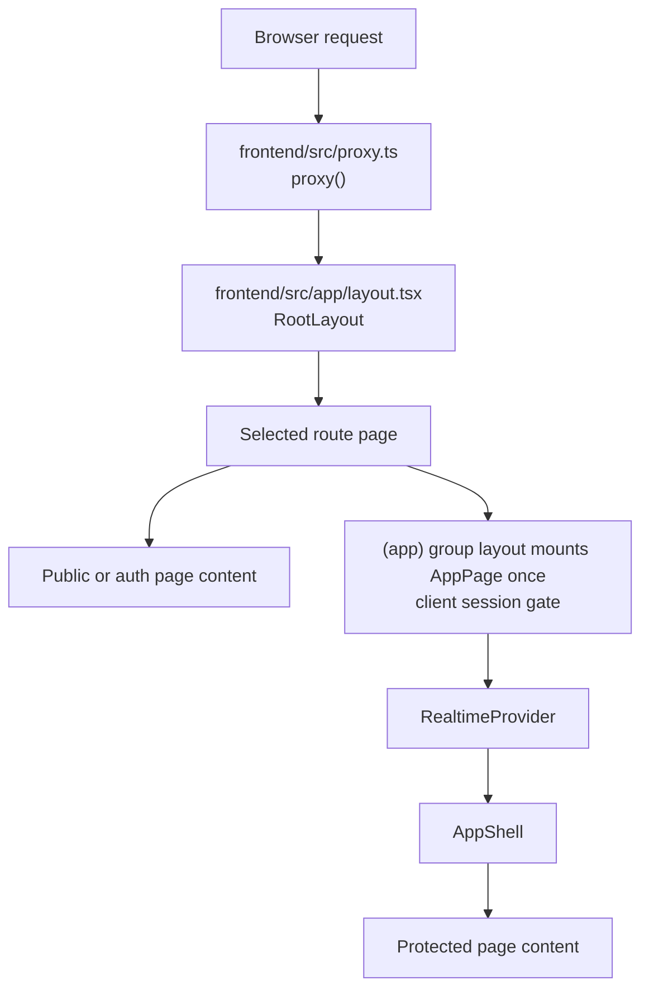
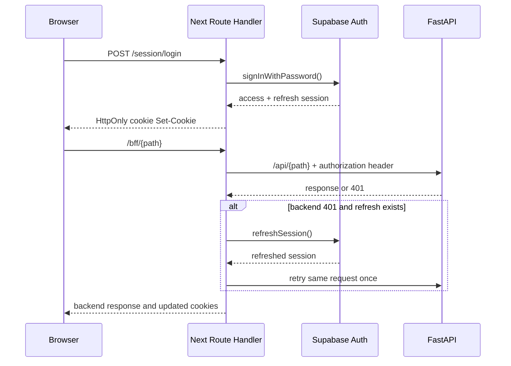

# Frontend Architecture

> **Scope:** The Next.js application, App Router, browser state, session handlers, BFF boundary, and build/proxy path.
> **Audience:** Frontend engineers, reviewers tracing browser requests, and operators running the frontend.
> **Related documents:** [API architecture](07-api-architecture.md), [Authentication and authorization](08-authentication-authorization.md), [Configuration](17-configuration.md), [Testing](16-testing-architecture.md), [Architecture risks](20-architecture-risks.md)

## Status vocabulary

The classifications below describe the current repository, not a target
architecture:

- **Implemented:** The route or pattern exists in source and is used by the
  current application flow.
- **Partial:** A working slice exists, but coverage, authority, or recovery is
  intentionally incomplete.
- **Static:** The UI is presentational or hard-coded rather than backed by live
  application data.
- **Stale:** The UI describes a previous or unsupported setup path.
- **Absent:** No corresponding frontend implementation exists.

## Runtime entry and rendering model

The frontend is a Next.js 16.3.1 App Router application under
`frontend/src/`. `frontend/src/app/layout.tsx:RootLayout` is the only layout. It loads
the Geist fonts and `globals.css`, renders the null-rendering
`ThemeProvider`, sets metadata, and awaits `connection()` so the per-request
CSP nonce produced by `frontend/src/proxy.ts:proxy` can be applied. There are no route
groups or protected server layouts.

Next.js pages and layouts are Server Components by default, but almost every
data-bearing page in this repository begins with `"use client"`. Those pages
fetch after hydration and hold their data, form values, loading state, and
errors locally. The public landing, setup, access-restricted, not-found, and
root error UI are presentational server/client entry points as noted below;
they do not establish a server-side authorization boundary. `connection()` in
the root layout means the application must not be described as a static export,
even where a page contains only static copy.



The route entry files and their current protection shape are:

| Area                        | Routes                                                                                                                                                               | Actual structure                                                                                                                                        |
| --------------------------- | -------------------------------------------------------------------------------------------------------------------------------------------------------------------- | ------------------------------------------------------------------------------------------------------------------------------------------------------- |
| Public                      | `/`, `/setup`, `/access-restricted`                                                                                                                                  | Standalone pages outside the `(app)` group (no shared gate). `/access-restricted` is a present page, not a reached authorization redirect.                |
| Sign-in and invitation      | `/login`, `/auth/setup`, `/auth/callback`                                                                                                                            | `/login` and `/auth/setup` are client-controlled forms. `/auth/callback` is a server Route Handler that exchanges a code or invite token and redirects. |
| Session endpoints           | `/session/login`, `/session/logout`, `/session/password`, `/session/status`, `/session/realtime-token`                                                               | Server Route Handlers used by browser forms, `AppPage`, the BFF, and realtime initialization; these are not page layouts.                               |
| Workspace                   | `/workspace`, `/settings/workspace`, `/onboarding`                                                                                                                   | `WorkspaceProvider` loads the deployment profile; the settings page lets administrators edit identity/timezone/locale and choose a scanned logo. Workspace metrics and onboarding copy remain static. |
| Record queries and views    | Module record list                                                                                                                                                    | The records page submits typed definitions to `/records/query`; its embedded view controls save personal views, publish shared copies for administrators, and request CSV export. |
| Files                       | Record edit attachments and `/administration/files`                                                                                                                    | Client components reserve, upload, scan, list, download, archive, reopen, reconcile, and purge private file metadata through the BFF. Scanner unavailability is surfaced as a pending/error state. |
| Structure                   | `/departments`, `/departments/new`, `/departments/[departmentId]`                                                                                                    | Client pages under the `(app)` group for listing, creation, module creation, and lifecycle controls.                                                    |
| Canonical module routes     | `/modules/[moduleId]`, `/modules/[moduleId]/schema`, `/modules/[moduleId]/records`, `/modules/[moduleId]/records/new`, `/modules/[moduleId]/records/[recordId]/edit` | Client pages that load module, department, field, record, and relationship data through `apiFetch`.                                                     |
| Department-scoped aliases   | `/departments/[departmentId]/modules/[moduleId]` and its `schema`, `records`, `records/new`, and `records/[recordId]/edit` descendants                               | Each `page.tsx` re-exports the corresponding canonical module page; the canonical page chooses its URL prefix from optional params.                     |
| Administration and settings | `/administration/users`, `/administration/roles`, `/administration/audit`, `/settings/appearance`                                                                    | Client pages under the `(app)` group; all domain reads and writes go through the BFF.                                                                  |
| Framework fallbacks         | `frontend/src/app/not-found.tsx`, `frontend/src/app/error.tsx`                                                                                                       | Root not-found UI and a root client error boundary. Route `loading.tsx` skeletons cover departments, records, admin users, and audit; no `global-error.tsx`. |

The empty `frontend/src/app/api/proxy/[...path]` and `frontend/src/app/api/session/*`
directories do not define Route Handlers. Application data uses `/bff/*`.
Direct Next `/api/*`, `/docs`, `/redoc`, and `/openapi.json` rewrites are not
configured; FastAPI's own API and documentation paths are local/private
operator surfaces.

## Public, auth, and protected page boundaries

`frontend/src/app/(app)/layout.tsx` mounts `frontend/src/components/app-page.tsx:AppPage` once for every authenticated route in the `(app)` group. `AppPage` is the shared client gate: on mount it requests `GET /session/status` with
`cache: "no-store"`. While waiting it renders a centered “Checking your
session…” status. A failed response, an invalid body, or a network error calls
`router.replace("/login")`; only `{ authenticated: true }` allows the shell to
mount.

After the gate succeeds, `AppPage` renders:

```text
RealtimeProvider
└── AppShell
    └── route page children
```

Mounted once by the group layout, client-side navigation swaps only the route
page children instead of remounting the session gate, `RealtimeProvider`, and
`AppShell`.

This is a client-side session check, not a protected server layout. It checks
Supabase session validity only; it does not check the backend's local profile,
role, or status. Backend authorization therefore remains authoritative for
domain data. A valid Supabase session with insufficient local access can reach
the shell and then receive API `401`/`403` responses. The existing
`/access-restricted` page is not wired into that branch. See
[authentication and authorization](08-authentication-authorization.md) and [risks and
limitations](20-architecture-risks.md) docs for the cross-system consequences.

## Sessions, cookies, and auth callbacks

The server-side Supabase client in `frontend/src/lib/supabase/server.ts:
createSupabaseServerClient` uses only the public Supabase URL and publishable
key. It disables persistence, automatic refresh, and URL session detection;
the frontend owns the browser session through HttpOnly cookies rather than a
Supabase client-side session store.

`frontend/src/lib/auth-cookies.ts` defines `openslate_access` and `openslate_refresh`.
Both are `HttpOnly`, `SameSite=Lax`, path `/`, and `Secure` only in production.
The access cookie uses the Supabase `expires_in` value (or one hour), and the
refresh cookie lasts seven days. Browser JavaScript does not read these values.

The session Route Handlers are:

- `frontend/src/app/session/login/route.ts:POST` checks same-origin requests and a
  strict Zod email/password schema, calls `signInWithPassword`, and sets both
  cookies. It returns generic `400`, `401`, or `503` errors with no-store
  responses.
- `frontend/src/app/session/status/route.ts:GET` reads both cookies, calls
  `establishSupabaseSession` from `frontend/src/lib/supabase/session.ts`, returns only
  `{ authenticated }`, refreshes cookies when a session is available, and
  clears them otherwise.
- `frontend/src/app/session/logout/route.ts:POST` checks same-origin, attempts local
  Supabase Auth sign-out using the access/refresh pair, and always clears the
  browser cookies even if Auth is unavailable.
- `frontend/src/app/session/password/route.ts:POST` checks same-origin, validates two
  matching passwords of at least 12 characters, establishes the cookie session,
  calls `auth.updateUser`, then directly calls private `POST /api/auth/invitations/accept`
  with the fresh access token after a successful password update; it is the only
  browser-facing invitation-acceptance path. Acceptance failures return `400`;
  cookies are cleared when no session can be established, otherwise the established
  session cookies are preserved.
- `frontend/src/app/session/realtime-token/route.ts:GET` checks same-origin, establishes
  or refreshes the cookie session, returns a short-lived `access_token` for the
  browser realtime client, and uses no-store responses.
- `frontend/src/app/auth/callback/route.ts:GET` accepts either a code or an invitation
  token hash (only `type=invite` for the latter), exchanges/verifies it, sets
  cookies, and redirects to `/auth/setup`; invalid input redirects to `/login`.



## BFF and backend communication

`frontend/src/app/bff/[...path]/route.ts:handle` is the canonical application data boundary used by pages. It exports `GET`, `POST`, `PATCH`, `PUT`, and `DELETE`, maps the
catch-all path to `${BACKEND_URL}/api/{path}`, preserves the query string, and
uses `cache: "no-store"` on its upstream fetch. The generic BFF denies
`auth/invitations/accept` with `403`; browsers cannot reach acceptance through
`/bff/*`. It forwards a small allowlist of request headers
(`accept`, language, content type, conditional headers) and places the access
cookie value in an `Authorization: Bearer` header. Unsafe methods require the
same-origin check from `frontend/src/lib/request-security.ts:isSameOriginRequest`.

On a backend `401`, the handler uses the refresh cookie with Supabase Auth and
retries the original request once with the new access token and original body.
Refresh failure or a second `401` clears cookies. Successful refreshes update
the response cookies; selected response headers and the backend status/body
are passed back to the browser. A backend `403` is not refreshed.

`frontend/src/lib/api.ts:apiFetch` is the browser-side client. It prefixes paths with
`/bff`, forces JSON content type and same-origin credentials, converts non-2xx
responses to `ApiError`, and hard-navigates to `/login` on `401`. Its generic
type parameter is an unchecked cast, not runtime response validation. The
`listQuery` helper builds the repeated search, deletion, sort, limit, and
offset query convention. Pages commonly request `limit=100` and currently do
not use `pagination.has_more`.

There is no direct Next `/api` or API documentation rewrite. Application pages
use the BFF so HttpOnly cookies are converted into backend authorization;
FastAPI remains the upstream application API. Backend API semantics and error contracts
belong in [API architecture](07-api-architecture.md).

## Browser state, theme, and realtime

There is no global data store, URL-backed filter state, SWR/React Query cache,
or generated client. Each page uses local `useState` and `useEffect`; repeated
loads are explicit `load()` functions and successful mutations generally call
`load()` again. `AppPage` listens for the browser event
`openslate:invalidation`. When an invalidation arrives it increments a key on
`AppShell`, causing the protected subtree to remount and refetch broadly.

`frontend/src/components/theme-provider.tsx:ThemeProvider` runs once in an effect and
reads `openslate-theme`, `openslate-accent`, `openslate-density`, and
`openslate-radius` from `localStorage`. It applies the `dark` class and
`data-*` attributes to `<html>` and renders no DOM.
`frontend/src/app/settings/appearance/page.tsx` updates the same keys immediately;
`frontend/src/app/globals.css` maps them to CSS variables. Preferences are browser-local,
not user profile data. Initial state defaults and post-hydration application can
flash light/default values, and a quick preference change can overwrite
persisted values not yet loaded.

`frontend/src/components/realtime-provider.tsx:RealtimeProvider` creates a browser
Supabase client with the publishable key and requests a short-lived token from
`/session/realtime-token`. It subscribes to the private
`openslate:invalidation` Broadcast channel and dispatches the local invalidation
event when it receives `invalidate`. The backend event carries no row snapshot;
the UI refetches through the BFF. A separate browser `BroadcastChannel` named
`openslate-session-events` clears client channels across tabs. The provider also
has `useRealtimeChannel` for optional private Broadcast subscriptions. The main
subscription has no status callback or general error-reporting path; token or
subscription failures are mostly silent while ordinary API work remains usable.

There is no polling fallback, optimistic cache reconciliation, row-level event
payload handling, or user-visible realtime failure state. Realtime is therefore
an invalidation enhancement, not a second data API.

## Forms and validation

Forms are controlled React forms with manual submit functions. Native browser
constraints are the normal client validation layer: `required`, `type`,
`minLength`, `maxLength`, `pattern`, `step`, and disabled states. The only
Route Handler Zod schemas cover login and password setup, while record forms
also use the client-side domain boundary in
`frontend/src/lib/field-schema.ts`. Domain page responses are not
runtime-validated.

Important current form patterns include:

- Department, module, field, user, and role forms submit through `apiFetch`
  and expose local pending/error state.
- `frontend/src/app/modules/[moduleId]/schema/page.tsx` builds select options from
  comma-separated input, configures relationship target/cardinality fields,
  reorders active fields, and sends an acceptance request. Its UI keeps closed
  fields visible but excludes them from active reordering.
- New and edit record pages serialize number and integer inputs to JavaScript
  numbers, keep decimals as strings while canonicalizing them through the
  schema, and convert `datetime-local` values using the workspace timezone to timezone-aware ISO strings;
  date values remain date strings. Blank optional values are omitted, as are
  closed and relationship fields. Relationship fields are deliberately
  excluded from record JSON and are managed afterward by `RelationshipManager`.
- For active primitive fields, `buildModuleSchema` creates a strict Zod object
  keyed by field UUID. Both record forms run this schema before submission and
  render field-specific and unassigned validation errors; API errors are mapped
  into the same field-error state. Backend validation remains authoritative.
- `RelationshipManager` loads outgoing and incoming links separately, supports
  single replacement or multiple links, shows hidden-link reasons, and leaves
  incoming links read-only.
- `LifecycleAction` is a preview → exact-name → password wizard for close or
  purge. Reopen uses the shared in-app Alert Dialog and a
  `{ confirmed: true }` request.
- `frontend/src/app/administration/roles/page.tsx` parses the permissions textarea with
  `JSON.parse` and checks only that it is an object. Permission metadata is
  displayed as configured but is not an effective frontend authorization
  mechanism.

There is no React Hook Form, Formik, server action, or generated form schema.
The [dynamic field validation test plan and results](../dynamic-field-validation-test-plan.md)
documents detailed frontend/backend parity and verification; the backend
remains the source of truth. The [API architecture](07-api-architecture.md)
defines the response and validation details rather than this document
duplicating them.

## Loading, errors, and recovery

- `AppPage` owns the initial session-check loading state and redirects on a
  failed check.
- Data pages use local loading state with skeletons for initial content and
  quiet progress indicators for populated refreshes. Route-level `loading.tsx`
  skeletons cover departments, records, People, and audit views. Initial errors
  do not become successful empty states; available retry actions reuse the
  existing requests.
- Most mutations and loads render a destructive `Alert` with a “Try again”
  action or an inline error. The audit page displays a text error without a
  retry action. `ApiError` preserves status/details/code for lifecycle-aware
  handling, but successful DTOs remain unchecked.
- `frontend/src/app/error.tsx` is a root client error boundary with generic copy and a
  reset button. `frontend/src/app/not-found.tsx` is the root 404 UI. No
  `global-error.tsx` or per-segment error boundaries exist.
- Expired authentication is recovered once in the BFF. The browser utility
  redirects to `/login` after a resulting `401`; `403` and validation errors
  stay in the page's local error state.

These are usable local recovery patterns, but not a complete loading/error
system. See [testing](16-testing-architecture.md) and [risks and
limitations](20-architecture-risks.md) docs for coverage and impact.

## UI structure and styling

`frontend/src/components/app-shell.tsx:AppShell` is the protected chrome: a fixed
desktop sidebar, a mobile overlay menu, a sticky header, account/sign-out
controls, a skip-to-content link, and a `main#main-content` container. Its
primary navigation follows OpenView, Boards, OpenComms, Sandbox, Access, and
Manage. Settings → Appearance selects OpenSlate or Classic, in that order;
the OpenSlate logo is the workspace shortcut in both structures. Structure,
ordinary-page collapse state, and expanded width persist in browser storage.
The desktop sidebar uses locally adapted shadcn Base UI Sidebar primitives,
with controlled state and a synchronized layout spacer. Mobile navigation uses
a Base UI Dialog-backed Sheet with focus restoration and scroll locking.
It uses a 64px collapsed rail and a
256px default/minimum
expanded width, resizable up to 400px. Its single footer toggle sits above
Appearance; width and page offset animate together for 180ms, except while
resizing or with reduced motion. The expanded-only separator supports pointer
and keyboard resizing, with Home or double-click restoring 256px. Mobile uses
a fixed-width dismissible drawer. Clicking a collapsed section expands the
sidebar and opens its nested items inline. Boards and OpenComms remain future features.
`frontend/src/components/page-header.tsx:PageHeader` provides compact titles,
descriptions, and actions. The ordinary-page top bar uses a breadcrumb navigation
landmark rather than another page heading. Ancestors link only to existing routes;
entity labels come from data already loaded by the current page.

Sandbox opens with a separate 64px navigation rail. Its
Structure panel has a 408px minimum/default width and a pointer/keyboard
separator, preserving at least 360px of canvas. Its preferred width persists
separately from navigation preferences and is temporarily clamped to available
space. Smaller editor containers use a dismissible Structure drawer, exclusive
with navigation. There is no right-side panel. Trailing creation rows and item
removal controls live in the hierarchy; explicit Edit actions open properties
in a dialog. Creation is freeform, subject to parent and relationship
prerequisites rather than workflow stages. Module cards display
field names, types, and required/optional markers in alternating rows. Selected
departments expose a corner resize grip with pointer, touch, and keyboard access.
Frames retain their chosen size and grow only when needed to contain children;
resizing never rearranges modules and is undoable. Structure groups have separate
spacing, and Sandbox controls use scoped pressed/focus feedback. Sandbox surfaces
use dimmer neutral tones. Relationships use animated dashed lines without
arrowheads; reduced-motion preferences disable the animation while preserving
the dashed appearance and stored relationship direction.
The canvas grid uses 24-unit cells with major lines every five cells. Node
movement and creation-row drops snap to the grid; Alt/Option permits free placement.
The grid follows pan/zoom, while theme and available-size updates preserve the
live graph and its positions. The sidebar Appearance action always navigates
to Settings → Appearance, including from Sandbox. Work remains session-only
and resets on navigation away or reload.

Reusable primitives in `frontend/src/components/ui/` are small typed wrappers for
`Button`, `Input`, `Label`, `Alert`, `Badge`, `Card`, `Separator`, and
`Skeleton`. `Button` uses Radix Slot and class-variance-authority for its
`asChild`, variant, and size behavior. Domain-specific shared components are
`LifecycleAction`, `RelationshipManager`, `RealtimeProvider`, and
`ApiStatus` (the latter is implemented but not mounted by a current page).

Stateful interactions use local shadcn-style Base UI wrappers: Dialog and Alert
Dialog for editing and confirmations, Sheet for mobile panels, Menu for account
and People actions, Tabs for audit views, Radio Group for Appearance choices,
Field for associated form errors, and Toast for confirmed action success.
Lifecycle confirmation steps and backend validation remain authoritative.
Errors that require action remain inline. Base UI receives the existing request
nonce through its CSP provider; production CSP is not relaxed for components.

Relationship target pickers use a Combobox with explicit paginated loading.
Opening a picker loads the first page; Load more follows the existing API's
offset and `has_more` response. Search filters only loaded records by readable
label and full ID, and the UI identifies incomplete results. Labels use available
non-redacted primitive field values with an ID fallback. Picker data remains
ordinary component state; no shared or persistent frontend cache is introduced.

Initial client loading states use layout-shaped skeletons with a loading status
and busy region. Refreshes retain populated content, while forms retain drafts.
Skeleton decoration is hidden from assistive technology and respects reduced
motion. Existing route-level skeletons remain in use.

`frontend/src/app/globals.css` is the design-token layer: Tailwind CSS 4, CSS variables for
background/foreground/surface/status/sidebar colors, radius, and data-attribute
variants for accent, density, and corner style. Routes compose cards, tables,
native inputs/selects, alerts, badges, and Lucide icons with utility classes.
There is no separate component-library package, Storybook, CSS-in-JS system,
or frontend design-token service.

## Build, environment, and Next.js Proxy

`frontend/package.json` pins Next.js 16.3.1, React 19.2.8, TypeScript, Tailwind
CSS 4, Supabase JS, Zod, and Playwright. `next.config.ts` enables
`output: "standalone"`, `reactStrictMode`, and `typedRoutes`; it has no backend
or API-documentation rewrites. Its response headers add `nosniff`, frame,
referrer, and permissions policies. Build-time and runtime configuration details
belong in [configuration](17-configuration.md).

`frontend/src/proxy.ts:proxy` is Next.js 16's renamed Proxy convention, not an
authentication middleware. For matched page requests it generates a nonce,
builds a CSP whose `connect-src` includes the configured Supabase origin and
websocket endpoint, puts `x-nonce` and the CSP on the upstream request, and
sets the CSP on the response. Its matcher excludes `/api`, `/bff`, `/session`,
`/auth/callback`, Next static/image assets, and the favicon, and skips prefetch
requests. In development only, `style-src` uses `'unsafe-inline'` instead of
the nonce (per the CSP spec a nonce disables `'unsafe-inline'`, and
Turbopack HMR plus the Next.js devtools inject styles without one —
without this the devtools trigger renders as an unstyled box);
production stays nonce-strict. Session and authorization decisions therefore remain in Route
Handlers, `AppPage`, and especially the backend.

`infra/docker/frontend.Dockerfile` builds with Node 24 in a dependency/build
stage, requires public Supabase build arguments, and runs
`.next/standalone/server.js` as a non-root user on port 3000. `BACKEND_URL` is
runtime-only for the BFF. This is a standalone image recipe, not deployment
orchestration; the supported local path is host-run Next.js plus the Supabase
CLI platform.

`frontend/src/components/lifecycle-dialog.tsx` reads
`NEXT_PUBLIC_LIFECYCLE_PURGE_ENABLED` at build time to expose the purge action.
The optional frontend flag is commented out in `.env.example` and remains off in
the supported deployment contract; it is independent from the backend purge
flag. Configuration ownership and cutover implications are tracked in
[configuration](17-configuration.md) and [risks and limitations](20-architecture-risks.md).

## Verified capability classification

| Capability                                                    | Classification                            | Verified current behavior                                                                                                                                                                                   |
| ------------------------------------------------------------- | ----------------------------------------- | ----------------------------------------------------------------------------------------------------------------------------------------------------------------------------------------------------------- |
| App Router entry, root layout, typed routes, standalone build | **Implemented**                           | `frontend/src/app/layout.tsx`, `next.config.ts`, and the package scripts provide the entry and build contract.                                                                                              |
| Public and auth pages                                         | **Implemented / static UI**               | `/`, `/login`, `/setup`, `/auth/setup`, and callback/session handlers exist; most copy and form rendering is presentational.                                                                                |
| Protected page access                                         | **Partial**                               | `AppPage` checks a Supabase session after hydration, but does not verify local role/status and does not wire `/access-restricted`.                                                                          |
| Cookie session and refresh path                               | **Implemented**                           | Session handlers set, refresh, and clear HttpOnly cookies; selected session responses set no-store headers. The BFF disables caching on its upstream fetch and forwards selected backend cache headers.     |
| Domain BFF and backend calls                                  | **Implemented / partial client contract** | BFF forwarding and one-refresh retry are real; `apiFetch<T>` casts unchecked DTOs and lists commonly cap at 100.                                                                                            |
| Workspace metrics and onboarding progress                     | **Static**                                | `frontend/src/app/workspace/page.tsx` renders zero counts and fixed “0 of 5 complete” content; `frontend/src/app/onboarding/page.tsx` has one fixed completed step.                                         |
| Schema and record workflows                                   | **Partial**                               | Creation, acceptance, record editing, relationship management, and lifecycle UI exist. New-record loading may fetch deleted/closed field rows, but closed primitive fields are filtered from rendering and serialization. Edit may display retained closed primitive values read-only, while it submits active primitive values only. |
| Appearance preferences                                        | **Partial**                               | Theme/accent/density/radius persist in local storage and CSS attributes, with hydration/default overwrite risks and no server profile persistence.                                                          |
| Realtime invalidation                                         | **Partial**                               | Private Broadcast invalidation and broad remount/refetch work; no polling fallback, row payload handling, or surfaced subscription failure exists.                                                          |
| Setup guidance                                                | **Implemented**                           | `/setup` points to the supported Supabase/Alembic/runtime-role/administrator bootstrap commands; the root README remains the canonical environment and operations guide.     |
| Workspace profile and regional UI                              | **Implemented**                           | `WorkspaceProvider`, workspace settings, workspace-aware date-time controls, and profile branding use `/workspace`; current workspace state is loaded after authentication.                              |
| Typed record views and CSV                                     | **Implemented**                           | Module record pages expose typed server-side filters, saved personal/shared views, and literal-admin CSV download. There is no aggregate report or chart UI.                                                |
| Files and application storage UI                               | **Implemented / fail closed**             | Upload confirms background scanning. Authorized visible panels poll at five-second intervals for two minutes, then retain manual refresh; upload-only users make no file reads. Ready logo candidates require explicit activation. Missing scanning retains quarantine. |
| Loading and error system                                      | **Partial**                               | Initial client and route skeletons, retained refresh content, inline errors/retries, and root error/not-found UI exist; no global-error boundary or app-wide data cache is introduced.                                                                        |
| Frontend automated verification                               | **Partial**                               | Playwright covers public pages plus mocked lifecycle/relationship flows and one home-page axe scan; there is no unit/component test framework, and session/BFF/JWT/database/realtime integration is mocked. |

The table intentionally separates **static UI** from Next.js static
rendering: the application uses `connection()` in its root layout and is built
as a standalone Node server, not as `output: "export"`.

## Architectural boundary

This document records how the current browser, Next.js server boundary, and
FastAPI boundary fit together. It does not redefine backend authorization,
domain invariants, audit behavior, deployment ownership, or test policy. Use
the linked [authentication and authorization](08-authentication-authorization.md),
[API architecture](07-api-architecture.md), [configuration](17-configuration.md), [testing](16-testing-architecture.md),
and [architecture risks](20-architecture-risks.md) for those concerns.
