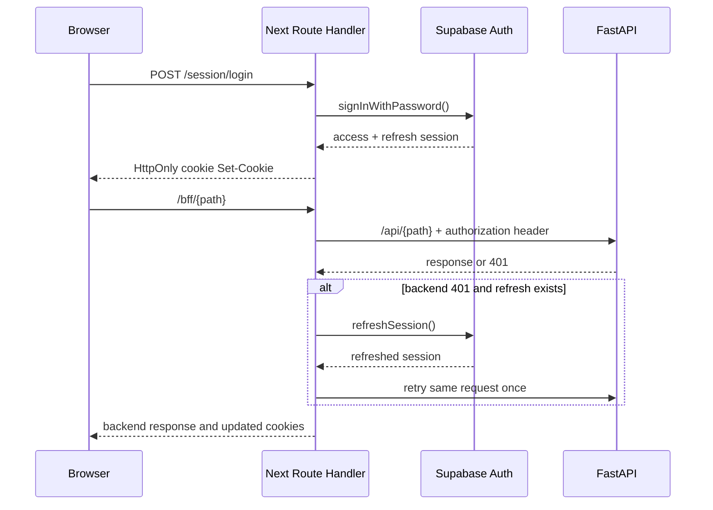

# Frontend Architecture

> **Scope:** The Next.js application, App Router, browser state, session handlers, BFF boundary, and build/proxy path.
> **Audience:** Frontend engineers, reviewers tracing browser requests, and operators running the frontend.
> **Related documents:** [API architecture](07-api-architecture.md), [Authentication and authorization](08-authentication-authorization.md), [Configuration](17-configuration.md), [Testing](16-testing-architecture.md), [Architecture risks](20-architecture-risks.md)

## Status vocabulary

The classifications below describe the current repository, not a target
architecture:

- **Implemented:** The route or pattern exists in source and is used by the
  current application flow.
- **Partial:** A working slice exists, but coverage, authority, or recovery is
  intentionally incomplete.
- **Static:** The UI is presentational or hard-coded rather than backed by live
  application data.
- **Stale:** The UI describes a previous or unsupported setup path.
- **Absent:** No corresponding frontend implementation exists.

## Runtime entry and rendering model

The frontend is a Next.js 16.3.1 App Router application under
`frontend/src/`. `frontend/src/app/layout.tsx:RootLayout` is the only layout. It loads
the Geist fonts and `globals.css`, renders the null-rendering
`ThemeProvider`, sets metadata, and awaits `connection()` so the per-request
CSP nonce produced by `frontend/src/proxy.ts:proxy` can be applied. There are no route
groups or protected server layouts.

Next.js pages and layouts are Server Components by default, but almost every
data-bearing page in this repository begins with `"use client"`. Those pages
fetch after hydration and hold their data, form values, loading state, and
errors locally. The public landing, setup, access-restricted, not-found, and
root error UI are presentational server/client entry points as noted below;
they do not establish a server-side authorization boundary. `connection()` in
the root layout means the application must not be described as a static export,
even where a page contains only static copy.


The route entry files and their current protection shape are:

| Area                        | Routes                                                                                                                                                               | Actual structure                                                                                                                                        |
| --------------------------- | -------------------------------------------------------------------------------------------------------------------------------------------------------------------- | ------------------------------------------------------------------------------------------------------------------------------------------------------- |
| Public                      | `/`, `/setup`, `/access-restricted`                                                                                                                                  | Standalone pages with no `AppPage` wrapper. `/access-restricted` is a present page, not a reached authorization redirect.                               |
| Sign-in and invitation      | `/login`, `/auth/setup`, `/auth/callback`                                                                                                                            | `/login` and `/auth/setup` are client-controlled forms. `/auth/callback` is a server Route Handler that exchanges a code or invite token and redirects. |
| Session endpoints           | `/session/login`, `/session/logout`, `/session/password`, `/session/status`, `/session/realtime-token`                                                               | Server Route Handlers used by browser forms, `AppPage`, the BFF, and realtime initialization; these are not page layouts.                               |
| Workspace                   | `/workspace`, `/onboarding`                                                                                                                                          | Client pages wrapped in `AppPage`; workspace metrics and checklist copy are currently static.                                                           |
| Structure                   | `/departments`, `/departments/new`, `/departments/[departmentId]`                                                                                                    | Client pages wrapped in `AppPage` for listing, creation, module creation, and lifecycle controls.                                                       |
| Canonical module routes     | `/modules/[moduleId]`, `/modules/[moduleId]/schema`, `/modules/[moduleId]/records`, `/modules/[moduleId]/records/new`, `/modules/[moduleId]/records/[recordId]/edit` | Client pages that load module, department, field, record, and relationship data through `apiFetch`.                                                     |
| Department-scoped aliases   | `/departments/[departmentId]/modules/[moduleId]` and its `schema`, `records`, `records/new`, and `records/[recordId]/edit` descendants                               | Each `page.tsx` re-exports the corresponding canonical module page; the canonical page chooses its URL prefix from optional params.                     |
| Administration and settings | `/administration/users`, `/administration/roles`, `/administration/audit`, `/settings/appearance`                                                                    | Client pages wrapped in `AppPage`; all domain reads and writes go through the BFF.                                                                      |
| Framework fallbacks         | `frontend/src/app/not-found.tsx`, `frontend/src/app/error.tsx`                                                                                                       | Root not-found UI and a root client error boundary. There is no `loading.tsx` or `global-error.tsx`.                                                    |

The empty `frontend/src/app/api/proxy/[...path]` and `frontend/src/app/api/session/*`
directories do not define Route Handlers. `/api/*`, `/docs`, `/redoc`, and
`/openapi.json` are handled by rewrites in `next.config.ts`; application pages
use `/bff/*` instead.

## Public, auth, and protected page boundaries

`frontend/src/components/app-page.tsx:AppPage` is the shared client gate for all pages
classified as protected. On mount it requests `GET /session/status` with
`cache: "no-store"`. While waiting it renders a centered “Checking your
session…” status. A failed response, an invalid body, or a network error calls
`router.replace("/login")`; only `{ authenticated: true }` allows the shell to
mount.

After the gate succeeds, `AppPage` renders:

```text
RealtimeProvider
└── AppShell
    └── route page children
```

This is a client-side session check, not a protected server layout. It checks
Supabase session validity only; it does not check the backend's local profile,
role, or status. Backend authorization therefore remains authoritative for
domain data. A valid Supabase session with insufficient local access can reach
the shell and then receive API `401`/`403` responses. The existing
`/access-restricted` page is not wired into that branch. See
[authentication and authorization](08-authentication-authorization.md) and [risks and
limitations](20-architecture-risks.md) docs for the cross-system consequences.

## Sessions, cookies, and auth callbacks

The server-side Supabase client in `frontend/src/lib/supabase/server.ts:
createSupabaseServerClient` uses only the public Supabase URL and publishable
key. It disables persistence, automatic refresh, and URL session detection;
the frontend owns the browser session through HttpOnly cookies rather than a
Supabase client-side session store.

`frontend/src/lib/auth-cookies.ts` defines `openslate_access` and `openslate_refresh`.
Both are `HttpOnly`, `SameSite=Lax`, path `/`, and `Secure` only in production.
The access cookie uses the Supabase `expires_in` value (or one hour), and the
refresh cookie lasts seven days. Browser JavaScript does not read these values.

The session Route Handlers are:

- `frontend/src/app/session/login/route.ts:POST` checks same-origin requests and a
  strict Zod email/password schema, calls `signInWithPassword`, and sets both
  cookies. It returns generic `400`, `401`, or `503` errors with no-store
  responses.
- `frontend/src/app/session/status/route.ts:GET` reads both cookies, calls
  `establishSupabaseSession` from `frontend/src/lib/supabase/session.ts`, returns only
  `{ authenticated }`, refreshes cookies when a session is available, and
  clears them otherwise.
- `frontend/src/app/session/logout/route.ts:POST` checks same-origin, attempts local
  Supabase Auth sign-out using the access/refresh pair, and always clears the
  browser cookies even if Auth is unavailable.
- `frontend/src/app/session/password/route.ts:POST` checks same-origin, validates two
  matching passwords of at least 12 characters, establishes the cookie session,
  calls `auth.updateUser`, and reissues or clears cookies on failure.
- `frontend/src/app/session/realtime-token/route.ts:GET` checks same-origin, establishes
  or refreshes the cookie session, returns a short-lived `access_token` for the
  browser realtime client, and uses no-store responses.
- `frontend/src/app/auth/callback/route.ts:GET` accepts either a code or an invitation
  token hash (only `type=invite` for the latter), exchanges/verifies it, sets
  cookies, and redirects to `/auth/setup`; invalid input redirects to `/login`.



## BFF and backend communication

`frontend/src/app/bff/[...path]/route.ts:handle` is the canonical application data boundary used by pages. It exports `GET`, `POST`, `PATCH`, `PUT`, and `DELETE`, maps the
catch-all path to `${BACKEND_URL}/api/{path}`, preserves the query string, and
uses `cache: "no-store"` on its upstream fetch. It forwards a small allowlist of request headers
(`accept`, language, content type, conditional headers) and places the access
cookie value in an `Authorization: Bearer` header. Unsafe methods require the
same-origin check from `frontend/src/lib/request-security.ts:isSameOriginRequest`.

On a backend `401`, the handler uses the refresh cookie with Supabase Auth and
retries the original request once with the new access token and original body.
Refresh failure or a second `401` clears cookies. Successful refreshes update
the response cookies; selected response headers and the backend status/body
are passed back to the browser. A backend `403` is not refreshed.

`frontend/src/lib/api.ts:apiFetch` is the browser-side client. It prefixes paths with
`/bff`, forces JSON content type and same-origin credentials, converts non-2xx
responses to `ApiError`, and hard-navigates to `/login` on `401`. Its generic
type parameter is an unchecked cast, not runtime response validation. The
`listQuery` helper builds the repeated search, deletion, sort, limit, and
offset query convention. Pages commonly request `limit=100` and currently do
not use `pagination.has_more`.

The direct `/api` rewrite remains reachable for health and domain endpoints and
also exposes FastAPI documentation paths. Application pages do not use it for
domain data because it does not convert HttpOnly cookies into backend authorization;
they use the BFF. Backend API semantics and error contracts
belong in [API architecture](07-api-architecture.md).

## Browser state, theme, and realtime

There is no global data store, URL-backed filter state, SWR/React Query cache,
or generated client. Each page uses local `useState` and `useEffect`; repeated
loads are explicit `load()` functions and successful mutations generally call
`load()` again. `AppPage` listens for the browser event
`openslate:invalidation`. When an invalidation arrives it increments a key on
`AppShell`, causing the protected subtree to remount and refetch broadly.

`frontend/src/components/theme-provider.tsx:ThemeProvider` runs once in an effect and
reads `openslate-theme`, `openslate-accent`, `openslate-density`, and
`openslate-radius` from `localStorage`. It applies the `dark` class and
`data-*` attributes to `<html>` and renders no DOM.
`frontend/src/app/settings/appearance/page.tsx` updates the same keys immediately;
`frontend/src/app/globals.css` maps them to CSS variables. Preferences are browser-local,
not user profile data. Initial state defaults and post-hydration application can
flash light/default values, and a quick preference change can overwrite
persisted values not yet loaded.

`frontend/src/components/realtime-provider.tsx:RealtimeProvider` creates a browser
Supabase client with the publishable key and requests a short-lived token from
`/session/realtime-token`. It subscribes to the private
`openslate:invalidation` Broadcast channel and dispatches the local invalidation
event when it receives `invalidate`. The backend event carries no row snapshot;
the UI refetches through the BFF. A separate browser `BroadcastChannel` named
`openslate-session-events` clears client channels across tabs. The provider also
has `useRealtimeChannel` for optional private Broadcast subscriptions. The main
subscription has no status callback or general error-reporting path; token or
subscription failures are mostly silent while ordinary API work remains usable.

There is no polling fallback, optimistic cache reconciliation, row-level event
payload handling, or user-visible realtime failure state. Realtime is therefore
an invalidation enhancement, not a second data API.

## Forms and validation

Forms are controlled React forms with manual submit functions. Native browser
constraints are the normal client validation layer: `required`, `type`,
`minLength`, `maxLength`, `pattern`, `step`, and disabled states. The only
frontend Zod schemas are server Route Handler schemas for login and password
setup. Domain page responses are not runtime-validated.

Important current form patterns include:

- Department, module, field, user, and role forms submit through `apiFetch`
  and expose local pending/error state.
- `frontend/src/app/modules/[moduleId]/schema/page.tsx` builds select options from
  comma-separated input, configures relationship target/cardinality fields,
  reorders active fields, and sends an acceptance request. Its UI keeps closed
  fields visible but excludes them from active reordering.
- New and edit record pages coerce number, decimal, integer, boolean, and
  datetime values before sending JSON; date values remain date strings. Relationship fields are deliberately
  excluded from record JSON and are managed afterward by
  `RelationshipManager`.
- `RelationshipManager` loads outgoing and incoming links separately, supports
  single replacement or multiple links, shows hidden-link reasons, and leaves
  incoming links read-only.
- `LifecycleAction` is a preview → exact-name → password wizard for close or
  purge. Reopen uses the browser's native confirmation dialog and a
  `{ confirmed: true }` request.
- `frontend/src/app/administration/roles/page.tsx` parses the permissions textarea with
  `JSON.parse` and checks only that it is an object. Permission metadata is
  displayed as configured but is not an effective frontend authorization
  mechanism.

There is no React Hook Form, Formik, server action, generated form schema, or
domain Zod boundary. Backend validation remains the source of truth; the
[API architecture](07-api-architecture.md) defines those response and validation details rather than this document duplicating them.

## Loading, errors, and recovery

- `AppPage` owns the initial session-check loading state and redirects on a
  failed check.
- Data pages usually render plain text such as “Loading records…” or “Loading
  departments…” from local state. `frontend/src/components/ui/skeleton.tsx` exists but
  is not used by the current route pages, and there are no route-level
  `loading.tsx` Suspense boundaries.
- Most mutations and loads render a destructive `Alert` with a “Try again”
  action or an inline error. The audit page displays a text error without a
  retry action. `ApiError` preserves status/details/code for lifecycle-aware
  handling, but successful DTOs remain unchecked.
- `frontend/src/app/error.tsx` is a root client error boundary with generic copy and a
  reset button. `frontend/src/app/not-found.tsx` is the root 404 UI. No
  `global-error.tsx` or per-segment error boundaries exist.
- Expired authentication is recovered once in the BFF. The browser utility
  redirects to `/login` after a resulting `401`; `403` and validation errors
  stay in the page's local error state.

These are usable local recovery patterns, but not a complete loading/error
system. See [testing](16-testing-architecture.md) and [risks and
limitations](20-architecture-risks.md) docs for coverage and impact.

## UI structure and styling

`frontend/src/components/app-shell.tsx:AppShell` is the protected chrome: a fixed
desktop sidebar, a mobile overlay menu, a sticky header, account/sign-out
controls, a skip-to-content link, and a `main#main-content` container. Its
primary navigation targets workspace, departments, people, roles, and audit;
appearance is a secondary setting. `frontend/src/components/page-header.tsx:PageHeader`
provides the repeated eyebrow/title/description/actions pattern.

Reusable primitives in `frontend/src/components/ui/` are small typed wrappers for
`Button`, `Input`, `Label`, `Alert`, `Badge`, `Card`, `Separator`, and
`Skeleton`. `Button` uses Radix Slot and class-variance-authority for its
`asChild`, variant, and size behavior. Domain-specific shared components are
`LifecycleAction`, `RelationshipManager`, `RealtimeProvider`, and
`ApiStatus` (the latter is implemented but not mounted by a current page).

`frontend/src/app/globals.css` is the design-token layer: Tailwind CSS 4, CSS variables for
background/foreground/surface/status/sidebar colors, radius, and data-attribute
variants for accent, density, and corner style. Routes compose cards, tables,
native inputs/selects, alerts, badges, and Lucide icons with utility classes.
There is no separate component-library package, Storybook, CSS-in-JS system,
or frontend design-token service.

## Build, environment, and Next.js Proxy

`frontend/package.json` pins Next.js 16.3.1, React 19.2.8, TypeScript, Tailwind
CSS 4, Supabase JS, Zod, and Playwright. `next.config.ts` enables
`output: "standalone"`, `reactStrictMode`, and `typedRoutes`. Its rewrites use
`BACKEND_URL` (defaulting to `http://localhost:8000`) for `/api/*`, FastAPI
docs, ReDoc, and OpenAPI. Its response headers add `nosniff`, frame, referrer,
and permissions policies. Build-time and runtime configuration details belong
in [configuration](17-configuration.md).

`frontend/src/proxy.ts:proxy` is Next.js 16's renamed Proxy convention, not an
authentication middleware. For matched page requests it generates a nonce,
builds a CSP whose `connect-src` includes the configured Supabase origin and
websocket endpoint, puts `x-nonce` and the CSP on the upstream request, and
sets the CSP on the response. Its matcher excludes `/api`, `/bff`, `/session`,
`/auth/callback`, Next static/image assets, and the favicon, and skips prefetch
requests. Session and authorization decisions therefore remain in Route
Handlers, `AppPage`, and especially the backend.

`infra/docker/frontend.Dockerfile` builds with Node 24 in a dependency/build
stage and runs `.next/standalone/server.js` as a non-root user on port 3000.
This is a standalone image recipe, not deployment orchestration; the supported
local path is host-run Next.js plus the Supabase CLI platform.

`frontend/src/components/lifecycle-dialog.tsx` reads
`NEXT_PUBLIC_LIFECYCLE_PURGE_ENABLED` at build time to expose the purge action.
That frontend flag is not declared in `.env.example` and is independent from
the backend purge flag; configuration ownership and cutover implications are
tracked in [configuration](17-configuration.md) and [risks and
limitations](20-architecture-risks.md).

## Verified capability classification

| Capability                                                    | Classification                            | Verified current behavior                                                                                                                                                                                   |
| ------------------------------------------------------------- | ----------------------------------------- | ----------------------------------------------------------------------------------------------------------------------------------------------------------------------------------------------------------- |
| App Router entry, root layout, typed routes, standalone build | **Implemented**                           | `frontend/src/app/layout.tsx`, `next.config.ts`, and the package scripts provide the entry and build contract.                                                                                              |
| Public and auth pages                                         | **Implemented / static UI**               | `/`, `/login`, `/setup`, `/auth/setup`, and callback/session handlers exist; most copy and form rendering is presentational.                                                                                |
| Protected page access                                         | **Partial**                               | `AppPage` checks a Supabase session after hydration, but does not verify local role/status and does not wire `/access-restricted`.                                                                          |
| Cookie session and refresh path                               | **Implemented**                           | Session handlers set, refresh, and clear HttpOnly cookies; selected session responses set no-store headers. The BFF disables caching on its upstream fetch and forwards selected backend cache headers.     |
| Domain BFF and backend calls                                  | **Implemented / partial client contract** | BFF forwarding and one-refresh retry are real; `apiFetch<T>` casts unchecked DTOs and lists commonly cap at 100.                                                                                            |
| Workspace metrics and onboarding progress                     | **Static**                                | `frontend/src/app/workspace/page.tsx` renders zero counts and fixed “0 of 5 complete” content; `frontend/src/app/onboarding/page.tsx` has one fixed completed step.                                         |
| Schema and record workflows                                   | **Partial**                               | Creation, acceptance, record editing, relationship management, and lifecycle UI exist, but new-record rendering includes deleted primitive fields and can submit inactive keys rejected by the backend.     |
| Appearance preferences                                        | **Partial**                               | Theme/accent/density/radius persist in local storage and CSS attributes, with hydration/default overwrite risks and no server profile persistence.                                                          |
| Realtime invalidation                                         | **Partial**                               | Private Broadcast invalidation and broad remount/refetch work; no polling fallback, row payload handling, or surfaced subscription failure exists.                                                          |
| Setup guidance                                                | **Stale**                                 | `/setup` still labels a Docker Compose path and shows legacy variables, and its bootstrap command omits the required `--email`; the supported flow is documented in the root README and backend script.     |
| Files, reports, views, and application storage UI             | **Absent**                                | No frontend routes or client API for these capabilities; Storage is only a platform foundation at present.                                                                                                  |
| Loading and error system                                      | **Partial**                               | Local text/alerts and root error/not-found UI exist; route loading files, global error handling, and consistent recovery are absent.                                                                        |
| Frontend automated verification                               | **Partial**                               | Playwright covers public pages plus mocked lifecycle/relationship flows and one home-page axe scan; there is no unit/component test framework, and session/BFF/JWT/database/realtime integration is mocked. |

The table intentionally separates **static UI** from Next.js static
rendering: the application uses `connection()` in its root layout and is built
as a standalone Node server, not as `output: "export"`.

## Architectural boundary

This document records how the current browser, Next.js server boundary, and
FastAPI boundary fit together. It does not redefine backend authorization,
domain invariants, audit behavior, deployment ownership, or test policy. Use
the linked [authentication and authorization](08-authentication-authorization.md),
[API architecture](07-api-architecture.md), [configuration](17-configuration.md), [testing](16-testing-architecture.md),
and [architecture risks](20-architecture-risks.md) for those concerns.
