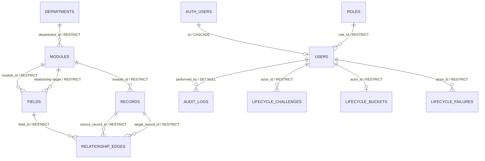

# Data Architecture

> **Scope:** PostgreSQL/Supabase application data, lifecycle persistence, audit behavior, and schema delivery.
> **Audience:** Developers changing models, migrations, constraints, lifecycle persistence, or database privileges.
> **Related documents:** [Authentication and authorization](08-authentication-authorization.md), [Lifecycle and state](09-lifecycle-and-state-management.md), [Audit and history](10-audit-and-history.md), [Deployment](12-deployment-architecture.md)

**State labels:** `[Implemented]` is present in checked-in code; `[DB-enforced]` is enforced by PostgreSQL DDL; `[ORM-enforced]` is supplied by SQLAlchemy behavior; `[App-enforced]` is enforced by service/router code; `[Configured]` is present in local configuration; `[Boundary]` is an explicit ownership boundary; `[Unresolved]` is not implemented for production.

This document is verified from SQLAlchemy models, Alembic environment/revisions, lifecycle services, and Supabase configuration. It does not prescribe a new schema.

## 1. PostgreSQL and Supabase boundary

- `[Configured]` Supabase supplies PostgreSQL 17, Auth, Realtime, Storage, Studio, and local Mailpit. The application tables are in `public`; `auth.users` is Supabase-managed and is not application-owned.
- `[Boundary]` Alembic is the sole owner of the application schema. Supabase migrations and seeds are disabled. `supabase/config.toml` exposes only `graphql_public` through the Data API, so FastAPI/SQLAlchemy is the supported application data API; there are no supported direct Data API writes.
- `[Boundary]` Auth owns identities, invitations, and passwords. `public.users.id` is the Auth UUID and references `auth.users.id`. Auth insert/email-update triggers maintain the local profile. File metadata is application-owned in `public.files`; Storage objects remain private and are addressed only through FastAPI, not browser Storage access.
- `[Boundary]` Realtime has no application-table publication. The application sends private Broadcast invalidation events after commit; it is not the source of record data.
- `[Unresolved]` A hosted deployment target, hosted migration procedure, backup/restore runbook, TLS terminator, and production platform topology are not defined in this repository.

Primary sources: [`supabase/config.toml`](../../supabase/config.toml), [`migrations/env.py`](../../backend/migrations/env.py), and revision [`20260819_0010_supabase_cutover.py`](../../backend/migrations/versions/20260819_0010_supabase_cutover.py).

## 2. Relational model

The following is the high-level model. `AUTH_USERS` is external `auth.users`; all other nodes are application tables. `performed_by` is present on every `BaseModel` table and on `audit_logs`, even where the edge is omitted from the diagram for readability.



### Shared model and key policy

`[Implemented]` [`BaseModel`](../../backend/app/core/base_model.py) is the abstract base for `roles`, `users`, `departments`, `modules`, `fields`, `records`, and `relationship_edges`. It supplies:

| Column                     | PostgreSQL shape and behavior                                                                                                 |
| -------------------------- | ----------------------------------------------------------------------------------------------------------------------------- |
| `id`                       | UUID primary key; SQLAlchemy default is UUIDv7.                                                                               |
| `created_at`, `updated_at` | Non-null `timestamptz`, application UTC defaults and `CURRENT_TIMESTAMP` server defaults; `updated_at` has an ORM `onupdate`. |
| `is_deleted`               | Non-null boolean, default `false`.                                                                                            |
| `deleted_at`               | Nullable `timestamptz`.                                                                                                       |
| `performed_by`             | Nullable UUID FK to `users.id`, `ON DELETE SET NULL`; the actor that caused the mutation.                                     |

`[Implemented]` PostgreSQL UUIDs and timezone-aware timestamps are used throughout. UUIDv7 is generated by the ORM for application rows; the Auth-backed user ID is supplied by `auth.users`. [`model_registry.py`](../../backend/app/core/database/model_registry.py) imports the complete ORM registry for metadata and migrations.

### Application entities

The following catalog covers every current application entity, including the audit table.

| Table/entity                              | Key and data columns                                                                                                                                                                                                          | FK and state notes                                                                                                                                                                                    |
| ----------------------------------------- | ----------------------------------------------------------------------------------------------------------------------------------------------------------------------------------------------------------------------------- | ----------------------------------------------------------------------------------------------------------------------------------------------------------------------------------------------------- |
| `roles` / `Role`                          | Shared columns; `role varchar(100)`; `permissions JSONB NOT NULL`, default `{}`.                                                                                                                                              | Soft-deletable. `uq_roles_role` makes `role` globally unique, including closed rows. Seeded names are `admin` and `member`; the database does not constrain the column to those two values.           |
| `users` / `User`                          | `id` is also the Auth identity key; `email varchar(320)`; `username varchar(100)`; `status varchar(20)`; `role_id`.                                                                                                           | `id -> auth.users.id ON DELETE CASCADE`; `role_id -> roles.id ON DELETE RESTRICT`; soft-deletable. Email and username are globally unique.                                                            |
| `departments` / `Department`              | Shared columns; `department_name varchar(150)`.                                                                                                                                                                               | Soft-deletable. Active department names are unique; closed rows can retain the same name as a later active row.                                                                                       |
| `modules` / `Module`                      | Shared columns; `department_id`; `module_name varchar(150)`; `is_schema_accepted boolean NOT NULL DEFAULT false`.                                                                                                             | `department_id -> departments.id ON DELETE RESTRICT`; soft-deletable. Active `(department_id, module_name)` is unique.                                                                                |
| `fields` / `Field`                        | Shared columns; `module_id`; `name varchar(150)`; `type varchar(20)`; `required boolean`; `position integer`; `config JSONB NOT NULL DEFAULT {}`; optional relationship target module and source/target cardinality booleans. | `module_id -> modules.id ON DELETE RESTRICT`; optional `relationship_target_module_id -> modules.id ON DELETE RESTRICT`; soft-deletable. Active field names and positions are unique within a module. |
| `records` / `Record`                      | Shared columns; `module_id`; `data JSONB NOT NULL DEFAULT {}`.                                                                                                                                                                | `module_id -> modules.id ON DELETE RESTRICT`; soft-deletable.                                                                                                                                         |
| `relationship_edges` / `RelationshipEdge` | Shared columns; `field_id`, `source_record_id`, `target_record_id`. Directed, soft-deletable edge.                                                                                                                            | All three FKs are `ON DELETE RESTRICT`. Active edge identity `(field_id, source_record_id, target_record_id)` is unique.                                                                              |
| `audit_logs` / `AuditLog`                 | Independent UUID PK; `created_at`; nullable actor; `action`; `entity_type varchar(50)`; nullable `entity_id`; nullable JSONB `before`/`after`; nullable request UUID/method/path; nullable `actor_label` and `note`.          | Does **not** inherit `BaseModel`: no `updated_at`, `is_deleted`, or `deleted_at`. `performed_by -> users.id ON DELETE SET NULL`. Immutable at the ORM boundary and not recursively audited.           |
| `workspace_profiles` / `WorkspaceProfile` | Singleton key; display/legal/contact/address fields; `timezone`; `locale`; revision; optional `logo_file_id`. | The singleton and non-deletion checks are DB-enforced. It is seeded with `OpenSlate`, `UTC`, and `en-US`; current logo FK restricts file deletion. |
| `saved_views` / `SavedView`               | `module_id`; `owner_id`; name; private/workspace visibility; revision; versioned definition JSONB. | Module/user FKs restrict deletion; owner/module and shared-module indexes support visibility-scoped lists. Definition is audit-redacted. |
| `files` / `File`                          | Purpose; optional record parent; creator; filename/media metadata; expected/actual size; digest; opaque object key; state/operation/provenance; scan requester, attempts and next-attempt time. | Purpose/parent, size, logo size, ready-verdict, state and nonnegative-attempt checks are DB-enforced. Requester deletion sets NULL, requiring adoption. The due-work partial index covers unclaimed pending scans; other record/creator FKs restrict deletion and object key is unique. |

Sources: [`users/models.py`](../../backend/app/systems/access/users/models.py), [`departments/models.py`](../../backend/app/systems/sandbox/departments/models.py), [`modules/models.py`](../../backend/app/systems/sandbox/modules/models.py), [`fields/models.py`](../../backend/app/systems/sandbox/fields/models.py), [`records/models.py`](../../backend/app/systems/sandbox/records/models.py), [`relationships/models.py`](../../backend/app/systems/sandbox/relationships/models.py), and [`audit/models.py`](../../backend/app/systems/manage/audit/models.py).

`reports`, `businesses`, and `admin` remain placeholders. `workspace`, `views`, and `files` contribute the entities above.

### Lifecycle persistence entities

`[Implemented]` The lifecycle tables inherit the bare SQLAlchemy `Base`, not `BaseModel`. They have UUIDv7 IDs and UTC/timestamptz timestamps where defined, but no soft-delete columns and no `performed_by` column. They are explicitly excluded from ORM audit capture with `__audit_enabled__ = False`.

| Table/entity                                                           | Columns and constraints                                                                                                                                                                                                                                                                                                                                                                                                                                                                                                                                                                                               | Index/uniqueness and lifecycle role                                                                                                                                                              |
| ---------------------------------------------------------------------- | --------------------------------------------------------------------------------------------------------------------------------------------------------------------------------------------------------------------------------------------------------------------------------------------------------------------------------------------------------------------------------------------------------------------------------------------------------------------------------------------------------------------------------------------------------------------------------------------------------------------- | ------------------------------------------------------------------------------------------------------------------------------------------------------------------------------------------------ |
| `lifecycle_confirmation_challenges` / `LifecycleConfirmationChallenge` | `actor_id -> users.id ON DELETE RESTRICT`; operation; polymorphic `target_type` and UUID `target_id`; impact digest; SHA-256 `token_hash`; failed attempts; status; created/updated/expiry/consumed timestamps; optional verification lease ID/expiry. Checks `ck_lifecycle_challenges_operation`, `ck_lifecycle_challenges_status`, `ck_lifecycle_challenges_failed_attempts_nonnegative`, `ck_lifecycle_challenges_five_minute_expiry`, `ck_lifecycle_challenges_target_type_nonempty`, `ck_lifecycle_challenges_token_hash_sha256`, and `ck_lifecycle_challenges_impact_digest_nonempty` enforce: operation `close | purge`; six listed statuses; attempts `0..5`; expiry after creation and no more than five minutes later; non-empty target type/digest; and a 64-character lowercase hex SHA-256 token hash.      | `token_hash` is unique; `verification_lease_id` is unique when present. A challenge is actor-, operation-, target-, and digest-bound and is single-use. `target_id` has no FK because targets are polymorphic. |
| `lifecycle_rate_limit_buckets` / `LifecycleRateLimitBucket`            | `actor_id -> users.id ON DELETE RESTRICT`; attempt count; rolling window start/expiry; optional `blocked_until`; created/updated timestamps. Checks `ck_lifecycle_buckets_attempt_count_nonnegative` and `ck_lifecycle_buckets_fifteen_minute_window` enforce attempts `0..5` and a window after its start and no more than 15 minutes.                                                                                                                                                                                                                                                                               | `actor_id` is unique: one mutable bucket per actor.                                                                                                                                              |
| `lifecycle_rate_limit_failures` / `LifecycleRateLimitFailure`          | `actor_id -> users.id ON DELETE RESTRICT`; `occurred_at`.                                                                                                                                                                                                                                                                                                                                                                                                                                                                                                                                                             | `ix_lifecycle_rate_limit_failures_actor_occurred` supports actor/time-window lookup. The service treats rows as immutable failure events and deletes only expired events during bounded cleanup. |

Source: [`lifecycle/models.py`](../../backend/app/systems/sandbox/lifecycle/models.py) and [`lifecycle_foundation.py`](../../backend/migrations/versions/20260829_0013_lifecycle_foundation.py).

### Foreign-key deletion matrix

`[DB-enforced]` The following are the current physical-delete rules. No SQLAlchemy relationship has an ORM delete cascade. Soft deletion does not invoke any FK action.

| Referencing column                                             | Referenced key   | On physical delete                            |
| -------------------------------------------------------------- | ---------------- | --------------------------------------------- |
| `users.id`                                                     | `auth.users.id`  | `CASCADE` from Auth identity to local profile |
| `role_id` on `users`                                           | `roles.id`       | `RESTRICT`                                    |
| `performed_by` on every `BaseModel` table and `audit_logs`     | `users.id`       | `SET NULL`                                    |
| `department_id` on `modules`                                   | `departments.id` | `RESTRICT`                                    |
| `module_id` on `fields`, `records`                             | `modules.id`     | `RESTRICT`                                    |
| `relationship_target_module_id` on `fields`                    | `modules.id`     | `RESTRICT`                                    |
| `field_id` on `relationship_edges`                             | `fields.id`      | `RESTRICT`                                    |
| `source_record_id`, `target_record_id` on `relationship_edges` | `records.id`     | `RESTRICT`                                    |
| `actor_id` on all lifecycle tables                             | `users.id`       | `RESTRICT`                                    |
| `record_id` on `files`                                         | `records.id`     | `RESTRICT`                                    |
| `creator_id` on `files`                                        | `users.id`       | `RESTRICT`                                    |
| `module_id` and `owner_id` on `saved_views`                    | `modules.id`, `users.id` | `RESTRICT`                              |
| `logo_file_id` on `workspace_profiles`                         | `files.id`       | `RESTRICT`                                    |

The lifecycle service therefore deletes relationship edges first, then records, fields, modules, and departments. This order is explicit and is not delegated to database cascades.

## 3. Constraints, indexes, JSONB, and string enums

### Database checks and uniqueness

`[DB-enforced]` In addition to non-null columns, primary keys, and the FK matrix above, the current checks are:

| Table                | Checks and uniqueness                                                                                                                                                                                                                                                                                                                                                         |
| -------------------- | ----------------------------------------------------------------------------------------------------------------------------------------------------------------------------------------------------------------------------------------------------------------------------------------------------------------------------------------------------------------------------- |
| `users`              | `ck_users_email_normalized`: email equals `lower(btrim(email))` and is non-empty; `ck_users_status`: `pending`, `active`, or `disabled`; unique email and username.                                                                                                                                                                                                           |
| `fields`             | `ck_fields_position_nonnegative`; `ck_fields_type`: `text`, `number`, `decimal`, `int`, `boolean`, `date`, `datetime`, `select`, or `relationship`; `ck_fields_relationship_metadata`: relationship fields require a target module, both cardinality flags, `required = false`, and empty config, while non-relationship fields require all relationship metadata to be null. |
| `relationship_edges` | `ck_relationship_edges_distinct_records`: source and target IDs differ; partial active-edge uniqueness.                                                                                                                                                                                                                                                                       |
| `audit_logs`         | `ck_audit_logs_action`: `create`, `update`, or `delete`.                                                                                                                                                                                                                                                                                                                      |
| lifecycle tables     | The operation, status, attempt, time-window, expiry, token-hash, target-type, and digest checks listed in the lifecycle catalog.                                                                                                                                                                                                                                              |

There is deliberately no database check coupling `is_deleted` and `deleted_at`, no database JSON schema for `config` or `data`, and no database check for active parents, same-department relationships, schema acceptance, cardinality, or protected roles.

PostgreSQL structurally constrains `fields` rows through columns, foreign keys, checks, and uniqueness, but it does not interpret UUID-keyed `Record.data`. FastAPI owns dynamic field semantics, including types, requiredness, ranges, options, and relationship meaning. Non-null decimal configuration bounds and record values are canonical JSON strings so their exact decimal text is preserved; optional record values may be JSON `null`, and migration `0015` also preserves legacy explicit-null bound keys that current runtime schema validation rejects. The boundary is covered by the [dynamic field validation test plan](../dynamic-field-validation-test-plan.md).

### Current indexes

`[DB-enforced]` The declared non-primary indexes are:

- `users`: `ix_users_email`, `ix_users_username`, `ix_users_role_id`, plus unique constraints `uq_users_email` and `uq_users_username`.
- `roles`: unique constraint `uq_roles_role`.
- `departments`: partial unique `uq_departments_name_active` on `department_name WHERE is_deleted = false`.
- `modules`: `ix_modules_department_id`; partial unique `uq_modules_department_name_active` on `(department_id, module_name) WHERE is_deleted = false`.
- `fields`: `ix_fields_module_id`, `ix_fields_relationship_target_module_id`; partial uniques `uq_fields_module_name_active` and `uq_fields_module_position_active` on active rows.
- `records`: `ix_records_module_id`.
- `relationship_edges`: partial unique `uq_relationship_edges_active`; partial `ix_relationship_edges_active_source` and `ix_relationship_edges_active_target`.
- `audit_logs`: `ix_audit_logs_created_at_id`, `ix_audit_logs_entity`, `ix_audit_logs_actor`, `ix_audit_logs_request`, and `ix_audit_logs_action`.
- lifecycle tables: unique `token_hash`, unique nullable `verification_lease_id`, unique `lifecycle_rate_limit_buckets.actor_id`, and `ix_lifecycle_rate_limit_failures_actor_occurred`.

There are no current GIN indexes on JSONB. The legacy users preferences GIN index is removed by revision `20260819_0004`.

### JSONB and string-enum policy

`[Implemented]` Current JSONB columns are:

- `roles.permissions` — mutable flat capability metadata evaluated by FastAPI for non-admin domain access. New documents are schema-validated; malformed persisted documents remain readable but grant nothing.
- `fields.config` — mutable field configuration; relationship fields must have `{}` by a database check.
- `records.data` — mutable JSONB record payload keyed by field UUID; PostgreSQL stores the JSON but does not interpret its keys or dynamic values, so FastAPI owns field-key/type/required/range/option semantics. Non-null decimal values use canonical JSON strings to preserve exactness; optional values may be JSON `null`.
- `audit_logs.before` and `audit_logs.after` — minimal redacted snapshots/diffs.
- `saved_views.definition` — versioned typed record-query definition. It is validated by FastAPI at save and execution, and is redacted from audit snapshots.

`[Implemented]` Python `StrEnum` values are persisted as bounded `varchar`/`String` columns, not PostgreSQL native enum types. Database checks back the following values: `UserStatus` (`pending`, `active`, `disabled`), `FieldType` (the nine field values above), `AuditAction` (`create`, `update`, `delete`), `LifecycleOperation` (`close`, `purge`), and `LifecycleChallengeStatus` (the six challenge states above). `UserRole` (`admin`, `member`) is a Python/application classification only; `roles.role` has no matching DB check. Lifecycle `target_type` is also polymorphic application data, only constrained to non-empty text.

Sources: [`base_model.py`](../../backend/app/core/base_model.py), the model files above, and revisions [`0005`](../../backend/migrations/versions/20260819_0005_create_domain_models.py), [`0008`](../../backend/migrations/versions/20260819_0008_constrain_field_types.py), [`0011`](../../backend/migrations/versions/20260819_0011_add_relationship_edges.py), and [`0013`](../../backend/migrations/versions/20260829_0013_lifecycle_foundation.py).

## 4. Invariant ownership

The enforcement boundary is intentional and must not be inferred from a model annotation alone.

| Invariant                                                                                                                                             | Classification                                                 | Source/reference                                                                                                                                                                                                                |
| ----------------------------------------------------------------------------------------------------------------------------------------------------- | -------------------------------------------------------------- | ------------------------------------------------------------------------------------------------------------------------------------------------------------------------------------------------------------------------------- |
| UUID PKs, non-null columns, FK targets, delete actions, checks, unique constraints, and active-row partial indexes                                    | `[DB-enforced]`                                                | SQLAlchemy `__table_args__` and Alembic revisions; see sections 2–3.                                                                                                                                                            |
| UUIDv7 generation, UTC defaults, `updated_at` ORM update, and mutable JSON change tracking                                                            | `[ORM-enforced]`                                               | [`base_model.py`](../../backend/app/core/base_model.py) and model `MutableDict` columns.                                                                                                                                        |
| Email and username normalization                                                                                                                      | Email `[ORM + DB-enforced]`; username `[ORM/App-enforced]`     | `User` validators normalize both; `ck_users_email_normalized` checks email only. Email/username uniqueness is DB-enforced.                                                                                                      |
| Active parent requirement, same-department relationship semantics, target module/type, source/target cardinality, and active endpoint rules           | `[App-enforced]`                                               | [`relationships/service.py`](../../backend/app/systems/sandbox/relationships/service.py) and domain routers/services; FKs provide structural integrity only.                                                                            |
| Field configuration, accepted module schema, required/type/range/option validation, record replacement-like updates, and closed-field value retention | `[App-enforced]`                                               | [`fields/validation.py`](../../backend/app/systems/sandbox/fields/validation.py), module/record routers.                                                                                                                                |
| `is_deleted`/`deleted_at` pairing, default exclusion of closed rows, close/reopen scope, blockers, impact digest, and plan drift detection            | `[App-enforced]`                                               | [`common/listing/query.py`](../../backend/app/common/listing/query.py), [`lifecycle/planner.py`](../../backend/app/systems/sandbox/lifecycle/planner.py), and [`lifecycle/service.py`](../../backend/app/systems/sandbox/lifecycle/service.py). |
| Role protection, capability authorization, and exact-`admin` reserved operations                                                                      | `[App-enforced]`                                               | [`common/dependencies/auth.py`](../../backend/app/common/dependencies/auth.py) and [`users/permissions.py`](../../backend/app/systems/access/users/permissions.py); the DB only stores role rows and uniqueness.                         |
| Auth identity/profile synchronization                                                                                                                 | `[DB trigger + cross-system]`                                  | Auth triggers in [`0010_supabase_cutover.py`](../../backend/migrations/versions/20260819_0010_supabase_cutover.py); Auth remains a separate system.                                                                             |
| Audit capture for ordinary audited ORM mutations                                                                                                      | `[App/session-enforced]`                                       | [`audit/listeners.py`](../../backend/app/systems/manage/audit/listeners.py); direct SQL, Alembic, Studio, Auth, Data API, and external clients are outside this audit boundary.                                                        |
| RLS/grant access to the runtime role                                                                                                                  | `[DB-enforced]`; domain authorization remains `[App-enforced]` | Revisions `0010`, `0011`, `0013`, and `0014`; policies use broad `true` predicates for `openslate_app`.                                                                                                                         |

## 5. Soft delete, reopen, and purge

### State rules

`[Implemented]` All `BaseModel` entities carry a reusable soft-delete state. A row is normally open when `is_deleted = false` and closed when `is_deleted = true`; `deleted_at` records the transition time. Lists exclude closed rows by default in application query construction. Partial unique indexes deliberately scope name/position/edge uniqueness to `is_deleted = false`.

`[App-enforced]` Lifecycle roots are departments, modules, fields, and records:

- Department close transitions the department and its modules, fields, and records in scope; module close transitions its owned fields and records; field close transitions only the field. Records cannot be closed through lifecycle operations.
- Reopen clears `is_deleted` and `deleted_at` only after checking active-parent, name/position, schema, and record-data blockers. A closed ancestor prevents reopening a child.
- Relationship edges are not automatically rewritten by a parent close. For an included edge, availability is computed from the field, endpoint records, and source/target modules; collection deletion filters separately control inclusion. Department close affects visibility indirectly because lifecycle also closes descendants.
- Roles, users, and relationship edges retain the shared soft-delete capability for their own services/routes, but they are not lifecycle root targets in the current lifecycle router.

### Purge and audit sequence

`[Configured]` Purge is disabled by default (`lifecycle_purge_enabled = false`). When explicitly enabled, purge requires a closed target, an impact preview, an actor-bound five-minute challenge, exact target confirmation (name for departments/modules/fields; ID for records), a Supabase password step-up, and a matching impact digest. The service locks the planned scope in canonical order with `NOWAIT`, recomputes the plan, and aborts on drift or blockers.

| Phase               | Data behavior                                                                                                                                                                                                                                        | Transaction/audit behavior                                                                                                                                              |
| ------------------- | ---------------------------------------------------------------------------------------------------------------------------------------------------------------------------------------------------------------------------------------------------- | ----------------------------------------------------------------------------------------------------------------------------------------------------------------------- |
| Preview/challenge   | Read scope, edge impacts, external schema dependencies, and field-key strips; persist only a token hash and challenge metadata.                                                                                                                      | Challenge issuance commits separately; lifecycle state is unchanged and challenge rows are not audited.                                                                 |
| Verification        | Reserve a lease, commit before the remote password call, then commit success/failure and rate-limit state.                                                                                                                                           | No database transaction is held across the network call.                                                                                                                |
| Close/reopen        | Lock and replan; update all selected rows with one lifecycle timestamp.                                                                                                                                                                              | Each changed audited row and its audit log are in the same mutation transaction.                                                                                        |
| Purge               | Physically delete edges first, strip primitive field UUID keys from surviving record JSON where required, then delete records, fields, modules, and departments. An external incoming relationship schema dependency blocks module/department purge. | Each physical delete and key-strip mutation is audited in the same transaction; any integrity/operational failure rolls back the purge. Purged rows cannot be reopened. |
| Commit/invalidation | Return only after the database commit.                                                                                                                                                                                                               | `after_commit` sends an opaque private Realtime invalidation best-effort; database state remains canonical if broadcast fails.                                          |

Sources: [`lifecycle/planner.py`](../../backend/app/systems/sandbox/lifecycle/planner.py), [`lifecycle/service.py`](../../backend/app/systems/sandbox/lifecycle/service.py), [`lifecycle/router.py`](../../backend/app/systems/sandbox/lifecycle/router.py), and [`audit/listeners.py`](../../backend/app/systems/manage/audit/listeners.py).

## 6. Transaction and audit architecture

`[Implemented]` FastAPI obtains an `AuditSession` from [`database/session.py`](../../backend/app/core/database/session.py). Routes/services perform explicit commits. The audit listener:

1. Captures new, dirty, and physically deleted auditable ORM instances in `before_flush` and sets `performed_by` from request context.
2. Inserts `AuditLog` rows in `after_flush_postexec`, still inside the originating database transaction. Soft-delete transitions are logged as `delete`; other updates are `update`; creates are `create`.
3. Stores minimal before/after diffs, recursively handles JSON mappings, serializes UUID/time/enum values, and redacts sensitive names containing password/token/secret/API-key/credential/private-key markers.
4. Rejects direct `AuditLog` mutations and rejects bulk/raw ORM mutations. Audit logs are not themselves audited recursively.
5. Clears pending audit/invalidation state on rollback. After commit, it performs best-effort private Broadcast invalidation and swallows only the optional Realtime failure.

The audit boundary excludes Supabase Auth, Studio, Alembic migrations, direct SQL, Data API operations, and external database clients. Revision `20260829_0013` adds nullable `actor_label`/`note` and records a clearly labeled rollout reclassification event for already-closed department/module/field rows; it does not reconstruct unknown historical closure actors.

Source: [`audit/listeners.py`](../../backend/app/systems/manage/audit/listeners.py), [`audit/snapshots.py`](../../backend/app/systems/manage/audit/snapshots.py), [`audit/models.py`](../../backend/app/systems/manage/audit/models.py), and migration [`0013`](../../backend/migrations/versions/20260829_0013_lifecycle_foundation.py).

## 7. RLS, grants, and runtime role

`[DB-enforced]` All current application and lifecycle tables have RLS enabled. The application role model is:

- `openslate_app` is a `NOLOGIN` privilege role created by revision `0010`.
- `openslate_runtime` is provisioned separately by [`provision_database_role.py`](../../backend/scripts/provision_database_role.py) as a constrained, inheriting login (`NOSUPERUSER`, `NOCREATEDB`, `NOCREATEROLE`, `NOREPLICATION`, `NOBYPASSRLS`) and is granted a non-delegable membership in `openslate_app`. On catalogs with membership options, that edge requires `INHERIT TRUE` and `SET FALSE`; older catalogs are checked through their available `admin_option`. The script checks the exact recursive membership set and never silently revokes drift.
- `openslate_app` has `USAGE` on `public`; CRUD on core domain tables, `saved_views`, and `files`; `SELECT/UPDATE` on the migration-seeded `workspace_profiles`; `SELECT/INSERT` on `audit_logs`; and the documented lifecycle privileges. It can `SELECT` `alembic_version`. UUID keys mean no sequence privilege is required.
- Policies for `openslate_app` use `USING (true)` / `WITH CHECK (true)` for the granted operations, including audit insert/select, edge delete after `0014`, and lifecycle CRUD. RLS therefore protects the boundary between roles, but is not the domain authorization layer or a tenant filter.
- `anon`, `authenticated`, and `service_role` effective privileges on application tables/functions are denied by revocations distributed across revisions `0010`, `0011`, and `0013`, together with default-privilege changes. `0013` relies on default privileges rather than an explicit client-role revoke for `lifecycle_rate_limit_failures`. `PUBLIC` loses `CREATE` on `public`. Authenticated Realtime receipt uses the narrowly scoped security-definer profile check rather than direct application-table access.

The effective actor authorization and audit boundary remain in FastAPI: JWT/local-profile validation, capability guards for domain reads/writes, literal-admin guards for management and purge operations, audited individual ORM writes, and lifecycle services. A direct database login bypasses these RBAC assumptions; a leaked login with equivalent owner/bypass capabilities would also bypass the application boundary. The intended runtime login is the provisioned role above.

Sources: [`0010_supabase_cutover.py`](../../backend/migrations/versions/20260819_0010_supabase_cutover.py), [`0011_add_relationship_edges.py`](../../backend/migrations/versions/20260819_0011_add_relationship_edges.py), [`0013_lifecycle_foundation.py`](../../backend/migrations/versions/20260829_0013_lifecycle_foundation.py), [`0014_allow_relationship_edge_purge.py`](../../backend/migrations/versions/20260830_0014_allow_relationship_edge_purge.py), [`workspace_profile.py`](../../backend/migrations/versions/e42d4f1e6b41_workspace_profile.py), [`saved_record_views.py`](../../backend/migrations/versions/709412f53ee5_saved_record_views.py), [`private_file_inventory.py`](../../backend/migrations/versions/17cf3df01f7a_private_file_inventory.py), [`workspace_logo_reference.py`](../../backend/migrations/versions/c8a1056a0758_workspace_logo_reference.py), [`durable_file_scan_scheduling.py`](../../backend/migrations/versions/523d35659ba3_durable_file_scan_scheduling.py), and [`settings.py`](../../backend/app/core/config/settings.py).

## 8. Migration chain, drift, and delivery

### Current linear chain

`[Implemented]` The chain is linear and currently ends at `523d35659ba3`:

| Revision        | Schema responsibility                                                                                                   |
| --------------- | ----------------------------------------------------------------------------------------------------------------------- |
| `20260819_0001` | Legacy numeric local `users` table, preferences JSONB, and initial indexes.                                             |
| `20260819_0002` | Forward-only UUIDv7 ID conversion and shared lifecycle columns.                                                         |
| `20260819_0003` | Initial application audit table.                                                                                        |
| `20260819_0004` | Role entities, UUID actors, credential/legacy preference removal, and user status migration.                            |
| `20260819_0005` | Departments, modules, fields, and records with shared FKs/indexes.                                                      |
| `20260819_0006` | Audit reshape to entity/before/after fields and UUID actor FK.                                                          |
| `20260819_0007` | Audit entity type length alignment.                                                                                     |
| `20260819_0008` | Field type check for supported record-validation types.                                                                 |
| `20260819_0009` | Recreated the existing numeric field-type check without changing its upgrade state; its downgrade is not schema-faithful to `0008`. |
| `20260819_0010` | Supabase Auth cutover, Auth triggers, `openslate_app`, RLS, private Storage bucket, and private Realtime authorization. |
| `20260819_0011` | Relationship field metadata, directed edges, edge indexes/RLS/grants.                                                   |
| `20260819_0012` | `modules.is_schema_accepted`.                                                                                           |
| `20260829_0013` | Lifecycle challenge/rate-limit tables, audit metadata, RLS/grants, and rollout audit reclassification.                  |
| `20260830_0014` | Runtime `DELETE` grant and RLS policy for relationship-edge purge.                                                      |
| `20260831_0015` | Converts decimal field config bounds and UUID-keyed record values to canonical JSON strings across active and closed rows; preserves explicit JSON `null` bounds. |
| `20260902_0016` | Creates the append-only security event store. |
| `a8873943bf48` | Adds user invitation/acceptance timestamps and token-validity cutoff. |
| `2c5bf7bc78fe` | Drops security-event user FKs so event history survives profile deletion. |
| `fc105d5b6283` | Adds the field audit-redaction flag. |
| `e42d4f1e6b41` | Creates and seeds the singleton workspace profile with its RLS/grants. |
| `709412f53ee5` | Creates saved views with visibility, revision, definition, indexes, RLS, and grants. |
| `17cf3df01f7a` | Creates private file metadata, constraints, indexes, RLS, and grants. |
| `c8a1056a0758` | Adds the restrictive workspace current-logo file reference and removes workspace-profile insert privilege. |
| `523d35659ba3` | Adds durable file scan scheduling fields, constraint, index, and user reference. |

### Alembic behavior and drift strategy

`[Implemented]` [`migrations/env.py`](../../backend/migrations/env.py) chooses `MIGRATION_DATABASE_URL` first and falls back to `DATABASE_URL`, imports the complete model registry, compares types, excludes the external `auth.users` placeholder from autogenerate, uses a null pool online, and runs revisions in Alembic transaction contexts. The expected workflow is:

```text
supabase start
  -> owner-capable Alembic connection upgrades the database to head
  -> provision_database_role.py creates/updates openslate_runtime
  -> DATABASE_URL points FastAPI at openslate_runtime
  -> alembic check detects model/database drift
```

The expected head is `523d35659ba3`. Re-run Alembic drift checks against the intended PostgreSQL database after migrations and before deployment; do not use SQLite or treat a model-only change as delivered schema. Preserve revision order and add a new forward migration for schema changes.

### Deployment prerequisites and compatibility

Before a new environment is usable:

1. Start/provision PostgreSQL plus Supabase Auth, Realtime, and Storage; confirm endpoints/ports with `supabase status -o env` without recording its keys.
2. Provide an owner-capable PostgreSQL `MIGRATION_DATABASE_URL`, a separate `DATABASE_URL` for the runtime login, and the runtime password input expected by the provisioning script. Values and keys must remain outside documentation and source control.
3. Apply `uv run alembic upgrade head`. Revision `0010` requires an empty `public.users` table for the Auth cutover, an existing Supabase Auth surface, and an owner-capable path for Auth-trigger and Supabase-owned Realtime policy DDL. It intentionally does not map legacy local identities; a populated legacy profile set must be restored/cut over explicitly rather than guessed.
4. Run `provision_database_role.py` with the required production confirmation outside local environments, then point FastAPI at `openslate_runtime`. Application startup does not automatically migrate or provision roles.
5. Bootstrap an invited administrator through the application script only after Auth triggers, roles, and runtime access are ready; this is separate from schema deployment.
6. Verify `alembic current`, `alembic check`, role privileges/RLS, and a disposable PostgreSQL integration path. Purge remains disabled unless retention approval and an operational recovery plan exist.

Revisions `0002`, `0004`, `0005`, `0006`, and `0010` are intentionally forward-only or raise `NotImplementedError` on downgrade; several later revisions are also operationally dependent on the cutover. Revision `0009`'s downgrade does not restore `0008`'s field-type check and is unsupported; do not edit applied revisions to repair it. Revision `0014` can revoke its edge-delete grant/policy on downgrade. Revision `0015` can convert canonical decimal strings back to JSON numbers after its preflight succeeds; explicit JSON `null` bounds remain null, and invalid intervening values fail before mutation. Physical purges, Auth identity changes, and old-schema restoration are not reversible by ordinary Alembic downgrade. Use a verified database backup/restore or a new forward migration for rollback. The compatibility boundary is therefore the current head plus its required Supabase/Auth objects, not an independently deployable SQLAlchemy model snapshot.

Sources: all files under [`backend/migrations/versions`](../../backend/migrations/versions), [`migrations/env.py`](../../backend/migrations/env.py), [`provision_database_role.py`](../../backend/scripts/provision_database_role.py), and [`supabase/config.toml`](../../supabase/config.toml).

## 9. Source-grounded review notes

- `[Implemented]` The application schema is PostgreSQL-specific and Alembic-owned; no application or frontend changes are included in this document.
- `[Implemented]` Every current application and lifecycle table is cataloged above, including external Auth identity linkage, audit exception, and lifecycle rate-limit persistence.
- `[DB-enforced]` Structural keys, FKs, checks, unique constraints, active-row indexes, RLS, and current runtime grants are distinguished from service-only invariants.
- `[Boundary]` Secrets, connection values, JWT keys, and Supabase status output are intentionally not reproduced.
- `[Unresolved]` Hosted migration ownership, backups, restore testing, and production observability/deployment topology remain deployment documentation work rather than database behavior.
