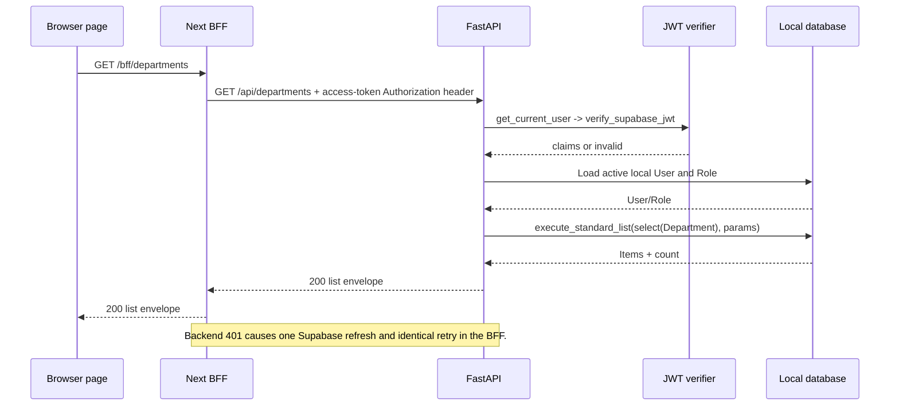

# API Architecture

> **Scope:** The FastAPI HTTP surface under `/api`, request/response conventions, authorization gates, and traced request sequences.
> **Audience:** API consumers, backend/frontend engineers, and reviewers validating endpoint behavior against source.
> **Related documents:** [Backend architecture](04-backend-architecture.md), [Authentication and authorization](08-authentication-authorization.md), [Audit and history](10-audit-and-history.md), [Error handling and recovery](15-error-handling-and-recovery.md)

## Status summary

| Area                           | Status              | Evidence-based state                                                                                                          |
| ------------------------------ | ------------------- | ----------------------------------------------------------------------------------------------------------------------------- |
| FastAPI `/api` surface         | **Implemented**     | `backend/app/main.py:create_app` includes the registered routers under `/api` and defines `/api/health`.                      |
| Resource list contract         | **Implemented**     | `backend/app/common/listing/schemas.py` and `query.py` provide the shared envelope, filters, ordering, count, and `has_more`. |
| Endpoint versioning            | **Documented Only** | No version segment or separate version negotiation is present in the reviewed route registration.                             |
| Conditional mutation semantics | **Unknown**         | The BFF forwards `If-Match`, but reviewed backend route signatures do not consume it; no backend ETag contract is evidenced.  |
| CRUD close-required responses  | **Implemented**     | Department, module, and field `DELETE` handlers return and document `409 close_required`; the registered-route/OpenAPI contract is covered by `backend/tests/test_legacy_delete_api.py`. |

## Route registration and endpoint inventory

All routes below are mounted beneath `/api`. Route prefixes and handlers come from `backend/app/main.py:create_app` and the cited router modules. “Admin” means the route uses the exact `admin` role through `require_roles(UserRole.ADMIN)`; a capability entry means the matching flat capability guard; “AuthN” means it uses `get_current_user` without an additional authorization guard.

| Group         | Implemented routes                                                                                                                                                                                                                                                                                                                                                       | Access and primary result                                                                                                                                                                                                                                                                                                                      |
| ------------- | ------------------------------------------------------------------------------------------------------------------------------------------------------------------------------------------------------------------------------------------------------------------------------------------------------------------------------------------------------------------------ | ---------------------------------------------------------------------------------------------------------------------------------------------------------------------------------------------------------------------------------------------------------------------------------------------------------------------------------------------- |
| System        | `GET /health`                                                                                                                                                                                                                                                                                                                                                            | Anonymous; `200` health object.                                                                                                                                                                                                                                                                                                                |
| Auth          | `POST /auth/invitations`, `POST /auth/invitations/{user_id}/resend`, `POST /auth/invitations/accept`, `GET /auth/me`                                                                                                                                                                                                                                                                     | Invitation and resend are Admin and return `UserResponse` (`201` for invite); accept uses `get_verified_pending_identity` (verified JWT subject/email, no active-local gate) and returns `UserResponse`; `me` is AuthN and returns `200 AuthMeResponse` with the role and sorted effective permissions. |
| Users         | `GET /users`, `GET /users/{user_id}`, `POST /users`, `PATCH /users/{user_id}`, `DELETE /users/{user_id}`, `POST /users/{user_id}/restore`, `POST /users/{user_id}/reconcile-auth`                                                                                                                                                                                             | All Admin. Lists return `UserListResponse`; create returns `201`; delete returns `204`; restore/update/reconcile return `UserResponse`. `POST /users` sends an invitation; `reconcile-auth` explicitly realigns the Auth banned state with the local active/deleted status. |
| Roles         | `GET /roles`, `GET /roles/{role_id}`, `POST /roles`, `PATCH /roles/{role_id}`, `DELETE /roles/{role_id}`, `POST /roles/{role_id}/restore`                                                                                                                                                                                                                                | All Admin. Lists return `RoleListResponse`; create returns `201`; delete returns `204`; role permission documents are stored and returned.                                                                                                                                                                                                     |
| Departments   | `GET /departments`, `GET /departments/{department_id}`, `POST /departments`, `PATCH /departments/{department_id}`, `DELETE /departments/{department_id}`, `POST /departments/{department_id}/restore`                                                                                                                                                                    | Reads require `departments.read`; writes require `departments.write`. Create returns `201`; ordinary delete discovery returns `409` with `code: close_required`; restore delegates to lifecycle reopen.                                                                                                                                        |
| Modules       | `GET /modules`, `GET /modules/{module_id}`, `POST /modules`, `PATCH /modules/{module_id}`, `DELETE /modules/{module_id}`, `POST /modules/{module_id}/restore`, `POST /modules/{module_id}/schema/accept`                                                                                                                                                                 | Reads require `modules.read`; writes require `modules.write`. Create returns `201`; `DELETE` returns `409 close_required`; schema acceptance and restore return `ModuleResponse`.                                                                                                                                                              |
| Fields        | `GET /fields`, `GET /fields/{field_id}`, `POST /fields`, `PATCH /fields/{field_id}`, `DELETE /fields/{field_id}`, `POST /fields/{field_id}/restore`, `POST /modules/{module_id}/fields/reorder`                                                                                                                                                                          | Reads require `fields.read`; writes require `fields.write`. Create returns `201`; `DELETE` returns `409 close_required`; reorder returns a field array.                                                                                                                                                                                        |
| Records       | `GET /records`, `GET /records/{record_id}`, `POST /records`, `PATCH /records/{record_id}`, `DELETE /records/{record_id}`, `POST /records/{record_id}/restore`                                                                                                                                                                                                            | Reads require `records.read`; writes require `records.write`. Create returns `201`; delete returns `204`; create/update/restore return `RecordResponse`.                                                                                                                                                                                       |
| Relationships | `GET /relationships`, `GET /relationships/{relationship_id}`, `POST /relationships`, `DELETE /relationships/{relationship_id}`, `PUT /relationships/fields/{field_id}/sources/{source_record_id}`                                                                                                                                                                        | Reads require `relationships.read`; writes require `relationships.write`. Create returns `201`; delete returns `204`; assignment returns a relationship or `null` when clearing/no current edge.                                                                                                                                               |
| Lifecycle     | Close preview/close/reopen for departments, modules, and fields; purge preview/purge for departments, modules, fields, and records. For example: `POST /departments/{department_id}/close/preview`, `POST /departments/{department_id}/close`, `POST /departments/{department_id}/reopen`, `POST /records/{record_id}/purge/preview`, `POST /records/{record_id}/purge`. | Close/reopen requires the target resource's `.write` capability; all purge routes are Admin. Preview returns an impact plus one-time token; mutation returns `LifecycleMutationResponse`. Record close is rejected by the planner, and no record reopen lifecycle route is registered; record restore is under `/records/{record_id}/restore`. |
| Audit         | `GET /audit-logs`, `GET /audit-logs/export`, `GET /audit-logs/{audit_log_id}`                                                                                                                                                                                                                                                                                                | All Admin. List returns `AuditLogListResponse`; export returns a bounded JSON array of at most 100 rows sharing the list filters; detail returns `AuditLogResponse`. There is no audit mutation route. |
| Security events | `GET /security-events`, `GET /security-events/{security_event_id}`, `GET /security-events/export`, `POST /internal/security-events`                                                                                                                                                                                                                                  | Reads and export require the exact `admin` role. The list supports `operation_id` and the standard list envelope; export returns at most 100 events. Internal ingestion requires `SECURITY_EVENT_SERVER_KEY` and returns `201 SecurityEventResponse`. |

The detailed handlers are in `backend/app/systems/auth/router.py` (the auth aggregation router), `backend/app/systems/users/router.py` (user listing/retrieval/creation), `backend/app/systems/users/roles_router.py`, `backend/app/systems/users/service.py`, `backend/app/systems/users/acceptance.py`, `backend/app/systems/users/account_operations.py`, and `backend/app/systems/users/reconciliation.py`, plus `backend/app/systems/departments/router.py`, `backend/app/systems/modules/router.py`, `backend/app/systems/fields/router.py`, `backend/app/systems/records/router.py`, `backend/app/systems/relationships/router.py`, `backend/app/systems/lifecycle/router.py`, and `backend/app/systems/audit/router.py` (audit-logs plus security-event list/detail/export and internal ingestion).

## HTTP conventions

### Paths, payloads, and responses

- Resource IDs are parsed as UUID path parameters by FastAPI and the route functions.
- Request bodies are Pydantic models. Several models set `extra="forbid"`; field validators normalize usernames/emails or validate field metadata before route logic. Field/module/record request models currently use Pydantic's default handling and ignore unknown top-level properties, while type-specific field `config` keys are validated strictly. Dynamic UUID-keyed record values are validated after the router loads authoritative field rows.
- Successful collection responses use `{ "items": [...], "pagination": { "limit", "offset", "count", "total", "has_more" } }`, implemented by `StandardListResponse` and `execute_standard_list`.
- The shared list request defaults to `limit=25`, `offset=0`, ascending order, and `deleted=exclude`; `limit` is bounded to 1–100. Supported sort fields and search columns are defined per endpoint.
- Standard list search trims whitespace and is escaped before an `ILIKE` condition. Unsupported search/deleted filtering is returned as a `422` application validation error.
- Create routes conventionally return `201`; successful hard HTTP deletion responses use `204`. Soft-delete state remains represented in response models where a body is returned. Department, module, and field `DELETE` handlers return `409` with `code: close_required` and document that conflict response in OpenAPI; lifecycle close/reopen is the supported state transition.
- Domain response models expose the common ID/timestamps/deletion/actor fields where their schema inherits or mirrors `BaseModel`.

Resource-specific list filters are implemented as follows:

| Group         | Additional filters and sorting                                                                                                                                                                  |
| ------------- | ----------------------------------------------------------------------------------------------------------------------------------------------------------------------------------------------- |
| Users         | `role_id`; sort by email, username, creation, or update; search email/username.                                                                                                                 |
| Roles         | Sort by role, creation, or update; search role.                                                                                                                                                 |
| Departments   | Sort by name, creation, or update; search department name.                                                                                                                                      |
| Modules       | `department_id`; sort by name, creation, or update; search module name.                                                                                                                         |
| Fields        | `module_id`, `type`, `required`; sort by name, position, creation, or update; search name.                                                                                                      |
| Records       | `module_id`; sort by creation or update; no search field.                                                                                                                                       |
| Relationships | Field/source/target/incident record IDs, source/target module IDs, and availability values `available`, `hidden`, or `all`; sort by creation or update.                                         |
| Audit logs    | `action`, `entity_type`, `entity_id`, `performed_by`, `request_id`, `created_after`, `created_before`; sort by action, creation, entity type, or request path; search entity type/request path. `GET /audit-logs/export` shares these filters and returns a bounded JSON array of at most 100 rows. |
| Security events | `operation_id`; sort by event type, occurrence time, outcome, or source; search event type, source, reason, or request path. `GET /security-events/export` shares `operation_id` filtering and returns a bounded JSON array of at most 100 events. Labels and metadata are bounded and reject sensitive keys at ingestion. |

### Error response convention

Most route errors are `HTTPException` instances whose body is FastAPI’s `{ "detail": ... }` shape. Lifecycle errors use `{ "detail": { "code": ..., "message": ..., "blockers": [...] } }` where applicable. There is no application-wide exception handler in `create_app`; the status and detail are selected by each dependency, router, or service adapter. The complete origin/status/rollback mapping is in [Error handling and recovery](15-error-handling-and-recovery.md).

Record create/update validation returns a structured `detail` with `code: "record_validation_failed"`, a message, an ordered `errors` array of `{code, field_id, message}`, and a `truncated` flag. The backend collects findings in deterministic phases and returns at most 20 errors. Ordinary validation returns `422`; any changed or new value for a closed field returns the same structured detail with `409`. Creation requires an accepted module schema, while update does not use acceptance as a gate. Field-impact validation is bounded in `backend/app/systems/fields/impact.py:validate_change_impact`: it selects only the field key/value, streams fixed batches of 250, and stops at the first invalidating value. Detailed evidence is in the [dynamic-field validation test plan](../dynamic-field-validation-test-plan.md).

User account lifecycle endpoints apply invitation provenance as an eligibility gate. A `pending` profile is always ineligible, including when its invitation timestamps are inconsistent. A non-pending profile with `invitation_sent_at` but no `invitation_accepted_at` is an unaccepted invitation and cannot authenticate, be activated, or be restored; the relevant administrative transitions return `409`. A non-pending profile with an acceptance timestamp is eligible, while a non-pending profile with neither invitation timestamp remains eligible as a legacy account. `PATCH /users/{user_id}` rejects pending-to-disabled transitions with `409`; deleting a pending invitation preserves its pending status and reserves its email identity. Restoring a deleted, unaccepted invitation is rejected, and email reuse or recovery requires a separately approved procedure. Known corrupted active profiles are denied authentication and excluded from active-administrator counts; no acceptance timestamp is inferred or backfilled.

## Traced request sequences

### Protected list request and one refresh attempt

This sequence is implemented by `frontend/src/app/bff/[...path]/route.ts:handle`, `backend/app/common/dependencies/auth.py:get_current_user`, `backend/app/core/security/supabase.py:verify_supabase_jwt`, and `backend/app/common/listing/query.py:execute_standard_list`. A `403` role failure is not refreshed by the BFF.

### Audited record mutation

1. `frontend/src/lib/api.ts:apiFetch` sends the request to `/bff/records/{id}` with same-origin credentials.
2. The BFF reads the access cookie, forwards the selected request headers and an Authorization header containing the access token to `/api/records/{id}`. For a non-safe method it first checks same-origin headers.
3. FastAPI dependencies verify the access token, load an active local user/role, set the audit actor, and provide an `AuditSession`.
4. `backend/app/systems/records/router.py:update_record` validates the replacement-like JSONB data, locks the active module and record, assigns the data, and calls `db.commit()`.
5. `AuditSession` listeners capture the dirty model in `before_flush`, add a redacted `AuditLog` in `after_flush_postexec`, and commit both records together.
6. After commit, the listener makes a best-effort opaque Realtime invalidation request. The API response returns to the BFF, which forwards the status/body and selected response headers.

The same commit/listener sequence applies to other audited ORM mutations, with domain-specific validation and locking.

### Invitation request

1. An administrator calls `POST /api/auth/invitations` or `POST /api/users` with normalized email/username input and an optional active role ID. `backend/app/systems/users/service.py:invite_user` runs a short preflight DB phase (fresh-admin check, role locks, duplicate-profile check), captures plain immutable values, rolls back so no row lock survives Auth HTTP, emits a durable correlated `user.invitation` attempt event, then calls the server-secret `SupabaseAdminClient:invite_user`.
2. The Auth-created identity is expected to have a trigger-created local pending profile (`auth_<hex>` placeholder, member role, `pending`). A short finalization DB phase revalidates the admin, role states, and exact placeholder profile state, then writes the requested email/username/role, keeps `pending` with `invitation_sent_at`, commits, and emits attempt/outcome `SecurityEvent` rows correlated by `operation_id` (`attempt`/`success`, `failure` before Auth, `partial` when finalization fails).
3. After Auth success the service never destructively compensates: it leaves the trigger profile pending and reports `502`/`409` without deleting the external Auth identity. `POST /api/auth/invitations/{user_id}/resend` follows the same pattern without deleting the Auth identity. Outbound provider calls use captured plain values after the local phase has ended; provider resend contract compatibility remains an unverified concern. Production acceptance is `frontend/src/app/session/password/route.ts:POST`, which sets the password through Supabase and then directly calls private `POST /api/auth/invitations/accept` with the fresh access token; the generic BFF (`frontend/src/app/bff/[...path]/route.ts:handle`) denies `auth/invitations/accept` with `403`, so `/session/password` is the only browser-facing acceptance path. `get_verified_pending_identity` derives the verified subject/email from that JWT and `backend/app/systems/users/acceptance.py:accept_verified_invitation` locks the admin role plus profile/role rows and flips a matching pending invite to `active`. Bootstrap (`backend/scripts/bootstrap_admin.py`) reserves any non-deleted pending/active admin assignment; only the exact same pending reservation is idempotent, finalization rechecks under the admin-role lock, and a concurrent loser remains a pending member profile with no destructive compensation.
4. The invitation callback and password setup are frontend session routes, not backend `/api` routes; their relationship to this endpoint is described in [Authentication and authorization](08-authentication-authorization.md).

### Lifecycle close request

The close API is a two-request flow:

1. `POST /api/{target}/{id}/close/preview` plans the scope and impact, issues a five-minute challenge, commits the challenge state, and returns its plaintext token once.
2. `POST /api/{target}/{id}/close` checks the confirmation name, binds the token to actor/operation/target/digest, reserves a verification lease, verifies the password against Supabase without holding the database transaction open, and consumes the challenge.
3. The service replans and compares the impact digest, locks the complete scope in canonical order, recomputes the plan, transitions the rows to closed state, and commits. Drift, blockers, or lock/database failures abort the mutation.

The route implementation is `backend/app/systems/lifecycle/router.py:_preview`/`_close`; scope and digest planning are in `backend/app/systems/lifecycle/planning_scope.py` and `backend/app/systems/lifecycle/planning.py`, blocker checks are in `backend/app/systems/lifecycle/planning_preflight.py`, challenge persistence and lease reservation are in `backend/app/systems/lifecycle/challenge_store.py`, password-result handling is in `backend/app/systems/lifecycle/challenge_verification.py`, and locked execution is in `backend/app/systems/lifecycle/execution.py` (with compatibility exports from `planner.py` and `service.py`). `challenge_store.begin_verification` rejects expired challenges, including rows already stored as `expired`, before committing a verification lease or calling the password provider.

## Source grounding

- `backend/app/main.py:create_app` for `/api` registration and health.
- `backend/app/common/listing/schemas.py:StandardListRequest`, `PaginationMetadata`, and `StandardListResponse`.
- `backend/app/common/listing/query.py:execute_standard_list`.
- The router files listed in the endpoint inventory for the authoritative route methods and response models.
- `backend/app/systems/users/service.py:invite_user`, `resend_invitation`; `backend/app/systems/users/acceptance.py:accept_verified_invitation`; `backend/app/systems/users/account_operations.py` for update/delete/restore; `backend/app/systems/users/reconciliation.py:reconcile_auth`; `backend/app/systems/users/coordination.py` for locks and administrator-count projections; `backend/app/common/dependencies/auth.py:get_verified_pending_identity`; `frontend/src/app/session/password/route.ts:POST` for the invitation accept call; `frontend/src/app/bff/[...path]/route.ts:handle` for the acceptance deny; `backend/scripts/bootstrap_admin.py` for the pending admin reservation.
- `backend/app/systems/relationships/locking.py`, `backend/app/systems/relationships/mutations.py`, and `backend/app/systems/relationships/projection.py` for relationship coordination and response projection; `backend/app/systems/audit/router.py:export_audit_logs`, `export_security_events` for bounded exports.
- `backend/app/systems/fields/impact.py:validate_change_impact`; `backend/scripts/seed_sample_data.py` and `backend/scripts/seed_sample_data_specs.py` for API seeding; and `backend/scripts/reset_application_data.py`, `backend/scripts/reset_models.py`, `backend/scripts/reset_planning.py`, and `backend/scripts/reset_execution.py` for the guarded reset facade and phases.
- `frontend/src/app/bff/[...path]/route.ts:handle` and `frontend/src/lib/api.ts:apiFetch` for the traced BFF path.
