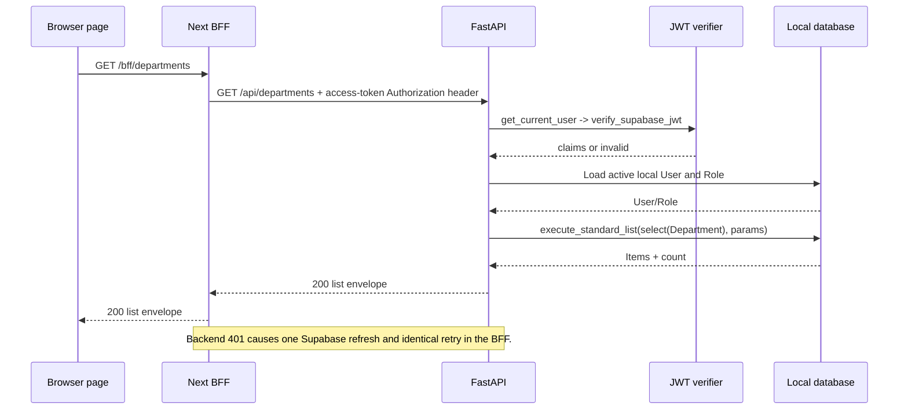

# API Architecture

> **Scope:** The FastAPI HTTP surface under `/api`, request/response conventions, authorization gates, and traced request sequences.
> **Audience:** API consumers, backend/frontend engineers, and reviewers validating endpoint behavior against source.
> **Related documents:** [Backend architecture](04-backend-architecture.md), [Authentication and authorization](08-authentication-authorization.md), [Audit and history](10-audit-and-history.md), [Error handling and recovery](15-error-handling-and-recovery.md)

## Status summary

| Area                           | Status              | Evidence-based state                                                                                                          |
| ------------------------------ | ------------------- | ----------------------------------------------------------------------------------------------------------------------------- |
| FastAPI `/api` surface         | **Implemented**     | `backend/app/main.py:create_app` includes the registered routers under `/api` and defines `/api/health`.                      |
| Resource list contract         | **Implemented**     | `backend/app/common/listing/schemas.py` and `query.py` provide the shared envelope, filters, ordering, count, and `has_more`. |
| Endpoint versioning            | **Documented Only** | No version segment or separate version negotiation is present in the reviewed route registration.                             |
| Conditional mutation semantics | **Unknown**         | The BFF forwards `If-Match`, but reviewed backend route signatures do not consume it; no backend ETag contract is evidenced.  |

## Route registration and endpoint inventory

All routes below are mounted beneath `/api`. Route prefixes and handlers come from `backend/app/main.py:create_app` and the cited router modules. “Admin” means the route uses `require_roles(UserRole.ADMIN)`; “AuthN” means it uses `get_current_user` without the admin role check.

| Group         | Implemented routes                                                                                                                                                                                                                                                                                                                                                       | Access and primary result                                                                                                                                                                                                                                    |
| ------------- | ------------------------------------------------------------------------------------------------------------------------------------------------------------------------------------------------------------------------------------------------------------------------------------------------------------------------------------------------------------------------ | ------------------------------------------------------------------------------------------------------------------------------------------------------------------------------------------------------------------------------------------------------------ |
| System        | `GET /health`                                                                                                                                                                                                                                                                                                                                                            | Anonymous; `200` health object.                                                                                                                                                                                                                              |
| Auth          | `POST /auth/invitations`, `GET /auth/me`                                                                                                                                                                                                                                                                                                                                 | Invitation is Admin and returns `201 UserResponse`; `me` is AuthN and returns `200 UserResponse`.                                                                                                                                                            |
| Users         | `GET /users`, `GET /users/{user_id}`, `POST /users`, `PATCH /users/{user_id}`, `DELETE /users/{user_id}`, `POST /users/{user_id}/restore`                                                                                                                                                                                                                                | All Admin. Lists return `UserListResponse`; create returns `201`; delete returns `204`; restore/update return `UserResponse`. `POST /users` sends an invitation.                                                                                             |
| Roles         | `GET /roles`, `GET /roles/{role_id}`, `POST /roles`, `PATCH /roles/{role_id}`, `DELETE /roles/{role_id}`, `POST /roles/{role_id}/restore`                                                                                                                                                                                                                                | All Admin. Lists return `RoleListResponse`; create returns `201`; delete returns `204`; role permissions are stored and returned.                                                                                                                            |
| Departments   | `GET /departments`, `GET /departments/{department_id}`, `POST /departments`, `PATCH /departments/{department_id}`, `DELETE /departments/{department_id}`, `POST /departments/{department_id}/restore`                                                                                                                                                                    | All Admin. Create returns `201`; ordinary delete discovery returns `409` with `code: close_required`; restore delegates to lifecycle reopen.                                                                                                                 |
| Modules       | `GET /modules`, `GET /modules/{module_id}`, `POST /modules`, `PATCH /modules/{module_id}`, `DELETE /modules/{module_id}`, `POST /modules/{module_id}/restore`, `POST /modules/{module_id}/schema/accept`                                                                                                                                                                 | All Admin. Create returns `201`; `DELETE` returns `409 close_required`; schema acceptance and restore return `ModuleResponse`.                                                                                                                               |
| Fields        | `GET /fields`, `GET /fields/{field_id}`, `POST /fields`, `PATCH /fields/{field_id}`, `DELETE /fields/{field_id}`, `POST /fields/{field_id}/restore`, `POST /modules/{module_id}/fields/reorder`                                                                                                                                                                          | All Admin. Create returns `201`; `DELETE` returns `409 close_required`; reorder returns a field array.                                                                                                                                                       |
| Records       | `GET /records`, `GET /records/{record_id}`, `POST /records`, `PATCH /records/{record_id}`, `DELETE /records/{record_id}`, `POST /records/{record_id}/restore`                                                                                                                                                                                                            | All Admin. Create returns `201`; delete returns `204`; create/update/restore return `RecordResponse`.                                                                                                                                                        |
| Relationships | `GET /relationships`, `GET /relationships/{relationship_id}`, `POST /relationships`, `DELETE /relationships/{relationship_id}`, `PUT /relationships/fields/{field_id}/sources/{source_record_id}`                                                                                                                                                                        | All Admin. Create returns `201`; delete returns `204`; assignment returns a relationship or `null` when clearing/no current edge.                                                                                                                            |
| Lifecycle     | Close preview/close/reopen for departments, modules, and fields; purge preview/purge for departments, modules, fields, and records. For example: `POST /departments/{department_id}/close/preview`, `POST /departments/{department_id}/close`, `POST /departments/{department_id}/reopen`, `POST /records/{record_id}/purge/preview`, `POST /records/{record_id}/purge`. | All Admin. Preview returns an impact plus one-time token; mutation returns `LifecycleMutationResponse`. Record close is rejected by the planner, and no record reopen lifecycle route is registered; record restore is under `/records/{record_id}/restore`. |
| Audit         | `GET /audit-logs`, `GET /audit-logs/{audit_log_id}`                                                                                                                                                                                                                                                                                                                      | All Admin. List returns `AuditLogListResponse`; detail returns `AuditLogResponse`. There is no audit mutation route.                                                                                                                                         |

The detailed handlers are in `backend/app/systems/auth/router.py`, `users/router.py`, `departments/router.py`, `modules/router.py`, `fields/router.py`, `records/router.py`, `relationships/router.py`, `lifecycle/router.py`, and `audit/router.py`.

## HTTP conventions

### Paths, payloads, and responses

- Resource IDs are parsed as UUID path parameters by FastAPI and the route functions.
- Request bodies are Pydantic models. Several models set `extra="forbid"`; field validators normalize usernames/emails or validate field metadata and data types before route logic.
- Successful collection responses use `{ "items": [...], "pagination": { "limit", "offset", "count", "total", "has_more" } }`, implemented by `StandardListResponse` and `execute_standard_list`.
- The shared list request defaults to `limit=25`, `offset=0`, ascending order, and `deleted=exclude`; `limit` is bounded to 1–100. Supported sort fields and search columns are defined per endpoint.
- Standard list search trims whitespace and is escaped before an `ILIKE` condition. Unsupported search/deleted filtering is returned as a `422` application validation error.
- Create routes conventionally return `201`; successful hard HTTP deletion responses use `204`. Soft-delete state remains represented in response models where a body is returned.
- Domain response models expose the common ID/timestamps/deletion/actor fields where their schema inherits or mirrors `BaseModel`.

Resource-specific list filters are implemented as follows:

| Group         | Additional filters and sorting                                                                                                                                                                  |
| ------------- | ----------------------------------------------------------------------------------------------------------------------------------------------------------------------------------------------- |
| Users         | `role_id`; sort by email, username, creation, or update; search email/username.                                                                                                                 |
| Roles         | Sort by role, creation, or update; search role.                                                                                                                                                 |
| Departments   | Sort by name, creation, or update; search department name.                                                                                                                                      |
| Modules       | `department_id`; sort by name, creation, or update; search module name.                                                                                                                         |
| Fields        | `module_id`, `type`, `required`; sort by name, position, creation, or update; search name.                                                                                                      |
| Records       | `module_id`; sort by creation or update; no search field.                                                                                                                                       |
| Relationships | Field/source/target/incident record IDs, source/target module IDs, and availability values `available`, `hidden`, or `all`; sort by creation or update.                                         |
| Audit logs    | `action`, `entity_type`, `entity_id`, `performed_by`, `request_id`, `created_after`, `created_before`; sort by action, creation, entity type, or request path; search entity type/request path. |

### Error response convention

Most route errors are `HTTPException` instances whose body is FastAPI’s `{ "detail": ... }` shape. Lifecycle errors use `{ "detail": { "code": ..., "message": ..., "blockers": [...] } }` where applicable. There is no application-wide exception handler in `create_app`; the status and detail are selected by each dependency, router, or service adapter. The complete origin/status/rollback mapping is in [Error handling and recovery](15-error-handling-and-recovery.md).

## Traced request sequences

### Protected list request and one refresh attempt

This sequence is implemented by `frontend/src/app/bff/[...path]/route.ts:handle`, `backend/app/common/dependencies/auth.py:get_current_user`, `backend/app/core/security/supabase.py:verify_supabase_jwt`, and `backend/app/common/listing/query.py:execute_standard_list`. A `403` role failure is not refreshed by the BFF.

### Audited record mutation

1. `frontend/src/lib/api.ts:apiFetch` sends the request to `/bff/records/{id}` with same-origin credentials.
2. The BFF reads the access cookie, forwards the selected request headers and an Authorization header containing the access token to `/api/records/{id}`. For a non-safe method it first checks same-origin headers.
3. FastAPI dependencies verify the access token, load an active local user/role, set the audit actor, and provide an `AuditSession`.
4. `backend/app/systems/records/router.py:update_record` validates the replacement-like JSONB data, locks the active module and record, assigns the data, and calls `db.commit()`.
5. `AuditSession` listeners capture the dirty model in `before_flush`, add a redacted `AuditLog` in `after_flush_postexec`, and commit both records together.
6. After commit, the listener makes a best-effort opaque Realtime invalidation request. The API response returns to the BFF, which forwards the status/body and selected response headers.

The same commit/listener sequence applies to other audited ORM mutations, with domain-specific validation and locking.

### Invitation request

1. An administrator calls `POST /api/auth/invitations` or `POST /api/users` with normalized email/username input and an optional active role ID.
2. `users.service:invite_user` calls the server-secret `SupabaseAdminClient:invite_user`.
3. The Supabase Auth invitation creates the external identity; the local profile is then reloaded, assigned the requested role, marked active, and committed.
4. On local finalization failure, the local transaction is rolled back and the service attempts to delete the newly invited Auth user before returning the route’s mapped error.
5. The invitation callback and password setup are frontend session routes, not backend `/api` routes; their relationship to this endpoint is described in [Authentication and authorization](08-authentication-authorization.md).

### Lifecycle close request

The close API is a two-request flow:

1. `POST /api/{target}/{id}/close/preview` plans the scope and impact, issues a five-minute challenge, commits the challenge state, and returns its plaintext token once.
2. `POST /api/{target}/{id}/close` checks the confirmation name, binds the token to actor/operation/target/digest, reserves a verification lease, verifies the password against Supabase without holding the database transaction open, and consumes the challenge.
3. The service replans and compares the impact digest, locks the complete scope in canonical order, recomputes the plan, transitions the rows to closed state, and commits. Drift, blockers, or lock/database failures abort the mutation.

The route implementation is `backend/app/systems/lifecycle/router.py:_preview`/`_close`; planning and execution are `backend/app/systems/lifecycle/planner.py:plan_lifecycle` and `backend/app/systems/lifecycle/service.py:verify_challenge`/`_execute`.

## Source grounding

- `backend/app/main.py:create_app` for `/api` registration and health.
- `backend/app/common/listing/schemas.py:StandardListRequest`, `PaginationMetadata`, and `StandardListResponse`.
- `backend/app/common/listing/query.py:execute_standard_list`.
- The router files listed in the endpoint inventory for the authoritative route methods and response models.
- `frontend/src/app/bff/[...path]/route.ts:handle` and `frontend/src/lib/api.ts:apiFetch` for the traced BFF path.
