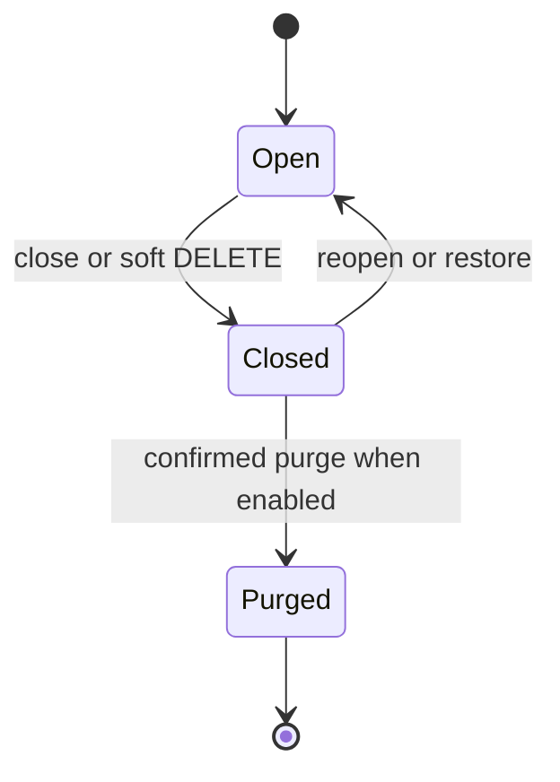
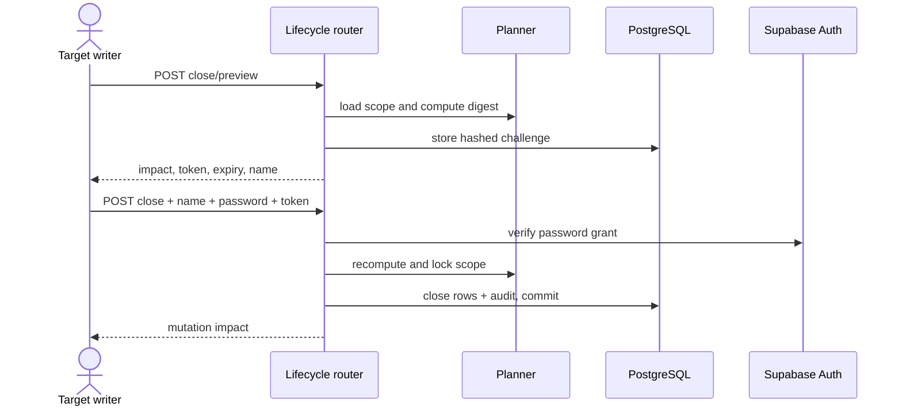

# Lifecycle and State Management

> **Scope:** Open/closed/purged entity states, transition rules, confirmation controls, cascades, and audit effects.
> **Audience:** Developers maintaining deletion, restoration, schema evolution, or lifecycle UI.
> **Related documents:** [Domain architecture](03-domain-architecture.md), [Data architecture](06-data-architecture.md), [Runtime flows](13-runtime-flows.md), [Audit and history](10-audit-and-history.md)

## State model

For `Department`, `Module`, `Field`, `Record`, `RelationshipEdge`, `Role`, and `User`, the shared persistence state is:

- **Open:** `is_deleted = false`, `deleted_at = null` by application convention.
- **Closed:** `is_deleted = true`, with `deleted_at` set by application operations.
- **Purged:** the row is physically deleted and cannot be restored by application code.

The database does not enforce consistency between `is_deleted` and `deleted_at`; routers and lifecycle services write both. “Closed” is the canonical documentation term even where API compatibility routes are named `DELETE` or `restore`.

User `status` is orthogonal: a non-closed user can be `pending`, `active`, or `disabled`. Authentication requires `active`, so an open-but-disabled user still cannot use protected APIs.

Purge is **Implemented but disabled by default** (`Settings.lifecycle_purge_enabled = false`). It is irreversible and has no general restore transition.

## Transition matrix

| Entity            | Close path                                                 | Reopen path                                                | Purge path               | Notes                                                                           |
| ----------------- | ---------------------------------------------------------- | ---------------------------------------------------------- | ------------------------ | ------------------------------------------------------------------------------- |
| Department        | Lifecycle close                                            | Lifecycle reopen                                           | Lifecycle purge          | Cascades plan across modules, fields, records, and touching edges.              |
| Module            | Lifecycle close                                            | Lifecycle reopen                                           | Lifecycle purge          | Includes fields and records; relationship impacts may cross the target subtree. |
| Field             | Lifecycle close                                            | Lifecycle reopen                                           | Lifecycle purge          | Record keys may be retained on close and stripped during purge planning.        |
| Record            | Direct soft `DELETE`                                       | Direct restore                                             | Lifecycle purge          | Record close through generic lifecycle is reported unsupported.                 |
| Relationship edge | Direct unlink/soft delete                                  | No restore route; assignment may create a replacement edge | Ordered dependency purge | Visibility also changes when dependencies close without edge mutation.          |
| User              | Direct soft delete/restore and enable/disable coordination | Restore/enable                                             | No lifecycle purge API   | Supabase Auth and local state are separate systems.                             |
| Role              | Direct soft delete/restore where allowed                   | Restore                                                    | No lifecycle purge API   | Built-in/protected-role rules are application-enforced.                         |

Sources: capability routers, `backend/app/systems/lifecycle/router.py`, `backend/app/systems/lifecycle/planning_scope.py`, `backend/app/systems/lifecycle/planning.py`, `backend/app/systems/lifecycle/planning_preflight.py`, `backend/app/systems/lifecycle/challenge_store.py`, `backend/app/systems/lifecycle/challenge_verification.py`, and `backend/app/systems/lifecycle/execution.py` (with compatibility exports from `planner.py` and `service.py`).

## Close preview and confirmation

Close is a two-request operation for departments, modules, and fields. Close and reopen require the target resource's write capability (`departments.write`, `modules.write`, or `fields.write`); purge preview and purge remain literal-`admin` operations.

### Preview

The planner loads the target hierarchy plus relationship edges that touch the planned rows. It computes:

- rows and their current fingerprints;
- external relationship impacts;
- record-key stripping impacts where relevant;
- blockers;
- a canonical SHA-256 impact digest.

Preview then stores a five-minute challenge containing only a SHA-256 token hash and its actor/operation/target/digest binding. Rate-limit and challenge rows are locked and cleaned before issuance. These support rows have audit disabled. Preview does not mutate the target.

### Password step-up

Confirmed close requires the exact confirmation name, challenge token, and current password. `challenge_store.begin_verification` locks the challenge, expires stale pending rows, and rejects both newly expired and already-`expired` rows before reserving a lease. It commits the lease before making the network call, so a database transaction is not held over password verification; expired challenges return `409` without invoking the password provider. A temporary Supabase password grant validates identity and is revoked; its access token is neither returned nor persisted.

Failed passwords increment challenge and rolling actor failure state. Expired, exhausted, already-verifying, actor-mismatched, or target-mismatched challenges fail without changing the target.

### Lock, replan, and commit

After password success, the service recomputes the plan. Execution locks rows with `FOR UPDATE NOWAIT` in stable order:

1. departments;
2. modules;
3. fields;
4. records;
5. relationship edges.

It recomputes again under lock and rejects digest drift or blockers. All planned open principal rows receive one UTC timestamp for `is_deleted = true`, `deleted_at`, and `updated_at`. Domain changes and generated audit logs commit together.

## Reopen

Reopen requires `{ "confirmed": true }` but no password challenge. The planner selects closed rows and checks:

- closed ancestors;
- active module-name conflicts;
- active field-name and position conflicts;
- effective module schema validity;
- active record-data validity.

Execution uses the same lock order and under-lock replan. Planned rows become open by setting `is_deleted = false` and `deleted_at = null`. Audit classifies reopen as `update`, because only the open-to-closed direction maps to audit action `delete`.

## Purge

Purge uses the preview/challenge/password pattern and additionally requires:

- backend purge configuration enabled;
- the target already closed;
- no unresolved external schema dependency or other blocker;
- unchanged impact digest.

The service physically deletes in dependency order: relationship edges, records, fields, modules, then departments. Database FKs are mostly `RESTRICT`; there is no ORM cascade that replaces this ordering. Physical deletion is still captured by the application audit listener before commit, but earlier audit records remain.

Purge exposure is controlled independently in the UI by `NEXT_PUBLIC_LIFECYCLE_PURGE_ENABLED`. The flag is commented out in `frontend/.env.example` and remains off in the supported deployment contract; showing the UI does not enable the backend operation.

## Relationship visibility through lifecycle

Closing a field, record, module, or department does not itself delete its relationship edges. Relationship responses calculate whether an included edge is `available` or `hidden` from field, record, and module state; collection deletion filters separately control whether a soft-deleted edge is included. Literal API reason values use legacy names such as `field_archived`; this documentation uses “closed” for lifecycle state. Department close affects visibility indirectly by closing descendants. Reopening all required dependencies can make an edge available again without updating the edge row.

Physical purge differs: edges that would violate FK restrictions are deleted first according to the approved purge plan.

## Record and schema evolution

- Closing a primitive field leaves its key/value in existing records.
- Record updates preserve closed-field values and reject attempts to alter them.
- Reopening a field checks field identity/position conflicts and validates the resulting schema and records.
- Purging a field may strip its UUID key from record JSON as a planned mutation.
- Field creation, an effective API field update, or a changed reorder can invalidate module schema acceptance. Lifecycle field close/reopen also invalidates acceptance under the existing parent-module lock; reopen preflight still validates the effective schema and records.
- Record creation rejects zero-active-field modules even if an old acceptance flag remains true. No historical records or flags are rewritten.

## Failure and recovery behavior

| Failure                                          | Result |
| ------------------------------------------------ | ------ |
| Missing target/challenge                         | `404`  |
| Confirmation mismatch/invalid request            | `422`  |
| State conflict, blocker, expiry, or impact drift | `409`  |
| Wrong actor/password or purge disabled           | `403`  |
| Password rate limit                              | `429`  |
| Lock or password-service unavailability          | `503`  |

Challenge/password-state commits are separate from the final domain transaction. A consumed challenge followed by impact drift requires a new preview. Final execution failures roll back domain and audit writes together. Post-commit Realtime failure does not roll back the committed state.

## Source references

- `backend/app/systems/lifecycle/router.py`
- `backend/app/systems/lifecycle/planning_scope.py:load_lifecycle_scope`, `LifecyclePlan`, and canonical digest helpers
- `backend/app/systems/lifecycle/planning.py:plan_lifecycle`, `impact_response`
- `backend/app/systems/lifecycle/planning_preflight.py:reopen_blockers`
- `backend/app/systems/lifecycle/challenge_store.py:issue_challenge`, `begin_verification`
- `backend/app/systems/lifecycle/challenge_verification.py:verify_challenge`, `consume_challenge`
- `backend/app/systems/lifecycle/execution.py:execute_lifecycle`, `close_lifecycle`, `reopen_lifecycle`, `purge_lifecycle`
- `backend/app/systems/lifecycle/planner.py` and `service.py` compatibility exports
- `backend/app/systems/lifecycle/password.py:SupabasePasswordGrantClient`
- `backend/app/systems/lifecycle/models.py`
- `backend/app/systems/audit/listeners.py`
- `frontend/src/components/lifecycle-dialog.tsx`
