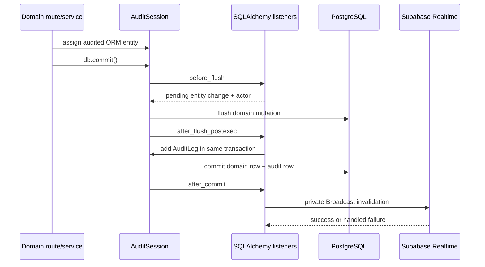

# Audit and History

> **Scope:** ORM audit capture, the append-only security-event ledger, transactions, snapshots/redaction, immutability, audit reads, and post-commit Realtime invalidation.
> **Audience:** Backend engineers, security reviewers, compliance reviewers, and operators tracing a recorded mutation.
> **Related documents:** [Backend architecture](04-backend-architecture.md), [Data architecture](06-data-architecture.md), [Runtime flows](13-runtime-flows.md), [Security architecture](14-security-architecture.md)

## Status summary

| Area                        | Status                                                 | Evidence-based state                                                                                                           |
| --------------------------- | ------------------------------------------------------ | ------------------------------------------------------------------------------------------------------------------------------ |
| Normal ORM mutation capture | **Implemented**                                        | `AuditSession` SQLAlchemy listeners capture new, dirty, and deleted audited instances.                                         |
| Same-transaction audit rows | **Implemented**                                        | Audit rows are added after flush and commit with the business mutation.                                                        |
| Minimal redacted snapshots  | **Implemented**                                        | `backend/app/systems/audit/snapshots.py` omits metadata and records changed values/diffs with sensitive-key redaction plus dynamic `Field.audit_redacted` redaction for newly created Record audit snapshots. Historical clear snapshots are not remediated. |
| AuditLog immutability       | **Implemented**                                        | The model is not a `BaseModel`; listeners reject dirty/deleted logs and non-internal inserts.                                  |
| Security event ledger       | **Implemented**                                        | `SecurityEvent` is a separate append-only model; one trusted writer feeds internal ingestion, while listeners reject ordinary ORM mutations. |
| Application audit boundary  | **Implemented for `AuditSession`; Unknown outside it** | The listener is attached to the application session class; no capture claim is made for clients or systems outside that class. |
| Post-commit invalidation    | **Implemented, best effort**                           | The backend publishes an opaque private Broadcast invalidation after commit and swallows notification failure.                 |

## Audit model and read API

`backend/app/systems/audit/models.py:AuditLog` is the immutable `audit_logs` model. It records:

- `id` and `created_at`.
- `performed_by` for the local actor, nullable if the actor is unavailable or later removed.
- `action`, constrained to `create`, `update`, or `delete`.
- `entity_type` and nullable `entity_id`.
- Nullable JSONB `before` and `after` snapshots.
- `request_id`, `request_method`, and `request_path` from the request-scoped `AuditContext`.
- Nullable `actor_label` and `note` metadata fields.

`AuditLog` has `__audit_enabled__ = False`, does not inherit `BaseModel`, and has no soft-delete/update lifecycle fields. It is read through the administrator-only `GET /api/audit-logs`, `GET /api/audit-logs/export`, and `GET /api/audit-logs/{audit_log_id}` routes in `backend/app/systems/audit/router.py`. `backend/app/systems/audit/service.py:list_audit_logs` supports filtering by action, entity, actor, request, and creation time, plus the standard list envelope and sorting. `GET /audit-logs/export` shares those filters and returns a bounded JSON array of at most 100 rows (`AuditLogExportRequest` limit 1–100, default 100).

`SecurityEvent` is a separate `security_events` model with occurrence time, event type, outcome, source, operation correlation, optional actor/subject IDs, bounded labels/metadata, and request context. Actor/subject IDs are immutable UUID snapshots without user foreign keys (migration `2c5bf7bc78fe` drops `fk_security_events_actor_id_users` and `fk_security_events_subject_id_users`); they do not cascade, null, or join to `users`. It does not inherit `BaseModel`, is not emitted as an `AuditLog`, and has no ordinary CRUD route. `append_security_event` is the trusted application writer, while request-facing flows use `append_committed_security_event` (independent-session durable commit). Exact-admin list/detail/export routes expose the ledger, with `operation_id` filtering, standard offset pagination, and a bounded JSON export of at most 100 events. The internal ingestion route requires the typed `SECURITY_EVENT_SERVER_KEY` setting and constant-time key comparison. The ledger is append-only through the application listener; direct database access remains outside that boundary and can insert misleading rows (see R3).

The ordinary listener populates request/actor columns but does not populate `actor_label` or `note`; no application mutation route in the reviewed source supplies those fields.

## Transaction and listener sequence

`backend/app/core/database/session.py:AuditSession` imports the listener module when a session is constructed. `get_db` places an `AuditContext` in `session.info` using the `RequestContext` request ID/method/path. `get_current_user` later sets `performed_by` after local AuthN succeeds.

The listener lifecycle is:

1. `before_flush` (`capture_changes`) rejects attempts to dirty/delete an `AuditLog`, rejects direct non-internal `AuditLog` creation, and rejects ordinary `SecurityEvent` insert/update/delete attempts.
2. For each new audited instance, it sets `performed_by` and records a pending `CREATE`.
3. For each dirty audited instance with column history, it records `UPDATE`, or `DELETE` when the change is the `is_deleted: false -> true` soft-delete transition.
4. For explicitly deleted audited instances, it records `DELETE`.
5. `after_flush_postexec` (`create_audit_logs`) turns pending changes into `AuditLog` rows and adds them to the same session. A realtime-pending flag is set in `session.info`.
6. `after_rollback` clears both pending state and the realtime-pending flag.
7. `after_commit` (`broadcast_committed_changes`) publishes one opaque data invalidation if the flag was set.

If the domain commit or audit insert fails, the transaction does not produce a committed pair. The individual domain commit helpers translate selected `IntegrityError`/`OperationalError` failures after rollback; listener `RuntimeError` guards are not replaced by a global handler.

## Snapshot and redaction behavior

`backend/app/systems/audit/snapshots.py` applies these rules:

- `id`, `created_at`, `updated_at`, and `performed_by` are metadata and are excluded from serialized entity snapshots.
- A create stores an `after` snapshot. An explicit delete stores a `before` snapshot with default deletion state included.
- An update stores only fields whose SQLAlchemy history changed. `build_update_snapshot` recursively diffs mapping values, so JSONB updates can contain nested before/after deltas rather than a complete record copy.
- The soft-delete transition is represented as an audited delete with the changed deletion fields in the update-style snapshot.
- A key is sensitive when it is in the model’s `__audit_redacted_fields__` set or its normalized name contains `password`, `token`, `secret`, `api_key`, `credential`, or `private_key`.
- Sensitive values and unsupported binary/object values serialize as `[REDACTED]`. UUIDs, dates, datetimes, enums, mappings, and lists receive JSON-compatible serialization.
- Model-specific redacted fields are read from the entity type by `serialize_record` and `build_update_snapshot`.
- Dynamic Record redaction: `backend/app/systems/audit/listeners.py:_record_redacted_fields` loads the current `Field.audit_redacted` set for the flushed Record modules in one query (no `is_deleted` filter, so renamed and soft-deleted fields are included) and passes those field-UUID strings as `redacted_fields` for newly created Record audit snapshots (create/update/delete). UUID-keyed `Record.data` values whose key is flagged are stored as `[REDACTED]` in the new `AuditLog` row only. This does not change `Record.data`, does not rewrite historical `AuditLog` rows, and does not backfill previously stored clear values. Name-based markers still do not match UUID keys, so only the explicit flag redacts dynamic values. Historical remediation was not performed and requires separate approval.

The snapshot contract intentionally records a minimal before/after diff, not a full historical version of every row at every timestamp.

## Immutability and mutation boundary

The capture boundary is the `AuditSession` ORM event set:

- `AuditLog` is excluded from normal capture and cannot recursively generate audit rows.
- `SecurityEvent` is excluded from normal capture; only `append_security_event` marks a new event as an allowed append, and dirty/deleted events remain rejected.
- `before_flush` raises `RuntimeError("Audit logs are immutable")` if an audit row is dirty or deleted.
- A new `AuditLog` is accepted only when the audit system marks it internal with `_audit_internal`.
- `do_orm_execute` rejects every non-`SELECT` ORM execution, preventing bulk/raw ORM mutation paths from bypassing per-instance listener capture. Normal application writes therefore use individual audited model mutations.
- A rollback clears pending audit and invalidation state so a failed transaction does not leave a later commit with stale pending changes.

The listener does not establish capture for Supabase Auth, Supabase Studio, Alembic, direct SQL, Data API operations, or external database clients. Those are outside the `AuditSession` event boundary; their audit status is **Unknown** from this application listener.

## Realtime invalidation

After a successful audited commit, `backend/app/systems/audit/listeners.py:broadcast_committed_changes` calls `broadcast_invalidation(InvalidationEvent(entity="data"))`. `backend/app/core/integrations/supabase.py:SupabaseAdminClient.broadcast` sends:

- Topic: `openslate:invalidation`.
- Event: `invalidate`.
- Private broadcast request.
- Payload: `{ "type": "data" }` for the listener path; no row snapshot is included.

The backend catches `SupabaseAdminError` from this post-commit call and does not turn it into a failed domain response or roll back the already committed transaction. The database and audit log remain canonical. The frontend `frontend/src/components/realtime-provider.tsx` subscribes to this topic and dispatches a browser invalidation event; `frontend/src/components/app-page.tsx:AppPage` increments an invalidation generation so the `AppShell` subtree remounts. That consumer behavior is included only to explain the end-to-end invalidation path.

## Source grounding

- `backend/app/core/database/session.py:AuditSession` and `get_db`.
- `backend/app/core/middleware/request_context.py:RequestContext`.
- `backend/app/systems/audit/context.py:AuditContext`, `get_audit_context`, and `set_audit_actor`.
- `backend/app/systems/audit/listeners.py:capture_changes`, `create_audit_logs`, `_record_redacted_fields`, `clear_pending_changes`, `broadcast_committed_changes`, and `reject_bulk_mutations`.
- `backend/app/systems/audit/snapshots.py:serialize_record`, `build_update_snapshot`, and `serialize_value`.
- `backend/app/systems/audit/models.py:AuditLog` and `AuditAction`.
- `backend/app/systems/audit/models.py:SecurityEvent` and `SecurityEventOutcome`; migration `2c5bf7bc78fe` for dropped user FKs; `backend/app/systems/fields/models.py:Field.audit_redacted` and migration `fc105d5b6283`.
- `backend/app/systems/audit/router.py` and `service.py:list_audit_logs`, `append_security_event`, `append_committed_security_event`, and `list_security_events`.
- `backend/app/core/integrations/supabase.py:InvalidationEvent`, `SupabaseAdminClient.broadcast`, and `broadcast_invalidation`.
