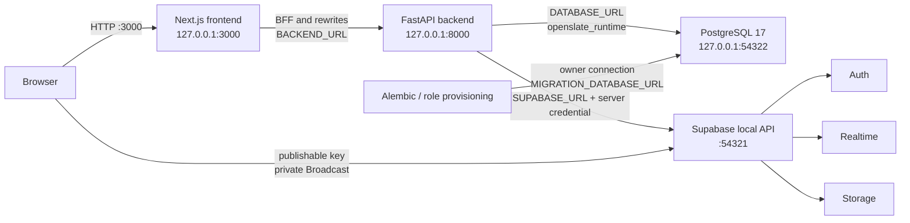

# Infrastructure Architecture

> **Scope:** The implemented local runtime topology, service boundaries, ports, containers, and operational start/stop order.
> **Audience:** Developers and operators running OpenSlate locally or inspecting its infrastructure boundary.
> **Related documents:** [Deployment](12-deployment-architecture.md), [Configuration](17-configuration.md), [Observability](18-observability.md), [Architecture index](README.md)

## State classifications

- **Implemented** means the behavior is represented by checked-in configuration or source.
- **Partially implemented** means the local path exists but a related capability is only a foundation or is not wired into the application.
- **Absent** means no supported implementation is present in this repository.
- **Unknown** means the repository does not define the behavior, target, or operating procedure.

## Actual local topology — Implemented

The supported development topology is two host-run application processes plus the
Supabase CLI local platform. Supabase CLI manages the local Docker containers;
there is no checked-in application Compose file or container orchestration layer.

The source of truth for the configured local platform is
`supabase/config.toml`. The source of truth for the currently published bindings
is `supabase status`; the configured values below are the documented defaults,
not a report of a currently running process.

| Service or surface                       | Local binding                                                               | State                            | Concrete source and boundary                                                                                                                                                                     |
| ---------------------------------------- | --------------------------------------------------------------------------- | -------------------------------- | ------------------------------------------------------------------------------------------------------------------------------------------------------------------------------------------------ |
| Next.js development server               | `127.0.0.1:3000`                                                            | Implemented                      | Root `README.md` starts `npm run dev -- --hostname 127.0.0.1`; `frontend/next.config.ts` supplies backend rewrites.                                                                              |
| FastAPI/Uvicorn                          | `127.0.0.1:8000` in the host workflow                                       | Implemented                      | `backend/app/main.py:app`; root `README.md` starts Uvicorn on port 8000.                                                                                                                         |
| Supabase API gateway, including Auth API | `127.0.0.1:54321`                                                           | Implemented                      | `[api].port` and `[auth].enabled` in `supabase/config.toml`; `SUPABASE_URL` is consumed by `backend/app/core/integrations/supabase.py`.                                                          |
| PostgreSQL 17                            | `127.0.0.1:54322`                                                           | Implemented                      | `[db].major_version` and `[db].port`; backend runtime and migration URLs use this local database.                                                                                                |
| PostgreSQL shadow database               | `127.0.0.1:54320`                                                           | Implemented by CLI configuration | `[db].shadow_port`; no application code connects to it directly.                                                                                                                                 |
| Supabase Studio                          | `127.0.0.1:54323`                                                           | Implemented                      | `[studio]` in `supabase/config.toml`; it is an operator UI, not the application data API.                                                                                                        |
| Mailpit local SMTP UI/service            | `127.0.0.1:54324`                                                           | Implemented                      | `[local_smtp]`; invitation mail is delivered here by local Auth.                                                                                                                                 |
| Supabase Storage                         | Supabase local platform surface; no separate application port is configured | Partially implemented            | `[storage]` enables it; migration `backend/migrations/versions/20260819_0010_supabase_cutover.py` creates the private `openslate-files` bucket, but no file API or object policy is implemented. |
| Supabase Realtime                        | Supabase local API surface; no table publication is configured              | Partially implemented            | `[realtime].enabled`; migration 0010 and `frontend/src/components/realtime-provider.tsx` use private Broadcast only.                                                                             |

The ports are published by Supabase CLI-managed containers. The repository does
not define container names, host volume mappings, or a second database service.

## Service and trust boundaries — Implemented

1. **Browser to frontend.** The browser reaches Next.js on port 3000. Browser
   code receives only `NEXT_PUBLIC_SUPABASE_URL` and the publishable key. Auth
   access and refresh tokens are kept in HttpOnly cookies by the Next.js session
   handlers (`frontend/src/lib/auth-cookies.ts`).
2. **Frontend to backend.** The BFF at
   `frontend/src/app/bff/[...path]/route.ts` reads the access cookie, forwards
   selected headers and the access token to `BACKEND_URL`, retries one backend
   `401` with a Supabase refresh, and clears cookies on failed refresh. The
   Next.js rewrites in `frontend/next.config.ts` also map `/api/*` and backend
   documentation paths to the backend URL.
3. **Backend to database.** FastAPI creates its SQLAlchemy engine from
   `DATABASE_URL` (`backend/app/core/database/session.py:get_engine`). The
   runtime login is the provisioned `openslate_runtime` role, which inherits
   `openslate_app`; migrations use the owner-capable
   `MIGRATION_DATABASE_URL` path instead.

   Provisioning verifies unsafe direct role attributes and grants `openslate_app`, but it does not enumerate or remove unexpected pre-existing role memberships.

4. **Backend to Supabase control surfaces.**
   `backend/app/core/integrations/supabase.py:SupabaseAdminClient` uses the
   server-only Supabase secret for Auth administration and post-commit Realtime
   invalidation. JWT verification obtains keys from the configured JWKS URL in
   `backend/app/core/security/supabase.py`.
5. **Application data API boundary.** `supabase/config.toml` exposes only
   `graphql_public` to the Supabase API. The application schema is owned and
   accessed by FastAPI through SQLAlchemy; PostgREST/Data API, Studio, direct
   SQL, Alembic, and external clients are outside the application audit path.
6. **Realtime boundary.** Migration 0010 enables RLS on
   `realtime.messages`, permits authenticated receipt only for the
   `openslate:invalidation` topic, and grants no authenticated insert/update/
   delete access. The backend sends opaque invalidation payloads after commit;
   the frontend refetches through the application API.
7. **Storage boundary.** Storage is the only file-storage foundation. The
   bucket is private, and no root `storage/` mount, application file route, or
   object policy is present.

## Configured Supabase services — Implemented or explicit absence

Enabled local services are Auth, Realtime, Storage, Studio, Mailpit, the API
gateway, and PostgreSQL. The following configured absences are intentional in
the checked-in local platform:

| Surface                                     | State                                | Evidence                                                                                                           |
| ------------------------------------------- | ------------------------------------ | ------------------------------------------------------------------------------------------------------------------ |
| Database pooler                             | Absent                               | `[db.pooler].enabled = false`; its configured port is not a running service.                                       |
| Supabase Edge Runtime                       | Absent                               | `[edge_runtime].enabled = false`.                                                                                  |
| Supabase analytics                          | Absent                               | `[analytics].enabled = false` and `[storage.analytics].enabled = false`.                                           |
| Storage S3 protocol                         | Absent                               | `[storage.s3_protocol].enabled = false`.                                                                           |
| Storage vector support                      | Absent                               | `[storage.vector].enabled = false`.                                                                                |
| Supabase migrations                         | Absent as an application-schema path | `[db.migrations].enabled = false`; Alembic owns the schema.                                                        |
| Supabase seed files                         | Absent as a supported seed contract  | `[db.seed].enabled = false`; sample data is sent through the FastAPI API by `backend/scripts/seed_sample_data.py`. |
| Application workers, queues, and schedulers | Absent                               | No worker entry point, queue configuration, or scheduler is checked in.                                            |
| Reverse proxy or TLS terminator             | Absent                               | `infra/caddy/` is empty; local API TLS is disabled and the host processes bind directly.                           |
| Root container orchestration                | Absent                               | No Compose, Kubernetes, Helm, Terraform, Pulumi, or CDK configuration is present.                                  |

## Local start and stop order — Implemented

The documented sequence in `README.md` and `AGENTS.md` is:

1. From the repository root, run `supabase start`.
2. Run `supabase status -o env` and map the non-secret names to the ignored
   root `.env`; do not commit the status output.
3. From `backend/`, run `uv sync` and `uv run alembic upgrade head`.
4. Run `uv run python scripts/provision_database_role.py`, then point
   `DATABASE_URL` at the provisioned runtime login.
5. Run `uv run python scripts/bootstrap_admin.py --email <email> --username
<username>` and retrieve the invitation in Mailpit.
6. Start FastAPI/Uvicorn in `backend/`.
7. Export the root environment in `frontend/` and start Next.js.

Uvicorn import does not run migrations, database-role provisioning, or admin
bootstrap: `backend/app/main.py` has no lifespan or startup hook. To stop the
stack, stop the two host processes and run `supabase stop`. A destructive local
reset is the separate sequence `supabase db reset` followed by
`uv run alembic upgrade head`; role provisioning and administrator bootstrap
are separate operations again if the reset removed them.

## Application images — Implemented, not part of local startup

`infra/docker/backend.Dockerfile` and `infra/docker/frontend.Dockerfile` are
standalone production-style image definitions. They are not referenced by a
local orchestration file or a deployment workflow. Their build and runtime
details are described in [`12-deployment-architecture.md`](./12-deployment-architecture.md).
