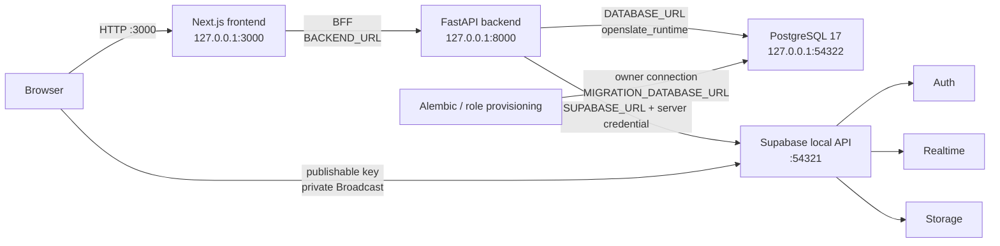

# Infrastructure Architecture

> **Scope:** The implemented local runtime topology, service boundaries, ports, containers, and operational start/stop order.
> **Audience:** Developers and operators running OpenSlate locally or inspecting its infrastructure boundary.
> **Related documents:** [Deployment](12-deployment-architecture.md), [Configuration](17-configuration.md), [Observability](18-observability.md), [Architecture index](README.md)

## State classifications

- **Implemented** means the behavior is represented by checked-in configuration or source.
- **Partially implemented** means the local path exists but a related capability is only a foundation or is not wired into the application.
- **Absent** means no supported implementation is present in this repository.
- **Unknown** means the repository does not define the behavior, target, or operating procedure.

## Actual local topology — Implemented

Local development supports host-run application processes or root `compose.yaml`
services for backend, frontend, and ClamAV. Supabase CLI separately manages the
platform containers in both workflows. See the root README for Compose setup
and individual service commands. Compose does not apply migrations, provision
identities, update scanner definitions, or start a file worker.



The source of truth for the configured local platform is
`supabase/config.toml`. The source of truth for the currently published bindings
is `supabase status`; the configured values below are the documented defaults,
not a report of a currently running process.

| Service or surface                       | Local binding                                                               | State                            | Concrete source and boundary                                                                                                                                                                     |
| ---------------------------------------- | --------------------------------------------------------------------------- | -------------------------------- | ------------------------------------------------------------------------------------------------------------------------------------------------------------------------------------------------ |
| Next.js development server               | `127.0.0.1:3000`                                                            | Implemented                      | Root `README.md` starts `npm run dev -- --hostname 127.0.0.1`; application data uses the `/bff/*` Route Handler.                                                                                 |
| FastAPI/Uvicorn                          | `127.0.0.1:8000` in the host workflow                                       | Implemented                      | `backend/app/main.py:app`; root `README.md` starts Uvicorn on port 8000.                                                                                                                         |
| Supabase API gateway, including Auth API | `127.0.0.1:54321`                                                           | Implemented                      | `[api].port` and `[auth].enabled` in `supabase/config.toml`; `SUPABASE_URL` is consumed by `backend/app/core/integrations/supabase.py`.                                                          |
| PostgreSQL 17                            | `127.0.0.1:54322`                                                           | Implemented                      | `[db].major_version` and `[db].port`; backend runtime and migration URLs use this local database.                                                                                                |
| PostgreSQL shadow database               | `127.0.0.1:54320`                                                           | Implemented by CLI configuration | `[db].shadow_port`; no application code connects to it directly.                                                                                                                                 |
| Supabase Studio                          | `127.0.0.1:54323`                                                           | Implemented                      | `[studio]` in `supabase/config.toml`; it is an operator UI, not the application data API.                                                                                                        |
| Mailpit local SMTP UI/service            | `127.0.0.1:54324`                                                           | Implemented                      | `[local_smtp]`; invitation mail is delivered here by local Auth.                                                                                                                                 |
| Supabase Storage                         | Supabase local platform surface; no separate application port is configured | Implemented application integration | The private `openslate-files` bucket is accessed by `backend/app/systems/files/storage.py`; FastAPI owns authorization and no browser object policy grants access. |
| Supabase Realtime                        | Supabase local API surface; no table publication is configured              | Partially implemented            | `[realtime].enabled`; migration 0010 and `frontend/src/components/realtime-provider.tsx` use private Broadcast only.                                                                             |

The ports are published by Supabase CLI-managed containers. The repository does
not define container names, host volume mappings, or a second database service.

## Service and trust boundaries — Implemented

1. **Browser to frontend.** The browser reaches Next.js on port 3000. Browser
   code receives only `NEXT_PUBLIC_SUPABASE_URL` and the publishable key. Auth
   access and refresh tokens are kept in HttpOnly cookies by the Next.js session
   handlers (`frontend/src/lib/auth-cookies.ts`).
2. **Frontend to backend.** The BFF at
   `frontend/src/app/bff/[...path]/route.ts` reads the access cookie, forwards
   selected headers and the access token to `BACKEND_URL`, retries one backend
   `401` with a Supabase refresh, and clears cookies on failed refresh. The
   frontend has no direct Next.js `/api/*` or backend documentation rewrites.
3. **Backend to database.** FastAPI creates its SQLAlchemy engine from
   `DATABASE_URL` (`backend/app/core/database/session.py:get_engine`). The
   runtime login is the provisioned `openslate_runtime` role, which inherits
   `openslate_app`; migrations use the owner-capable
   `MIGRATION_DATABASE_URL` path instead.

    Provisioning verifies the constrained runtime and `openslate_app` role
    attributes, creates a non-delegable direct membership edge with
    `INHERIT TRUE`/`SET FALSE` when the catalog supports those options, and
    fails on any unexpected recursive membership without revoking drift.

4. **Backend to Supabase control surfaces.**
   `backend/app/core/integrations/supabase.py:SupabaseAdminClient` uses the
   server-only Supabase secret for Auth administration and post-commit Realtime
   invalidation. JWT verification obtains keys from the configured JWKS URL in
   `backend/app/core/security/supabase.py`.
5. **Application data API boundary.** `supabase/config.toml` exposes only
   `graphql_public` to the Supabase API. The application schema is owned and
   accessed by FastAPI through SQLAlchemy; PostgREST/Data API, Studio, direct
   SQL, Alembic, and external clients are outside the application audit path.
6. **Realtime boundary.** Migration 0010 enables RLS on
   `realtime.messages`, permits authenticated receipt only for the
   `openslate:invalidation` topic, and grants no authenticated insert/update/
   delete access. The backend sends opaque invalidation payloads after commit;
   the frontend refetches through the application API.
7. **Storage boundary.** FastAPI owns private file metadata, upload and download.
   Storage keys are immutable and objects remain quarantined until the serial
   worker records a matching clean verdict. Browsers never receive Storage
   credentials or direct object URLs.
8. **Scanning boundary.** The worker reads exact stored bytes and streams them
   through `clamdpy` to a private ClamAV container. The engine receives no
   application credentials, database connection, or writable application mount.

## Configured Supabase services — Implemented or explicit absence

Enabled local services are Auth, Realtime, Storage, Studio, Mailpit, the API
gateway, and PostgreSQL. The following configured absences are intentional in
the checked-in local platform:

| Surface                                     | State                                | Evidence                                                                                                           |
| ------------------------------------------- | ------------------------------------ | ------------------------------------------------------------------------------------------------------------------ |
| Database pooler                             | Absent                               | `[db.pooler].enabled = false`; its configured port is not a running service.                                       |
| Supabase Edge Runtime                       | Absent                               | `[edge_runtime].enabled = false`.                                                                                  |
| Supabase analytics                          | Absent                               | `[analytics].enabled = false` and `[storage.analytics].enabled = false`.                                           |
| Storage S3 protocol                         | Absent                               | `[storage.s3_protocol].enabled = false`.                                                                           |
| Storage vector support                      | Absent                               | `[storage.vector].enabled = false`.                                                                                |
| Supabase migrations                         | Absent as an application-schema path | `[db.migrations].enabled = false`; Alembic owns the schema.                                                        |
| Supabase seed files                         | Absent as a supported seed contract  | `[db.seed].enabled = false`; sample data is sent through the FastAPI API by `backend/scripts/seed_sample_data.py`. |
| File scanner worker                         | Implemented entry point              | `python -m app.systems.files.worker` processes the durable file queue. There is no general scheduler or broker. |
| Reverse proxy or TLS terminator             | Absent                               | `infra/caddy/` is empty; local API TLS is disabled and the host processes bind directly.                           |
| Local container orchestration | Implemented | Existing root `compose.yaml` starts backend/frontend/ClamAV through `scripts/environment.py compose`; Supabase stays CLI-managed. No Kubernetes or hosted infrastructure is defined. |

## Local start and stop order — Implemented

The sequence in `README.md` is:

1. Create root `.env` from `.env.example` for a new checkout; configure stack
   ports before `supabase start`. Supabase TOML uses explicit `env(NAME)` values.
2. Read `supabase status -o env` privately and fill the canonical secrets. Set
   owner and runtime database URLs separately, storing each password only in
   its URL. Fill the administrator identity/local test credential group.
3. From `backend/`, run `uv sync --locked`, `uv run alembic upgrade head`, and
   `uv run alembic check`.
4. Run `uv run python scripts/provision_database_role.py`; it reads the runtime
   password from `DATABASE_URL` using the owner connection for provisioning.
5. For a new installation, run `uv run python scripts/bootstrap_admin.py`, using
   configured `ADMIN_EMAIL` and `ADMIN_USERNAME`, then accept the Mailpit invitation.
6. Start the backend with `uv run python -m app --reload`.
7. From `frontend/`, run `npm ci` and `npm run dev`. The launcher regenerates a
   fixed frontend-only `.env.local` from root `.env`; never source root secrets
   into the frontend process.

Uvicorn import does not run migrations, database-role provisioning, or admin
bootstrap. The lifespan in `backend/app/main.py` configures logging and disposes
readiness/database resources on shutdown. To stop the
stack, stop the two host processes and run `supabase stop`. A destructive local
reset is the separate sequence `supabase db reset` followed by
`uv run alembic upgrade head`; role provisioning and administrator bootstrap
are separate operations again if the reset removed them.

## Application images — Implemented

`infra/docker/backend.Dockerfile` and `infra/docker/frontend.Dockerfile` are
standalone production-style image definitions used by root `compose.yaml` for
optional local container startup. Their build and runtime
details are described in [`12-deployment-architecture.md`](./12-deployment-architecture.md).

## Automatic file scanning — container operating procedure

The initial scanner operating model is hosted and operator-managed. This does
not provision a hosting platform or change the supported Supabase CLI development
path. `infra/docker/clamav.Dockerfile` pins the official ClamAV 1.4.6 LTS Linux
amd64 image by digest. `clamdpy==0.2.0` is the backend client dependency. Retain
their license notices and the built image's package/license inventory in the
deployment record; customer redistribution is outside this operating model.

`infra/clamav/clamd.conf` fixes serial scanning (`MaxThreads=1`, `MaxQueue=2`),
25-MiB input, 100-MiB expanded scan size, 2,048 contained files and recursion 10.
PDF, Office XML, archive and image inspection are enabled. Limit and encryption
alerts reject the file under inspection policy. `MaxScanTime` in this engine
version covers ZIP processing only. The backend gives the SDK client a bounded
60-second process deadline; terminating that client does not prove remote scan
termination. No scan hook, debug file retention, live definition reload or
FreshClam daemon runs in the serving container.

The engine must have a read-only root, a read-only definition mount, no added
capabilities, no new privileges, 4 GiB memory, 2 CPUs and a 128-MiB temporary
filesystem. It runs as UID 100/GID 101. Its network is internal and has only the
worker and engine attached; do not publish its configured `FILES_CLAMAV_PORT`. Clamd TCP has no built-in
authentication ([official documentation](https://docs.clamav.net/manual/Usage/Scanning.html)).
The worker also attaches to the existing application network for PostgreSQL and
Storage; the engine does not. The disposable test runner follows the same
engine isolation boundary and uses a containerized SDK client and worker.
Use `--log-driver none` on the serving engine, with no file or syslog logging,
so ordinary detection names are not retained. Report sanitized readiness,
failure categories, worker exits and queue state through application operations.

### Daily definition maintenance and first provisioning

Use a new candidate directory on the deployment host and preserve the previous
verified directory. The examples assume repository-root build context and
operator-selected absolute paths. `SCANNER_DEFINITIONS` and
`SCANNER_DEPLOYMENT_RECORD` contain public definitions/metadata, never secrets.

1. Stop the worker, then stop the engine. Wait for both containers to exit and
   inspect their `State.Running` values; both must be false. If graceful stop
   cannot finish, terminate the old engine container and confirm exit. Never
   start another worker while the old engine may still execute a request.
   After confirming exit, remove the old worker and engine containers before
   recreating their names below; preserve the previous definition directory.
   First provisioning has no existing scanner containers to stop or remove.
2. Build the scanner artifact and record its immutable image ID. Create a fresh
   candidate directory, optionally copying the previous verified definitions
   into it. Make only this candidate writable by UID 100/GID 101. Run the
   official updater once, with outbound access to the official definition feed:

   ```sh
   docker build --platform linux/amd64 -f infra/docker/clamav.Dockerfile -t openslate-clamav:verified .
   docker run --rm --platform linux/amd64 --user 100:101 --read-only \
     --cap-drop ALL --security-opt no-new-privileges --memory 4g --cpus 2 \
     --pids-limit 64 --tmpfs /tmp:rw,noexec,nosuid,size=128m,uid=100,gid=101,mode=1770 \
     --mount "type=bind,src=$SCANNER_DEFINITIONS,dst=/var/lib/clamav" \
     --entrypoint /usr/bin/freshclam openslate-clamav:verified \
     --config-file=/etc/clamav/openslate-freshclam.conf
   ```

3. Require updater success and validate every `.cvd`/`.cld` using the image's
   `sigtool --info`. FreshClam's `TestDatabases yes` loads candidate definitions
   before accepting them. Record SHA-256 hashes of the exact `main`, `daily`,
   and `bytecode` files. Reject duplicate `.cvd`/`.cld` names for one database,
   unexpected signature files, or missing main/daily definitions. Preserve
   the updater result and validation record. Remove write access to this
   candidate before serving; never update the running generation in place.
4. Create the private scanner network once and start the replacement engine
   with the candidate mounted read-only. Use the immutable built image ID for
   `SCANNER_IMAGE`:

   ```sh
   docker network create --internal openslate-scanner
   docker run --detach --name openslate-clamav --restart=no --log-driver none \
     --platform linux/amd64 --network openslate-scanner --user 100:101 \
     --read-only --cap-drop ALL --security-opt no-new-privileges \
     --memory 4g --cpus 2 --pids-limit 64 \
     --env "FILES_CLAMAV_PORT=$FILES_CLAMAV_PORT" \
     --tmpfs /tmp:rw,noexec,nosuid,size=128m,uid=100,gid=101,mode=1770 \
     --mount "type=bind,src=$SCANNER_DEFINITIONS,dst=/var/lib/clamav,readonly" \
     "$SCANNER_IMAGE"
   ```

5. From an operator process on that private network, use `clamdpy`'s `version()`
   to verify engine version and daily definition version/date. The image uses
   UTC, including the otherwise timezone-less Clamd version timestamp. Store
   the following JSON fields in `manifest.json` in the deployment record:

   | Field | Meaning |
   | --- | --- |
   | `engine_version` | Exact SDK version string, for example `ClamAV 1.4.6` |
   | `signature_version` | Positive integer daily database version |
   | `signature_timestamp` | Daily build timestamp with UTC offset |
   | `image_digest` | Running engine container's `.Image` value (`sha256:` ID); retain the base image pin separately |
   | `generation` | Unique deployment generation identifier, at most 100 characters |
   | `checked_at` | UTC time of successful official-feed verification |
   | `signature_hashes` | Definition basenames mapped to lowercase SHA-256 hashes |

   `backend/app/systems/files/clamav_client.py:ServingManifest` is the schema.
   Readiness fails closed if the engine version/date differs, verification is
   older than 24 hours, or daily definitions are older than 72 hours. Future
   timestamps also fail. Preserve the exact manifest and definition hashes;
   the verdict's signature provenance includes the SHA-256 of the exact UTF-8
   manifest bytes, including whitespace. Do not rewrite or canonicalize a
   manifest after it has produced verdicts. Do not
   manufacture a fresh `checked_at` after a failed update. If the candidate
   fails validation or startup, return to the previous immutable generation
   only while its real verification and signature ages remain eligible.
6. Make the public manifest readable by the worker and mount it read-only.
   Supply the worker's usual backend settings through the deployment's existing
   protected environment file, with its runtime database role and server-side
   Storage credential. Exclude migration credentials. Add
   `OPENSLATE_ENV_SOURCE=process`, `FILES_CLAMAV_HOST=openslate-clamav`, the same
   explicit `FILES_CLAMAV_PORT` as the engine, and
   `FILES_CLAMAV_MANIFEST_PATH=/run/clamav/manifest.json` to this worker environment.
   Start one worker using the same backend image as the API:

   ```sh
   docker create --name openslate-file-worker --restart=no --no-healthcheck \
     --network "$APPLICATION_NETWORK" --user 10001:10001 --read-only \
     --cap-drop ALL --security-opt no-new-privileges --memory 1g --cpus 2 \
     --pids-limit 64 --tmpfs /tmp:rw,noexec,nosuid,size=128m,mode=1777 \
     --env-file "$WORKER_ENV_FILE" --env LOG_DIR=/tmp/logs \
     --mount "type=bind,src=$SCANNER_DEPLOYMENT_RECORD/manifest.json,dst=/run/clamav/manifest.json,readonly" \
     "$BACKEND_IMAGE" python -m app.systems.files.worker
   docker network connect openslate-scanner openslate-file-worker
   docker start openslate-file-worker
   ```

   The backend image's HTTP healthcheck is disabled for this worker. Monitor
   its exit status and queue state through the deployment's existing monitoring.
   A second worker cannot acquire the database leadership lock. The manifest
   is cached by each worker; every maintenance cycle must restart the worker
   as well as replace the engine. There is no automatic update scheduler.
   If maintenance interrupted a scan, use the recovery command below instead
   of the ordinary worker command; a remaining claim intentionally blocks startup.

### Uncertain execution and queue recovery

Any pending scan claim left by a crash blocks startup, even if its lease expired.
`scan_execution_unresolved` also blocks admission. Neither ordinary retry,
reconciliation nor purge can clear this condition. A healthy version response
alone does not prove that old work stopped.

After completing steps 1–5 above and confirming old engine termination, replace
the worker container with the same settings and the command
`python -m app.systems.files.worker --acknowledge-engine-replacement`. This
operator-only command obtains leadership, fences old claims and resumes eligible
due work; preserve the acknowledgement in the deployment record. It does not
replace the engine itself. Do not configure automatic worker restart or invoke
this flag from a generic health-restart policy.

Storage GETs run in a fixed disposable Python child with a 120-second total
budget, including startup, transfer, IPC, and a two-second kill/reap reserve.
A terminated download timeout follows normal unavailable retry handling. If
child cleanup cannot be confirmed, a process-local fence blocks further file
transfer admission and the scan worker halts after attempting normal
`scan_unavailable` completion. This fence does not survive process restart:
stop the affected API or worker runtime, confirm its old child tree is gone,
then restart it. GET cleanup alone does not require engine-replacement
acknowledgement. Keep the worker's `--restart=no` policy; any claim left by a
failed completion still follows the unresolved-claim recovery procedure above.

Normal unavailable prerequisites preserve quarantine and resume automatically.
Readiness failures consume no file attempt; file attempts are limited to five,
with delays of 30, 120, 600 and 1,800 seconds. An authorized retry adopts the
requester for suspended/exhausted/legacy work. Download remains unavailable until
fresh authority checks and a matching clean verdict succeed. At most 100
non-ready/non-purged files and 1 GiB are admitted for new uploads; archived,
rejected and unresolved inventory remains charged, with 2 MiB reserved per logo.
Cleanup remains possible when this admission threshold is full. Unused
reservations expire after 24 hours only if no provider write was admitted.
