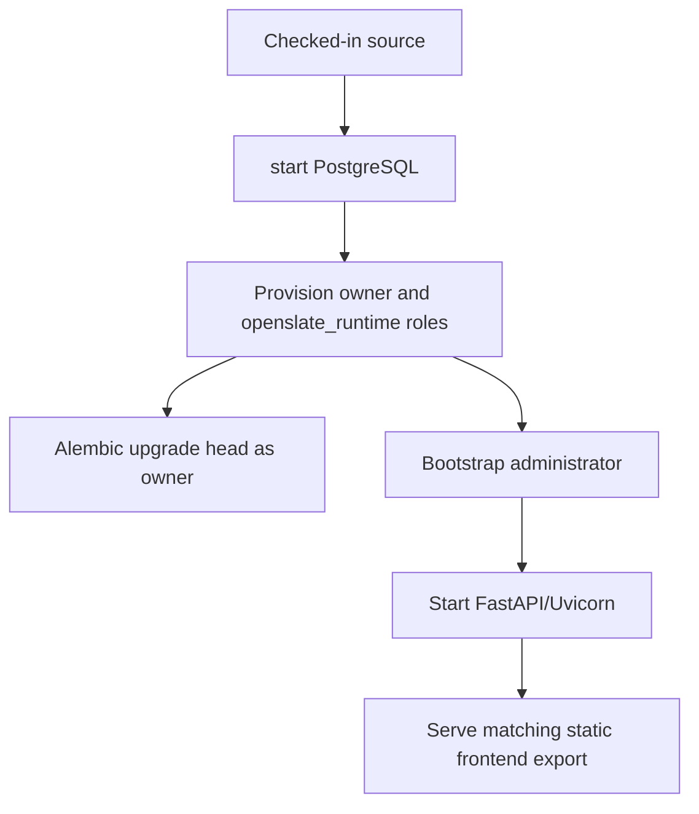

# Deployment Architecture

> **Scope:** FastAPI-only server artifacts, CI, schema/identity operations, the unspecified hosted-deployment boundary, and a proposed future Windows and macOS customer deployment.
> **Audience:** Release operators, developers, and maintainers evaluating builds, updates, recovery, and deployment.
> **Related documents:** [Infrastructure](11-infrastructure.md), [Configuration](17-configuration.md), [Observability](18-observability.md), [Architecture index](README.md)

## State classifications

- **Implemented** means the repository contains the workflow or artifact and its relevant commands are identifiable.
- **Partially implemented** means a local or build artifact exists without the corresponding hosted release machinery.
- **Absent** means no supported workflow or artifact is checked in.
- **Unknown** means a hosted target, policy, or operating procedure is not defined by the repository.

## Deployment state map

| Area                                      | Classification       | Verified repository state                                                                                                                           |
| ----------------------------------------- | -------------------- | --------------------------------------------------------------------------------------------------------------------------------------------------- |
| Local development platform                | Implemented          | Disposable vanilla PostgreSQL plus host-run FastAPI and direct `next dev` with a development-only `/api` proxy. The installed Caddy gateway profile is disabled. See `README.md`. |
| Unified server artifact                   | Implemented artifact | The FastAPI artifact includes the static Next.js export; it has no Node.js production runtime or separate frontend image.                            |
| Pull-request and main-branch verification | Implemented          | `.github/workflows/backend.yml` and `frontend.yml` verify their owned code; frontend, backend, shared configuration, and infrastructure changes conditionally build the unified server image. |
| Branch-protection enforcement             | Maintainer action    | Stable backend and `Frontend / verify` checks exist, but repository branch protection is not represented in source; a maintainer must configure it. |
| Image registry and image publishing       | Absent               | No registry, `docker push`, release tag, or image-publishing step is checked in.                                                                    |
| Hosted application target                 | Unknown              | No provider, cluster, VM, service definition, DNS, or environment manifest is present.                                                              |
| Hosted ingress/TLS                        | Unknown              | No hosted ingress or TLS termination configuration is present.                                                                                      |
| Hosted secrets/configuration delivery     | Unknown              | Only local `.env.example` and process environment consumption are defined.                                                                          |
| Hosted deployment trigger                 | Absent               | GitHub Actions verify; neither workflow deploys.                                                                                                    |

## Implemented local release flow

Local application updates are manual and split between platform, schema, and
host processes. No image entry point applies schema changes or provisions
accounts automatically.

The corresponding commands are documented in `README.md`:

- The documented Compose or disposable runner path starts PostgreSQL.
- `cd backend && uv sync --locked` installs backend dependencies.
- `uv run python operations/provision_database_role.py` uses the cluster-admin
  bootstrap connection to create the owner and constrained `openslate_runtime`
  logins and their required grants.
- `uv run alembic upgrade head` then applies the application schema through
  the owner connection.
- `uv run python operations/bootstrap_admin.py` reads `ADMIN_EMAIL` and
  `ADMIN_USERNAME` from canonical configuration and reserves a pending single-use
  administrator assignment through local FastAPI Identity. It creates local
  identity/action-token state. Optional SMTP delivery is disabled by default;
  the local temporary-password flow remains available without it.
  Outside local environments it also requires the explicit `--confirm` flag.
- `uv run python -m app --reload` starts FastAPI, while `cd frontend && npm run
  dev` starts the local Next development process at the direct daily browser
  origin. Its development-only `/api` proxy reaches loopback FastAPI. `next dev`
  is a hot-reload tool; it does not run in production or receive application
  secrets.

`backend/migrations/env.py` requires `MIGRATION_DATABASE_URL` without a runtime
URL fallback, imports the complete model registry, and runs the vanilla
PostgreSQL baseline plus forward revisions. The checked-in migration chain is
resolved dynamically by Alembic (`upgrade head`, `check`, or `heads`); release
procedures must not hard-code a revision ID. PostgreSQL schema changes are
applied only by Alembic.

## Unified server artifact — Implemented

The production build has three stages: Node builds the locked static frontend
export; Python builds the locked FastAPI runtime; the final non-root server
artifact contains FastAPI and the export only. It runs `python -m app` with the
configured bind, port, concurrency, and keep-alive settings, and FastAPI reads
`WEB_ASSETS_ROOT` to serve the matching browser application.

The final artifact contains no Node executable, `node_modules`, Next.js
standalone server, frontend listener, frontend image, or frontend runtime
configuration. Build-time Node inputs never become server secrets or browser
configuration.

Root Compose uses `scripts/environment.py compose ...` to derive service
transports and apply explicit per-service environment allowlists. The effective
environment exists in the Docker child process only; full rendered Compose
output is secret. See [Configuration](17-configuration.md) for source modes.

The unified artifact does not migrate the application schema, provision the
runtime role, or bootstrap an administrator.

## CI verification — Implemented; deployment absent

### Backend workflow

`.github/workflows/backend.yml` always classifies pull requests and pushes to
`main`. Backend paths select the backend quality and coverage jobs. Frontend,
backend, shared configuration, and infrastructure paths select the unified
server-image build. The workflow:

1. Uses Ubuntu, Python 3.14, and locked project tooling for backend quality.
2. Runs Ruff and mypy plus the packaging-backup and repository-tooling tests.
3. Runs the disposable-PostgreSQL full-stack runner for migrations, backend
   integration tests, and the configured coverage thresholds.
4. Builds the unified FastAPI server image, including the static frontend
   export, when the change classifier selects that artifact.

It has no registry, image publishing, release, deployment, migration-to-hosted,
or rollback step.

### Frontend workflow

`.github/workflows/frontend.yml` always reports its stable required-check job.
For relevant changes it installs locked dependencies and pinned Chromium, runs
formatting, ESLint, TypeScript, the retained isolated and targeted HTTP
route-contract tests, and one static production export. The backend workflow
separately verifies that export inside the unified server image. The frontend
workflow runs no full-stack journey, collects no frontend line coverage, and
does not publish an image or deploy the application.

## Approved hosted deployment contract — implementation still blocked

This is the approved operating contract for a future hosted deployment, not
evidence that hosted infrastructure exists or is production-ready.

- Use one trust domain per deployment. Isolate local Identity, PostgreSQL,
  private files, secrets, backups, and administrator population; shared tenancy is
  deferred.
- Caddy is the browser-facing canonical origin with one FastAPI upstream.
  FastAPI serves static UI routes, `/api`, and `/api/events`; no separate
  identity, database, event, or frontend endpoint is teammate-facing.
- Release in this order: **pre-migration backup; Alembic upgrade and drift
  check; runtime-role provision and verification; backend/private smoke;
  frontend/FastAPI identity smoke; traffic**. Resolve the current Alembic head during
  the release; do not pin a historical revision in the runbook.
- Before hosted traffic, Priority 3 must prove private FastAPI/PostgreSQL
  boundaries, trusted proxy/Host handling, aggregate ingress limits, readiness
  traffic admission, the database connection budget, log collection/retention,
  and alert delivery for operational failures. Priority 5 application bounds
  and structured logs do not establish those infrastructure controls.
- Rollback is forward-only: apply a forward fix or perform a coordinated
  restore. Do not treat Alembic downgrade or the local reset utility as release
  recovery. Purge remains off.

The image registry, secret manager, SMTP service, RPO/RTO, retention policy,
full restore procedure, and hosted topology are still selections or blockers.
No provider-neutral hosted infrastructure is specified here.

## Schema, provisioning, and bootstrap operations

| Operation              | Implemented behavior                                                                                                                                                                                                                                                                                                                                                                                                             | Hosted state                                                                                                                                                                                                                   |
| ---------------------- | -------------------------------------------------------------------------------------------------------------------------------------------------------------------------------------------------------------------------------------------------------------------------------------------------------------------------------------------------------------------------------------------------------------------------------- | ------------------------------------------------------------------------------------------------------------------------------------------------------------------------------------------------------------------------------ |
| Application migrations | Alembic owns `backend/migrations/`; the vanilla PostgreSQL baseline plus forward revisions are applied explicitly with `uv run alembic upgrade head`. | Unknown. Hosted deployment must provide the documented owner migration connection. |
| Drift check            | `uv run alembic check` is run locally and in backend CI.                                                                                                                                                                                                                                                                                                                                                                         | Unknown. No hosted drift job is defined.                                                                                                                                                                                       |
| Runtime database role  | `provision_database_role.py` requires the cluster-admin `DATABASE_BOOTSTRAP_URL`, owner migration URL, and runtime URL. It creates the owner/runtime roles before migrations and verifies required grants. | Unknown. No hosted role-delivery or password-rotation workflow is defined. |
| First administrator    | `bootstrap_admin.py` checks schema and seeded roles and creates local Identity bootstrap state. Optional SMTP can enqueue one-time delivery; disabled mode uses the local temporary-password flow. | Unknown. The confirmation guard exists, but no hosted bootstrap runbook or environment is defined. |
| Optional sample data   | `seed_sample_data.py` calls the authenticated FastAPI API with an admin access token; it does not write tables directly. Its one-shot preflight rejects existing sample roles or domain rows, including archived rows, before sending writes.                                                                                                                                                                                    | Unknown. It is a development utility, not a release step.                                                                                                                                                                      |

## Update, rollback, backup, and recovery state

| Concern                           | Classification                           | Repository-defined behavior                                                                                                                                                                                                                                                                             |
| --------------------------------- | ---------------------------------------- | ------------------------------------------------------------------------------------------------------------------------------------------------------------------------------------------------------------------------------------------------------------------------------------------------------- |
| Local update                      | Implemented                              | Synchronize backend/frontend dependencies, build the static export into the FastAPI artifact, apply Alembic head, provision the runtime role if needed, and restart the service. No automatic updater exists. |
| Hosted update                     | Contract defined; implementation unknown | The approved release order is defined above, but no hosted service, provider, deployment command, or migration gate is checked in.                                                                                                                                                                      |
| Local rollback                    | Partially implemented                    | Recreating a disposable PostgreSQL database followed by Alembic upgrade is not an application release rollback. Several migrations are intentionally forward-only. |
| Migration downgrade               | Partially implemented                    | The current forward chain supports its declared Alembic downgrade boundary, but downgrade is not the release-recovery contract. There is no checked-in release downgrade runbook. |
| Release rollback                  | Forward-only contract; automation absent | No versioned deployment manifest, previous-image selection, traffic switch, or rollback workflow is present. Recovery is a forward fix or coordinated restore.                                                                                                                                          |
| Backup                            | Foundation and isolated manual restore proven; release proof absent | `scripts/backup_installation.py` creates a guarded encrypted Restic snapshot. A separate task-owned PostgreSQL 17/Restic rehearsal restored Access data and private bytes with the [manual restore command](../../packaging/backup/restore_installation.py), including a destructive-downgrade source check. Installed-host recovery, scheduling, retention, and native Windows/macOS controls remain unverified; see the [scoped recovery proof](../plans/access-recovery-compatibility.md). |
| Local disposable reconstruction   | Implemented procedure                    | Recreate disposable PostgreSQL, provision roles, run `uv run alembic upgrade head`, and bootstrap an administrator where needed; this is not release or disaster recovery. |
| Hosted recovery/disaster recovery | Unknown                                  | No restore source, recovery point/objective, local identity recovery procedure, private-file recovery procedure, or failover topology is defined. |

## Proposed Windows and macOS server-app deployment — foundation only

This section defines the target customer deployment on both Windows and macOS.
It is separate from the implemented local flow and approved hosted contract
above. A development-only host-native Manager shell and backup command are
checked in. No signed customer installer, bundled runtime services, OS service
registration, PWA packaging, or automated backup schedule is currently
implemented.

The PostgreSQL section above documents current local development. The hosted
contract above describes a separate, unimplemented deployment. Neither is the
intended end-user installation. The proposed native Docker-free Windows and
macOS target packages the already implemented identity, files, and SSE contracts.

The target is a **single-organization OpenSlate Server** installed on a
customer-managed Windows or macOS computer. The host provides the OpenSlate web
application to people on that organization's local network. The administrator
can use the host computer; teammates can use a supported browser or install
the same application as a PWA. Both access modes are required for the first
customer release. This is not an offline promise: normal work needs the
running host and its local network connection.

The host app also offers **Open workspace** using the same locally served
product UI. Its desktop view must obey the same session, authorization, and
HTTPS rules as browser and PWA clients; it does not become a second frontend.

FastAPI remains the application API, static-content, and data-access layer,
PostgreSQL remains the application database, and Alembic remains the
application-schema owner. Next.js produces the static UI at build time only;
the customer server has no Next.js or Node.js service. See
[Infrastructure](11-infrastructure.md), [Configuration](17-configuration.md),
and [Authentication and authorization](08-authentication-authorization.md).

### Target decisions and release blockers

| Topic                | Target decision                                                                                                                                                                                                                                   | Status and boundary                                                                                                 |
| -------------------- | ------------------------------------------------------------------------------------------------------------------------------------------------------------------------------------------------------------------------------------------------- | ------------------------------------------------------------------------------------------------------------------- |
| Deployment unit      | One customer organization receives one isolated installation, trust domain, database, file store, administrator population, backup set, and support record.                                                                                       | Proposed. It follows the approved single-trust-domain deployment contract; it does not create multi-tenant hosting. |
| Customer experience  | A signed OS-specific installer installs the server and a management/status application. The status application is a control surface, not the process supervisor.                                                                                  | Proposed. Packaging and UI implementation are not selected.                                                         |
| Long-running runtime | Windows Service Control Manager or macOS `launchd`, not an open desktop window, owns server processes, restart policy, and startup after reboot.                                                                                                  | Proposed. Service definitions, accounts, and packaging are unresolved.                                              |
| Serving path         | The LAN browser reaches one browser-facing HTTPS endpoint. Caddy forwards every browser request to FastAPI; FastAPI serves exact static UI exports, `/api`, and `/api/events`. PostgreSQL, scanner, and worker endpoints are never teammate-facing. | Proposed. The canonical local name, certificate source, ingress, and network discovery method are unresolved. |
| Database and API     | PostgreSQL, FastAPI, SQLAlchemy, the constrained runtime role, and Alembic are retained. FastAPI already owns application data access, so this is a deployment change rather than a database rewrite.                                             | Proposed packaging of implemented application contracts. No Windows or macOS runtime bundle exists.                 |
| Frontend             | Build a static Next.js export into the FastAPI service payload. The first customer release supports both browser access and installation of the same UI as a PWA, after installability and cache behavior are implemented and tested.                          | Proposed. There is no PWA or offline capability in the repository.                                                  |
| Authentication       | Package FastAPI Identity with Argon2 credentials, PostgreSQL sessions/action tokens, HttpOnly cookies/CSRF, and bearer CLI tokens. | Implemented application contract; native packaging remains blocked. |
| File storage         | Package private local filesystem objects with PostgreSQL metadata, immutable keys, quarantine, authorization, and scan state. | Implemented application contract; native ACL/backup validation remains blocked. |
| Invalidation         | Package authenticated SSE with PostgreSQL notification as optional cache refresh signaling. | Implemented application contract; native network validation remains blocked. |
| Malware scanning     | Keep the existing Scanner protocol, dedicated file worker, and ClamAV engine separate from browser-facing services. Definitions must be verified before a scanner is healthy.                                                                     | Proposed. Native scanner distribution, service operation, and redistribution must be verified on both OSes.         |
| Cache                | Add no Valkey service or generic cache abstraction for the first release.                                                                                                                                                                         | No Valkey or general cache service is required by the current runtime.                                              |
| Python packaging     | Bundle the FastAPI runtime so customers install neither Python nor developer tools; a single frozen executable is optional.                                                                                                                       | Packaging method remains a build decision after service and child-process behavior is proven on each OS.            |

The labels **proposed** and **release blocker** identify the intended product
shape, not a developer setup path and not a customer-installable release.

### Platform packaging and service contract

One release has a shared application version, database schema, setup state
machine, and acceptance contract. Windows and macOS have separate signed build
artifacts and OS integration. A single installer is a customer-facing package,
not a requirement that PostgreSQL, FastAPI, and ClamAV run in one process. The
installer includes their compatible runtimes; the customer does not install
Python, Node.js, PostgreSQL, ClamAV, or Docker.

| Concern            | Windows target                                                                                                             | macOS target                                                                                                                                                                                                       |
| ------------------ | -------------------------------------------------------------------------------------------------------------------------- | ------------------------------------------------------------------------------------------------------------------------------------------------------------------------------------------------------------------ |
| Release artifact   | Signed installer executable and signed bundled programs; exact installer tool is selected after a clean-host prototype.    | Developer ID signed, notarized, stapled `.pkg` containing the management app and service payloads. Sign nested executables and the installer with their appropriate identities.                                    |
| Management app     | Installed host UI for setup, status, backup, update, and repair.                                                           | `/Applications/OpenSlate.app` provides the same host UI and operations.                                                                                                                                            |
| Background runtime | Separate services under Windows Service Control Manager, with explicit service identities and recovery policy.             | System `launchd` jobs/LaunchDaemons that survive closing the UI and logging out. Use non-root runtime identities; a privileged installer/helper performs only protected setup or updates.                          |
| Durable data       | `C:\ProgramData\OpenSlate\` with restrictive service-specific ACLs; binaries under `C:\Program Files\OpenSlate\`.          | `/Library/Application Support/OpenSlate/` with restrictive ownership and permissions; no customer data in the app bundle or a login user's home directory.                                                         |
| Setup approval     | Administrative install and a narrowly scoped Windows Firewall rule require elevation.                                      | Administrative install and background-service/firewall approval may require interaction with macOS System Settings. The app shows **approval pending** and resumes when authorized; it does not bypass OS prompts. |
| Availability       | A sleeping, powered-off, or locked-volume host cannot serve teammates; setup checks the intended always-on operating mode. | The same host availability rule applies. Test sleep/wake and FileVault restart/unlock behavior before claiming unattended restart.                                                                                 |
| Release matrix     | Publish only Windows versions and CPU architectures that have passed clean-host install, update, and restore checks.       | Build and test each advertised macOS version and CPU architecture, including Apple silicon and Intel if both are offered. Do not assume one package works on both without evidence.                                |

For macOS, the selected minimum supported version determines whether modern
`SMAppService` registration is usable or another supported `launchd` installation
path is required. Approval and service health are separate states: registration
alone does not prove the database or network is ready. PostgreSQL must never
run as root. ClamAV's macOS package provides binaries but not a complete
OpenSlate configuration, definition directory, or update policy. The release
build must own those parts. See [Apple packaging](https://developer.apple.com/documentation/xcode/packaging-mac-software-for-distribution),
[notarization](https://developer.apple.com/documentation/security/notarizing-macos-software-before-distribution),
[Service Management](https://developer.apple.com/documentation/servicemanagement/smappservice/register%28%29),
[Apple filesystem guidance](https://developer.apple.com/library/archive/documentation/FileManagement/Conceptual/FileSystemProgrammingGuide/FileSystemOverview/FileSystemOverview.html),
[PostgreSQL initialization](https://www.postgresql.org/docs/current/app-initdb.html),
[ClamAV installation](https://docs.clamav.net/manual/Installing.html),
[macOS power settings](https://support.apple.com/en-is/guide/mac-help/mchlp1168/mac),
[FileVault](https://support.apple.com/en-sg/guide/mac-help/mh35881/mac),
[macOS firewall settings](https://support.apple.com/en-au/guide/mac-help/mh11783/mac),
and [Windows service guidance](https://learn.microsoft.com/en-us/windows/win32/rstmgr/guidelines-for-services).

### Supported host, trust, and user journeys

The first targeted customer release is a customer-owned Windows or macOS host
intended to remain powered on while the team uses OpenSlate. It needs local
administrative installation rights, durable storage for database, uploaded files, backups,
definitions, logs, and update staging, and an organization-owned LAN with a
stable way for teammate devices to reach the host. The release must publish a
tested OS-version, CPU architecture, storage, memory, and network support
matrix before it is offered to customers. This document does not invent those
limits.

Each installation is one trust boundary. It has its own administrator
population, database, credentials, encryption material, private files, scanner
definitions, backups, logs, and update history. It must not discover, share
credentials with, or attach to a different customer's installation. Remote
access, public Internet exposure, customer-to-customer sharing, and
high-availability/failover are outside this first target.

| Person                     | Intended journey                                                                                                                                                                                                                                                                                                                      |
| -------------------------- | ------------------------------------------------------------------------------------------------------------------------------------------------------------------------------------------------------------------------------------------------------------------------------------------------------------------------------------- |
| Customer installer         | Downloads a signed release, confirms the host and data location, acknowledges network and backup responsibilities, and runs the installer with required permissions. The installer performs the first configuration and presents a recoverable failure state rather than asking the customer to run database or application commands. |
| Organization administrator | Opens the local management application, confirms the canonical team address and TLS trust state, completes the first-administrator flow once identity is available, checks backup and scanner status, and invites teammates through OpenSlate. The administrator never receives database, service, or secret values.                  |
| Teammate                   | Opens the organization-provided HTTPS address in a supported browser or installs the same UI as a PWA, then signs in through the selected identity flow. Both modes connect to the host; the PWA has no offline-data guarantee.                                                                                                       |
| Support/developer          | Uses a customer-approved, sanitized diagnostics package and release/backup identifiers. Support access, if introduced, must be explicitly enabled by the customer and separately designed; it is not implied by local installation.                                                                                                   |

The management application may close after setup. Closing it must not stop the
database, web application, scanner, or worker. It explains state and initiates
approved operations; the OS service manager keeps installed runtime processes
alive. Logging out of the interactive user session must not stop them.

For a customer, the intended installation is:

1. Download the Windows installer or macOS package for the supported host and
   run it with local administrator permission. The package verifies its
   signature and host compatibility before touching customer data.
2. In the OpenSlate management app, choose the durable-data and external-backup
   locations, identify the host on the local network, and complete the few OS
   approvals that cannot be granted silently. The app explains each pending
   step; customers run no database, Python, Node.js, or Docker command.
3. Let OpenSlate initialize its services and complete the one-time
   administrator enrollment locally. The first verified backup includes that
   established identity; no default password is shipped or displayed in logs.
4. Confirm the HTTPS team address from a second device without a certificate
   warning. The administrator can then invite teammates. Each teammate uses a
   browser or installs that same site as an app through a supported browser.
5. Use the host app to open the same workspace, review health, manage backups,
   apply signed updates, repair setup, and approve diagnostic export. Closing
   its window leaves the server running.

The installer automates deterministic setup work. It pauses for a human choice
or OS approval where necessary, then resumes safely; it must never treat an
untrusted certificate, inaccessible backup destination, or incomplete
administrator claim as a successful installation.

### Target component and process topology

Teammate browser or installed PWA traffic reaches a selected TLS ingress over
LAN HTTPS. The ingress forwards every browser request to the FastAPI
browser-facing service. FastAPI serves the static UI, API, and SSE, uses
PostgreSQL through the restricted runtime role, and
accesses the private local file provider. The dedicated file-scan worker reads
the stored bytes, records scan results in PostgreSQL, and reaches ClamAV over a
private scan connection. ClamAV starts only with a verified definition
generation. The host management application controls and observes these
services through a protected OS-specific control channel.
Its workspace view has ordinary application permissions; backup, restore,
service, firewall, and update controls require explicit local OS authorization
through that channel. The UI alone is never a privileged service endpoint.

Only the browser-facing web endpoint is reachable from teammate devices. The
selected ingress terminates TLS and receives browser requests before forwarding
to FastAPI. PostgreSQL, ClamAV,
worker control, storage paths, and any future identity administration endpoint
bind only to private local interfaces or protected service channels.

| Service                       | Target responsibility                                                                                                          | Restart/availability expectation                                                                                                                             |
| ----------------------------- | ------------------------------------------------------------------------------------------------------------------------------ | ------------------------------------------------------------------------------------------------------------------------------------------------------------ |
| PostgreSQL                    | Durable application data; accepts the restricted runtime connection and separate migration/provisioning capability.            | Starts before API services. A database failure makes readiness fail without being mistaken for a web-process crash.                                          |
| FastAPI                       | Static UI delivery, canonical API, authorization, audited ORM mutations, file metadata, upload/download authorization, and SSE. | Waits for the database and matching static asset payload, then becomes ready after its required admission checks succeed. |
| File scan worker              | Claims durable queued file work, reads exact stored bytes, and records a clean/rejected/failed verdict.                        | Starts after database, file store, scanner, and definition validation are ready; it may remain stopped during scanner maintenance.                           |
| ClamAV                        | Scans bytes presented by the worker and exposes no application data path.                                                      | Starts from a verified immutable definition generation. Its failure blocks files from becoming clean; it must never mark files clean by timeout or fallback. |
| Management/status application | Local setup, status, diagnostics, backup/update initiation, service visibility, and access to the same OpenSlate workspace UI. | It may be stopped without changing serving state. Its workspace view does not bypass application authorization or hold process ownership.                    |

The selected service design must use least-privileged service identities,
distinct write permissions, dependency ordering, and bounded restart behavior.
The exact Windows service account layout, macOS LaunchDaemon identities,
control channel, process-supervision policy, and desktop packaging remain
implementation decisions. The controller waits for dependency readiness rather
than assuming that an OS service reports a healthy application immediately
after process start; macOS `launchd` restart throttling must be surfaced as a
degraded state rather than hidden by repeated retries.

The installation and update controller checks schema/version compatibility
before admitting team traffic; the existing API readiness probe checks database
connectivity and cannot establish schema compatibility.

Normal service restart or host reboot verifies this compatibility but does not
run Alembic or provision database roles. Those are one-time installation or
explicit, guarded update operations.

### Automatic first installation and safe retry

First installation is a resumable state machine stored with private installation
data, not a best-effort chain hidden in a desktop window. Each stage records
only safe status and identifiers. A retry validates completed work before
continuing; it does not silently replace customer data, credentials, or an
existing administrator.

1. **Preflight.** Verify the signed package, supported OS/CPU combination,
   installer permissions, available data/backup capacity, writable backup
   destination, intended always-on host mode, and selected LAN name/TLS plan.
2. **Separate product and data.** Install versioned binaries/assets under a
   platform program location. Create the separate access-controlled data root
   from the platform table before generating credentials or initializing PostgreSQL.
3. **Protected configuration.** Generate per-installation secrets and write
   only protected service configuration. Do not put values in installer logs,
   browser configuration, command lines, or diagnostics exports. The local
   machine-secret mechanism and restore/rotation procedure must be selected
   and tested on both operating systems before implementation.
4. **Database and schema.** Initialize the private database cluster, apply the
   resolved Alembic head, run drift checking, and provision the constrained
   runtime role from an owner-capable operation. Bind the database only to
   private local transport, configure deliberate authentication instead of
   an unsafe `trust` default, and run it under a non-root/dedicated identity.
   End users never see the owner or runtime database connection values.
5. **Identity and administrator.** Run only after a selected replacement can
   create, revoke, and verify application identities. Reserve the first
   administrator exactly once. Present a short-lived, single-use enrollment
   action locally in the management app so the administrator can set their own
   credential without a default password or preconfigured mail server. Keep
   setup-only access local until enrollment and sign-in complete; do not allow
   LAN claim of the initial administrator. The present local bootstrap
   script is not an installer contract.
6. **Private files and scanner.** Create service-only quarantine and clean
   locations. Fetch definitions into a candidate generation, validate it, make
   it read-only for serving, and retain the previous verified generation if an
   update fails.
7. **Backup setup.** After the customer selects a backup destination, schedule,
   retention policy, and key-recovery approach, validate destination access,
   capacity, and backup creation. Record an explicit **not configured** or
   **degraded** backup state when those choices are deferred or validation fails;
   do not imply recovery protection or invent recovery objectives by default.
   Keep a new installation in setup-only mode until its first backup is verified.
8. **Network access and OS approval.** Configure the canonical HTTPS name and
   certificate/trust chain. Register background services and request required
   OS approval. Prepare the platform's narrowly scoped inbound access for the
   browser-facing service, but leave team traffic closed. On macOS, show a
   resumable **approval pending** state if service or firewall approval is not
   granted. Verify from another device that private listeners remain unreachable.
9. **Start and verify.** Start database, API, web, scanner, and worker in
   readiness order. Check liveness, database readiness, same-origin API reachability,
   schema admission, identity readiness, private file permissions, scanner
   definitions, established administrator sign-in, and backup state. Open only
   the approved LAN HTTPS endpoint and present the team address after all gates
   pass, including a trusted-certificate check from a teammate device.

Package verification, directory creation, service registration, firewall-rule
creation, and a verified database role may be repeated after inspection. A
schema operation relies on Alembic state and stops on drift or incomplete
migration. Identity initialization must recognize the exact pending
administrator reservation; an unexpected identity state needs review. Scanner
replacement keeps the last verified generation, and storage initialization never
deletes a non-empty customer location merely to make setup succeed.

An interruption leaves a visible state such as configuration pending, OS
approval pending, database setup failed, identity setup required, TLS trust
pending, or scanner not ready. A retry resumes its recorded stage. A partially
initialized installation must not start a team-facing service or invent a
default administrator password.

### Configuration, secrets, ports, TLS, and firewall

The existing root environment file and PostgreSQL configuration are
developer-local configuration, described in [Configuration](17-configuration.md).
They are not the customer configuration surface. The target installer generates
protected service configuration and exposes only concise settings such as the
canonical team name, allowed LAN profile, data location, backup destination, and
diagnostics consent.

| Boundary              | Target rule                                                                                                                                                                                                                                                                                                                                                                      |
| --------------------- | -------------------------------------------------------------------------------------------------------------------------------------------------------------------------------------------------------------------------------------------------------------------------------------------------------------------------------------------------------------------------------- |
| Secrets               | Generate per installation; store them using a selected protected local mechanism; inject only into the service that needs them. Do not write them to program files, browser bundles, logs, support packages, or exported configuration.                                                                                                                                          |
| Public configuration  | The static frontend uses same-origin relative requests and requires no per-customer runtime configuration. Never expose server credentials or place deployment settings in browser files. |
| Private configuration | Database ownership/runtime credentials, identity administration credentials, server-to-server keys, file-store location, scanner controls, and log settings stay server-only. The management application displays status rather than values.                                                                                                                                     |
| Ports/listeners       | The release selects non-conflicting bindings and validates them during install. Development defaults are not a product promise. Publish only the browser-facing TLS listener; keep all others private.                                                                                                                                                                           |
| Firewall              | On Windows, create/remove only the minimum installer-owned inbound rule for the intended LAN profile. On macOS, guide and verify the required incoming-connection approval using supported OS mechanisms. Never open database, scanner, worker, or management control ports.                                                                                                     |
| TLS/name resolution   | Use one stable canonical HTTPS origin per installation. A certificate for a private LAN name is not automatically trusted by teammate devices: the administrator must supply a trusted name/certificate path or distribute and trust an organization-controlled CA. Verify on every supported client OS before declaring team access ready. Do not ask users to bypass warnings. |
| Logging               | Continue the redacted structured logging approach in [Observability](18-observability.md). Store logs under durable data with capacity/retention controls; do not make unbounded logs a hidden dependence on the system disk.                                                                                                                                                    |

The selected identity and SSE designs must define cookie attributes, trusted
origin handling, CSRF/session protections, websocket/TLS behavior if used, and
clock/time requirements. These are security release gates because the current
browser session flow uses FastAPI-issued cookies and JWT verification.

The installation remains local and usable for host-side setup while certificate
or OS approval is pending, but it must not announce a team URL or open traffic
until the selected trust method works. An installable PWA on another device also
requires a trusted HTTPS origin; `localhost` on the host does not secure the
teammate's LAN URL. See [Apple local-network TLS guidance](https://developer.apple.com/documentation/Network/creating-an-identity-for-local-network-tls)
and [PWA installability](https://developer.mozilla.org/en-US/docs/Web/Progressive_web_apps/Guides/Making_PWAs_installable).

### Required migration gates

The end-user runtime already uses local identity, private files, and SSE; native packaging is the remaining deployment task.

| Dependency today           | Required target capability and acceptance gate                                                                                                                                                                                                                                                                                                                                                                                                                                                                                                             |
| -------------------------- | ---------------------------------------------------------------------------------------------------------------------------------------------------------------------------------------------------------------------------------------------------------------------------------------------------------------------------------------------------------------------------------------------------------------------------------------------------------------------------------------------------------------------------------------------------------- |
| Local Identity | Prove packaged sign-in, password setup/recovery, invitation, refresh/revocation, and administrator recovery. Existing-organization import is not provided. |
| Private files | Prove native private ACLs, immutable object keys, metadata consistency, quarantine-before-clean state, FastAPI authorization, and coordinated backup/restore. |
| SSE invalidation | Prove opaque recipient-authorized invalidation and refresh recovery across packaged service restart. |
| PostgreSQL baseline | Prove owner migration, runtime-role provisioning, and clean-host database initialization. |

Identity comes first because current profiles and authorization depend on it.
Files and SSE are implemented application contracts; packaging verifies their OS-specific operation.

### Current source portability gates

The target must be proven from packaged builds on both OSes. Current source
contains known development/Linux assumptions:

| Current source                                                                                                                                     | Required release proof                                                                                                                                                                                                   |
| -------------------------------------------------------------------------------------------------------------------------------------------------- | ------------------------------------------------------------------------------------------------------------------------------------------------------------------------------------------------------------------------ |
| `backend/app/systems/platform/files/validation_worker.py` and `clamav_client.py` import Python `resource` and use Unix resource limits.            | Replace or guard this path with equivalent tested Windows process bounds while retaining macOS limits. Python documents `resource` as Unix-only. See [Python resource](https://docs.python.org/3/library/resource.html). |
| File validation and scanner helpers launch `sys.executable -m ...` from the source layout; backend configuration reads the checkout's root `.env`. | Packaged child entrypoints and customer configuration resolve from installed, protected locations without a developer checkout or editable source tree.                                                                  |
| `frontend/next.config.ts` produces the static browser export. | Build the export into the FastAPI payload; prove that the final Windows/macOS service bundle contains no Node executable, Next.js server, or frontend listener. |
| `infra/docker/clamav.Dockerfile` and `infra/clamav/serve.sh` implement a Linux container path.                                                     | Prove native engine and worker startup, signature generation/refresh, limits, crash recovery, and redistribution on every supported Windows/macOS architecture.                                                          |
| There is no checked-in PWA manifest, service worker, or installability check.                                                                      | Prove browser and installed-app access, secure-origin installation, session isolation, cache behavior, and honest disconnected state on supported client devices.                                                        |

These are implementation and release gates, not claims that the source already
runs natively on Windows or is packaged for macOS. The existing Linux resource
limit tests and application CI are useful baselines but cannot satisfy these
native-host checks.

### Private files, scanner definitions, and PWA behavior

The target keeps the file-security model in
[Infrastructure](11-infrastructure.md): FastAPI authorizes uploads/downloads;
files have private metadata and immutable keys; new bytes are quarantined; only
the serial worker records a matching clean verdict; browsers never receive
storage credentials or direct file URLs.

The local provider needs separate quarantine and clean locations, restrictive
ACLs, atomic write/finalization semantics, and an integrity check between stored
bytes and scan result. A failed or unavailable scan is pending/rejected, never
a clean fallback.

Scanner definitions are versioned. The maintenance flow stages a candidate from
the approved source, validates engine compatibility/signatures/hashes/version,
retains the previous verified generation until the replacement passes health,
makes the accepted generation non-writable to the serving scanner, and pauses
new work claims while no verified engine is available. The existing container
procedure is a Linux operating model; Windows and macOS targets must establish
equivalent supported limits with their selected scanner packages. The upstream
macOS ClamAV package does not supply a ready `clamd`/`freshclam` configuration
or definition directory; OpenSlate must provision and maintain them. Neither
platform may mark files clean because a definition download or scanner service
failed. See [ClamAV installation](https://docs.clamav.net/manual/Installing.html)
and [signature management](https://docs.clamav.net/manual/Usage/SignatureManagement.html).

The browser UI remains the product UI. A PWA is an installed shortcut to the
same HTTPS origin, identity session, authorization, and file behavior; it
is not a second desktop client, data store, or server. To support PWA
installation in the first customer release, the product needs a manifest,
icons, a selected cache strategy, supported-browser testing, and clear update
behavior. The selected strategy may
use a service worker, but that is an implementation choice with its own privacy
and update tests. Cache policy must not expose private records on shared
devices. Until offline behavior is explicitly designed/tested, pages and
mutations communicate network failure honestly and do not promise cached
records, queued writes, or offline file access.

### Program files, customer data, backup, restore, update, and uninstall

| Location class              | Windows target                                        | macOS target                                                                           | Rule                                                                                                                                                                                                         |
| --------------------------- | ----------------------------------------------------- | -------------------------------------------------------------------------------------- | ------------------------------------------------------------------------------------------------------------------------------------------------------------------------------------------------------------ |
| Product binaries            | `C:\Program Files\OpenSlate\`                         | `/Applications/OpenSlate.app` plus protected service payloads installed by the package | Signed binaries, FastAPI static-export assets, and versioned scanner/runtime files may be replaced only by a verified update.                                                                                 |
| Durable application data    | `C:\ProgramData\OpenSlate\`                           | `/Library/Application Support/OpenSlate/`                                              | PostgreSQL cluster, private files, scanner generations, protected configuration, install state, logs, and backup history survive update and uninstall. Service identities receive only the access they need. |
| External backup destination | Customer-approved location outside the live data root | Customer-approved location outside the live data root                                  | Encrypted, versioned backup sets and integrity/restore records have their own retention and access policy; uninstall never deletes them.                                                                     |

A usable backup is a coordinated restorable set of database data, private files,
selected identity state or documented recovery material, and configuration needed
to interpret it without reusing a live secret. It is integrity checked,
encrypted under the selected operating model, retained by explicit policy, and
tracked with recovery-point and restore evidence. A copy of Program Files is not
a customer backup.

The release must define a portable backup format and test a restore to a fresh
host on each supported OS. Raw copies of a running PostgreSQL data directory
or an app bundle are not that format. Cross-OS restore also needs explicit
re-binding of machine-protected secrets and the canonical HTTPS origin before
teammates reconnect.

The management application makes backup freshness/failure visible. Before an
update that changes schema or persistent file behavior, create and verify a
pre-migration backup. Downgrade is not recovery: current release policy is a
forward fix or coordinated restore.

Restore is a controlled outage: confirm destination and backup identity; stop
browser-facing/mutation-capable services; restore database and private files as
one consistent set; restore/reconcile identity and rebind secrets where required;
validate schema/runtime role, object inventory, scan state, scanner availability,
API readiness, and administrator sign-in; then reopen traffic. Recovery-point
and recovery-time objectives, frequency, retention, key recovery, and isolated
restore testing remain unresolved release choices.

An update verifies a signed versioned package and compatibility, stages immutable
files away from live data, creates the required backup, drains/stops services,
applies migrations when required, validates runtime role and post-update API,
identity, API, file, and scanner gates, and reopens traffic only after success.
The management app may check for and stage a newer signed release, or accept the
same release package from an approved offline transfer. It shows expected
downtime and backup status and requires administrator initiation before a
schema-changing update; an automatic download must not silently migrate a
customer database. An interrupted update resumes from its recorded stage or
stays closed for repair rather than starting mixed versions.

Returning to a previous binary is allowed only with explicitly proven schema,
identity, and file compatibility. Otherwise recovery is a forward fix or the
pre-update restore.

PostgreSQL major-version upgrades are a separate, rehearsed operation using
the supported upgrade or dump/restore path and a verified pre-upgrade backup;
an app package must not replace a major database binary and start the existing
cluster as though it were a routine application update. See
[PostgreSQL upgrade guidance](https://www.postgresql.org/docs/17/upgrading.html).

Uninstall stops/unregisters only OpenSlate services and removes only product
files and network settings it owns. It preserves customer data and external
backups by default, explains their locations, and requires a separate,
explicitly confirmed data-erasure flow with a backup warning. On macOS it must
not assume an upstream ClamAV package can be removed automatically or that an
OS-managed firewall approval is an installer-owned rule.

### Health, diagnostics, release pipeline, and acceptance

The management application needs independent status for service state; API
liveness/readiness; schema/version admission; canonical HTTPS/API reachability;
identity; private file/scanner state; backup freshness; and capacity. Current
readiness proves database reachability only. It does not prove schema
compatibility, identity, scanner, backup, or restored-file integrity.

Diagnostics follow the current redaction policy: timestamps, version, service
state, safe failure codes, request identifiers, scanner generation, backup
result, and install/update identifiers are useful. Credentials, cookies,
database URLs, raw bodies, file names/contents, and user data are not. The
customer previews or explicitly authorizes diagnostic export/support upload.
Automatic support access or transmission is outside this target.

Installers come from a repeatable Windows and macOS release pipeline, not a
copied developer checkout. It uses locked backend/frontend inputs, creates
versioned runtime artifacts, assembles one platform package per tested OS/CPU
combination, records an artifact manifest/hashes, signs required deliverables,
notarizes/staples macOS packages, and retains source revision, dependency
inventory, build environment, and test evidence. A single release manifest
ties both packages to the same application and schema version. Existing CI
remains the application baseline; packaging adds native builds and signing,
service installation/logout/reboot, OS approval, network/TLS, backup/restore,
and LAN browser/PWA evidence. Include redistribution notices and reviewed
licenses for every bundled runtime and scanner component. A release must not
claim macOS compatibility based on a Windows package test or vice versa.

No release is acceptable until clean supported Windows and macOS hosts, for
every advertised OS/CPU combination, without Docker, a developer checkout, or
developer service dependencies prove:

1. Signed installation completes without manual database, Node, Python, Docker,
   commands, and has a recoverable interruption path.
2. Database, FastAPI with its matching static assets, scanner, and worker start after the OS is
   available following reboot; closing the management window and logging out
   do not stop them. On macOS, test sleep/wake, FileVault unlock requirements,
   and explicit background-service approval; report any manual prerequisite.
3. An administrator completes selected identity setup, invites a teammate, and
   that teammate signs in from a second LAN device without a certificate warning.
4. The PWA installs on that device and honestly reports a disconnected
   host/network.
5. A private quarantined file becomes downloadable only after verified scanning,
   and scanner interruption never produces a clean fallback.
6. Private listeners are unreachable from the teammate device; browser/API
   limits, session boundaries, and log redaction hold in the packaged runtime.
7. A backup is integrity checked and restored on another supported host or
   isolated recovery target, including administrator sign-in and representative
   file verification. Prove the advertised cross-OS restore path with
   machine-secret re-binding.
8. A schema-changing update passes post-update gates and has a demonstrated
   forward-fix/restore recovery path.
9. Uninstall removes installer-owned services/product files while preserving
   customer data and backups by default on both operating systems.

Run the teammate matrix from a Windows browser/PWA and a macOS browser/PWA to
each supported host OS, using the supported browser versions. Check trusted
HTTPS, sign-in/session refresh, file access, and disconnection in all four
host/client combinations. A host-side **Open workspace** view must satisfy the
same authentication and authorization cases.

| Failure                                 | Safe behavior                                                                                                                     | Required path                                                                         |
| --------------------------------------- | --------------------------------------------------------------------------------------------------------------------------------- | ------------------------------------------------------------------------------------- |
| Interrupted installer/preflight failure | Do not start a partial team-facing stack; retain a resumable record.                                                              | Fix named prerequisite, then retry/repair from management application.                |
| OS approval pending                     | Do not treat registered services or a pending firewall approval as a completed installation.                                      | Show the exact OS approval step, then resume and recheck readiness.                   |
| Database unavailable                    | API readiness fails; do not restart web tier as if healthy.                                                                       | Restore database service/space/connectivity or use backup recovery.                   |
| Schema drift or incompatible version    | Keep team traffic closed at the separate schema/version admission gate; the database-only API readiness probe cannot detect this. | Investigate migration state and apply a forward fix or coordinated restore.           |
| Identity unavailable                    | Keep data protected; sign-in, refresh, invitation, and password work report controlled unavailability.                            | Repair selected identity dependency; do not substitute an unverified local account.   |
| TLS/name/firewall failure               | Do not direct users to bypass warnings or expose private ports.                                                                   | Repair canonical origin, trust, discovery, or platform firewall approval.             |
| Scanner/definitions unavailable         | New files remain pending/quarantined and worker claims pause/fail safely.                                                         | Restore last verified generation or perform approved definition update.               |
| Storage/permission/disk failure         | Reject/pause file work without exposing bytes or marking files clean.                                                             | Restore platform permissions/capacity or recover the consistent database/file backup. |
| Host asleep or encrypted volume locked  | Show the host as unavailable to teammates; make no offline-sync promise for the PWA.                                              | Wake/unlock the host and verify services and HTTPS before team access resumes.        |
| Failed persistent update                | Keep traffic closed until a forward fix or coordinated restore.                                                                   | Use pre-update backup; do not force a downgrade.                                      |
| Stale backup/failed restore test        | Surface degraded recovery status; do not call the installation recoverable.                                                       | Repair destination/keys/capacity and complete backup plus restore verification.       |

### Delivery order for developers

1. Prove the shared application contracts on a native PostgreSQL installation:
   select identity ownership and migration, implement private local storage,
   and verify local SSE refresh behavior on native platforms.
2. Make backend child processes, paths, resource limits, static-export build,
   and scanner provisioning portable. Exercise the same
   application and file-security tests on native Windows and macOS runners.
3. Prototype service registration, app-close/logout/reboot recovery, TLS from
   another device, and signed package installation independently on each OS.
   Fix platform gaps before adding a polished setup wizard.
4. Build the shared resumable setup/update controller, host management app,
   external backup/restore path, and customer-neutral packages. Treat all
   manual OS approval and certificate-trust steps as named wizard states.
5. Ship only after the full acceptance matrix above succeeds on clean customer
   hosts. Publish the tested host/client support matrix and recovery procedure
   alongside the signed packages.

This target gives end users one installed server application and a browser/PWA
client experience while keeping developer maintenance explicit: versioned
services, repeatable release artifacts, staged updates, isolated customer data,
and demonstrated recovery. Until the listed gates are implemented and accepted,
the supported operational path remains the implemented local PostgreSQL and
host-process workflow described earlier in this document.
