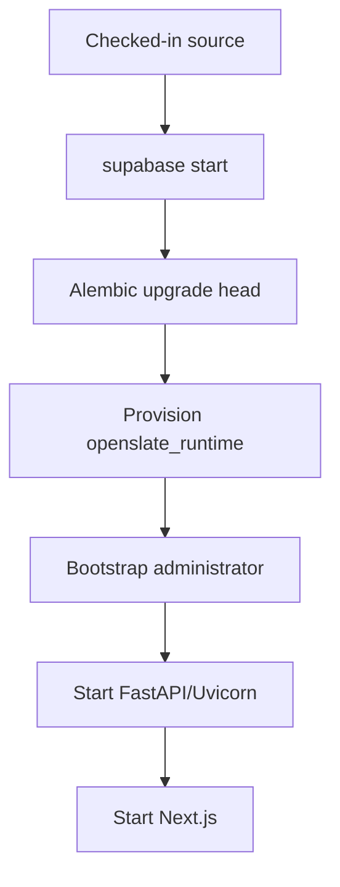

# Deployment Architecture

> **Scope:** Local update operations, standalone images, CI, schema/identity operations, and the unspecified hosted-deployment boundary.
> **Audience:** Release operators, developers, and maintainers evaluating builds, updates, recovery, and deployment.
> **Related documents:** [Infrastructure](11-infrastructure.md), [Configuration](17-configuration.md), [Observability](18-observability.md), [Architecture index](README.md)

## State classifications

- **Implemented** means the repository contains the workflow or artifact and its relevant commands are identifiable.
- **Partially implemented** means a local or build artifact exists without the corresponding hosted release machinery.
- **Absent** means no supported workflow or artifact is checked in.
- **Unknown** means a hosted target, policy, or operating procedure is not defined by the repository.

## Deployment state map

| Area                                      | Classification       | Verified repository state                                                                   |
| ----------------------------------------- | -------------------- | ------------------------------------------------------------------------------------------- |
| Local development platform                | Implemented          | Supabase CLI plus host-run FastAPI and Next.js; see `README.md` and `supabase/config.toml`. |
| Backend image                             | Implemented artifact | `infra/docker/backend.Dockerfile` builds a standalone non-root image.                       |
| Frontend image                            | Implemented artifact | `infra/docker/frontend.Dockerfile` builds a standalone Next.js image.                       |
| Pull-request and main-branch verification | Implemented          | `.github/workflows/backend.yml` and `frontend.yml`.                                         |
| Image registry and image publishing       | Absent               | No registry, `docker push`, release tag, or image-publishing step is checked in.            |
| Hosted application target                 | Unknown              | No provider, cluster, VM, service definition, DNS, or environment manifest is present.      |
| Hosted ingress/TLS                        | Unknown              | No hosted ingress or TLS termination configuration is present.                              |
| Hosted secrets/configuration delivery     | Unknown              | Only local `.env.example` and process environment consumption are defined.                  |
| Hosted deployment trigger                 | Absent               | GitHub Actions verify; neither workflow deploys.                                            |

## Implemented local release flow

Local application updates are manual and split between platform, schema, and
host processes. No image entry point applies schema changes or provisions
accounts automatically.

The corresponding commands are documented in `README.md`:

- `supabase start` starts the local platform.
- `cd backend && uv sync && uv run alembic upgrade head` installs backend
  dependencies and applies the application schema.
- `uv run python scripts/provision_database_role.py` uses the owner connection
  and `OPENSLATE_DATABASE_PASSWORD` to create or update the constrained
  `openslate_runtime` login and grant membership in `openslate_app`.
- `uv run python scripts/bootstrap_admin.py --email <email> --username
<username>` uses Supabase Auth invitation delivery, the Auth-created pending
  profile, and an audited role promotion. Outside local environments it also
  requires `--confirm` or `BOOTSTRAP_ADMIN_CONFIRM`.
- `uv run uvicorn app.main:app --reload --host 127.0.0.1 --port 8000` and
  `npm run dev -- --hostname 127.0.0.1` start the application processes.

`backend/migrations/env.py` chooses `MIGRATION_DATABASE_URL` and falls back to
`DATABASE_URL`, imports the model registry, excludes the external Auth profile
table placeholder from autogeneration, and runs the linear Alembic chain. The
checked-in chain ends at revision `20260830_0014`. Supabase migrations and seeds
are disabled, so neither `supabase start` nor a container command applies this
chain.

## Standalone image artifacts — Implemented

| Image    | Build and runtime behavior                                                                                                                                                                                                         | Operational boundary                                                                                                                                                                             |
| -------- | ---------------------------------------------------------------------------------------------------------------------------------------------------------------------------------------------------------------------------------- | ------------------------------------------------------------------------------------------------------------------------------------------------------------------------------------------------ |
| Backend  | `python:3.13-slim`; copies the pinned `backend/uv.lock`; runs `uv sync --frozen --no-dev`; copies backend source; creates UID 10001 `appuser`; exposes 8000; runs `uvicorn app.main:app --host 0.0.0.0 --port 8000`.               | Does not run Alembic, role provisioning, admin bootstrap, or Supabase startup. `DATABASE_URL` and other runtime settings are supplied externally.                                                |
| Frontend | Multi-stage `node:24-alpine`; runs `npm ci` and `npm run build`; uses Next standalone output; creates UID 10001 `nextjs`; sets `NODE_ENV=production`, `HOSTNAME=0.0.0.0`, and `PORT=3000`; exposes 3000 and runs `node server.js`. | No database or Supabase platform is bundled. Next rewrite destinations use `BACKEND_URL` at config evaluation and the BFF reads it at runtime, with the source fallback `http://localhost:8000`. |

The frontend standalone helper `frontend/scripts/start-standalone.mjs` copies
`.next/static` and `public` into `.next/standalone` before importing the
generated `server.js`. This supports the local production-style `npm start`
path and is also reflected in the image layout.

## CI verification — Implemented; deployment absent

### Backend workflow

`.github/workflows/backend.yml` runs on pull requests and pushes to `main` when
backend, Supabase, environment-example, or workflow files change. It:

1. Uses Ubuntu, Python 3.14, latest `uv`, and latest Supabase CLI.
2. Runs `uv sync --locked`.
3. Starts local Supabase and derives disposable values from
   `supabase status -o env` without storing them in source.
4. Verifies that public signup is disabled through the local Auth endpoint.
5. Runs `uv run alembic upgrade head` and `uv run alembic check`.
6. Generates a temporary runtime password, provisions the runtime role, and
   exports disposable `DATABASE_URL` and `TEST_DATABASE_URL` into the job.
7. Runs Ruff, mypy, and pytest, then stops Supabase with `--no-backup` in an
   always-run cleanup step.

It has no build, registry, release, deployment, migration-to-hosted, or
rollback step.

### Frontend workflow

`.github/workflows/frontend.yml` runs on pull requests and pushes to `main` for
frontend, image, environment, Supabase, authentication-related backend, and
workflow changes. It uses Node 24, runs `npm ci`, installs Chromium/Firefox/
WebKit, then runs formatting, lint, typecheck, build, and Playwright E2E with
`PLAYWRIGHT_USE_PRODUCTION=1`. It uploads the HTML Playwright report always and
test results on failure. It has no image publishing or deployment step.

## Schema, provisioning, and bootstrap operations

| Operation              | Implemented behavior                                                                                                                                                                                                                       | Hosted state                                                                                                                                                                                                                   |
| ---------------------- | ------------------------------------------------------------------------------------------------------------------------------------------------------------------------------------------------------------------------------------------ | ------------------------------------------------------------------------------------------------------------------------------------------------------------------------------------------------------------------------------ |
| Application migrations | Alembic owns `backend/migrations/`; the 14-revision linear chain is applied explicitly with `uv run alembic upgrade head`.                                                                                                                 | Unknown. Migration 0010 needs owner-capable access to Supabase-managed Realtime metadata and role DDL; its hosted branch fails closed unless that capability exists or is handled by a separately approved owner-capable step. |
| Drift check            | `uv run alembic check` is run locally and in backend CI.                                                                                                                                                                                   | Unknown. No hosted drift job is defined.                                                                                                                                                                                       |
| Runtime database role  | `provision_database_role.py` requires `MIGRATION_DATABASE_URL` and `OPENSLATE_DATABASE_PASSWORD`, rejects unsafe direct attributes, creates/updates `openslate_runtime`, and grants `openslate_app`; it does not remove other memberships. | Unknown. No hosted role-delivery or password-rotation workflow is defined.                                                                                                                                                     |
| First administrator    | `bootstrap_admin.py` checks schema and seeded roles, rejects an existing active admin, invites through server-side Supabase Auth, finalizes the local profile, and audits the admin promotion.                                             | Unknown. The confirmation guard exists, but no hosted bootstrap runbook or environment is defined.                                                                                                                             |
| Optional sample data   | `seed_sample_data.py` calls the authenticated FastAPI API with an admin access token; it does not write tables directly.                                                                                                                   | Unknown. It is a development utility, not a release step.                                                                                                                                                                      |

## Update, rollback, backup, and recovery state

| Concern                           | Classification        | Repository-defined behavior                                                                                                                                                                                            |
| --------------------------------- | --------------------- | ---------------------------------------------------------------------------------------------------------------------------------------------------------------------------------------------------------------------- |
| Local update                      | Implemented           | Start/update Supabase, synchronize backend/frontend dependencies, apply Alembic head, provision the runtime role if needed, and restart host processes or run the standalone image paths. No automatic updater exists. |
| Hosted update                     | Unknown               | No hosted service, release sequencing, migration gate, or deployment command is defined.                                                                                                                               |
| Local rollback                    | Partially implemented | `supabase db reset` is a destructive reset followed by Alembic upgrade; it is not an application release rollback. Several migrations are intentionally forward-only.                                                  |
| Migration downgrade               | Partially implemented | Revisions including 0010 explicitly raise `NotImplementedError` and direct operators to restore a database backup; there is no checked-in downgrade runbook.                                                           |
| Release rollback                  | Absent                | No versioned deployment manifest, previous-image selection, traffic switch, or rollback workflow is present.                                                                                                           |
| Backup                            | Absent                | No backup scheduler, snapshot policy, export command, retention setting, or hosted backup integration is checked in. The CI cleanup explicitly uses `supabase stop --no-backup`.                                       |
| Local recovery                    | Implemented procedure | `supabase start`, `supabase db reset`, `uv run alembic upgrade head`, role provisioning, and, where needed, administrator bootstrap reconstruct the documented disposable local stack.                                 |
| Hosted recovery/disaster recovery | Unknown               | No restore source, recovery point/objective, Auth recovery procedure, Storage recovery procedure, or failover topology is defined.                                                                                     |

The Auth cutover migration does not map existing local identities. It refuses a
non-empty `public.users` table before the destructive cutover and describes
backup restoration as the downgrade/cutover boundary. That behavior is source
in `backend/migrations/versions/20260819_0010_supabase_cutover.py`, not a
complete hosted recovery process.
