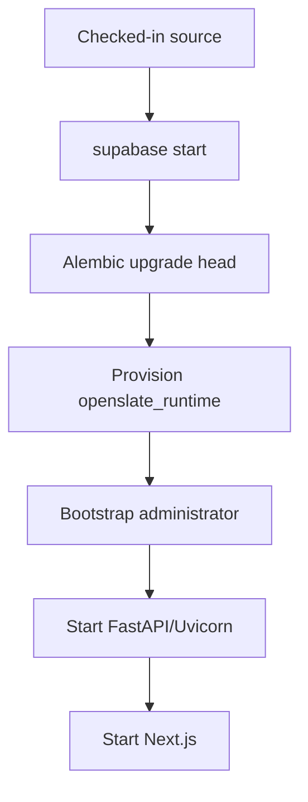

# Deployment Architecture

> **Scope:** Local update operations, standalone images, CI, schema/identity operations, and the unspecified hosted-deployment boundary.
> **Audience:** Release operators, developers, and maintainers evaluating builds, updates, recovery, and deployment.
> **Related documents:** [Infrastructure](11-infrastructure.md), [Configuration](17-configuration.md), [Observability](18-observability.md), [Architecture index](README.md)

## State classifications

- **Implemented** means the repository contains the workflow or artifact and its relevant commands are identifiable.
- **Partially implemented** means a local or build artifact exists without the corresponding hosted release machinery.
- **Absent** means no supported workflow or artifact is checked in.
- **Unknown** means a hosted target, policy, or operating procedure is not defined by the repository.

## Deployment state map

| Area                                      | Classification       | Verified repository state                                                                   |
| ----------------------------------------- | -------------------- | ------------------------------------------------------------------------------------------- |
| Local development platform                | Implemented          | Supabase CLI plus host-run FastAPI and Next.js; see `README.md` and `supabase/config.toml`. |
| Backend image                             | Implemented artifact | `infra/docker/backend.Dockerfile` builds a standalone non-root image.                       |
| Frontend image                            | Implemented artifact | `infra/docker/frontend.Dockerfile` builds a standalone Next.js image.                       |
| Pull-request and main-branch verification | Implemented          | `.github/workflows/backend.yml`, `frontend.yml`, and `fullstack.yml` verify code, images, and the disposable production-style release gate. |
| Branch-protection enforcement              | Maintainer action    | The stable `Full-stack release gate` check exists, but repository branch protection is not represented in source; a maintainer must require it after landing. |
| Image registry and image publishing       | Absent               | No registry, `docker push`, release tag, or image-publishing step is checked in.            |
| Hosted application target                 | Unknown              | No provider, cluster, VM, service definition, DNS, or environment manifest is present.      |
| Hosted ingress/TLS                        | Unknown              | No hosted ingress or TLS termination configuration is present.                              |
| Hosted secrets/configuration delivery     | Unknown              | Only local `.env.example` and process environment consumption are defined.                  |
| Hosted deployment trigger                 | Absent               | GitHub Actions verify; neither workflow deploys.                                            |

## Implemented local release flow

Local application updates are manual and split between platform, schema, and
host processes. No image entry point applies schema changes or provisions
accounts automatically.

The corresponding commands are documented in `README.md`:

- `supabase start` starts the local platform.
- `cd backend && uv sync --locked && uv run alembic upgrade head` installs backend
  dependencies and applies the application schema.
- `uv run python scripts/provision_database_role.py` uses the owner connection
  and the password encoded in `DATABASE_URL` to create or update the constrained
  `openslate_runtime` login and grant membership in `openslate_app`.
- `uv run python scripts/bootstrap_admin.py` reads `ADMIN_EMAIL` and
  `ADMIN_USERNAME` from canonical configuration and reserves a pending single-use
  administrator assignment through
  Supabase Auth invitation delivery and leaves the Auth-created profile `pending`
  until verified post-password acceptance via `/session/password` to private
  `POST /api/auth/invitations/accept`. Outside local environments it also
  requires the explicit `--confirm` flag. `ADMIN_PASSWORD` is local sign-in
  metadata; bootstrap still delivers an invitation and never applies it.
- `uv run python -m app --reload` and `npm run dev` start the application
  processes using the configured stack ports. Local npm commands regenerate
  the frontend allowlist from root `.env`; do not source root secrets into Node.

`backend/migrations/env.py` requires `MIGRATION_DATABASE_URL` without a runtime
URL fallback, imports the model registry, excludes the external Auth profile
table placeholder from autogeneration, and runs the linear Alembic chain. The
checked-in migration chain is resolved dynamically by Alembic (`upgrade head`,
`check`, or `heads`); release procedures must not hard-code a revision ID.
Historically, revision `0015` converted decimal config bounds and UUID-keyed
record values to canonical JSON strings across active and closed rows while
preserving explicit JSON `null` bounds. Supabase migrations and seeds are
disabled, so neither `supabase start` nor a container command applies this
chain.

## Standalone image artifacts — Implemented

| Image | Build and runtime behavior | Operational boundary |
| --- | --- | --- |
| Backend | `python:3.13-slim`, pinned `backend/uv.lock`, `uv sync --frozen --no-dev`, UID 10001. Runs `python -m app` with explicit bind, port, concurrency, and keep-alive settings. Healthcheck reads the same `BACKEND_PORT`. | Requires runtime API configuration with `OPENSLATE_ENV_SOURCE=process`; receives no owner connection or administrator credentials. |
| Frontend | Multi-stage `node:24-alpine`, `npm ci`, standalone output, UID 10001. Build requires all three public settings: Supabase URL, publishable key, and purge visibility. | Server endpoint, logging, and limits are supplied only at runtime. Bind/port are required inputs; no endpoint or port fallback is baked in. |

`frontend/scripts/start-standalone.mjs` validates public/runtime settings before
importing `server.js` and copies static/public assets for local `npm start`.
The image uses `--from-process`; local startup regenerates `frontend/.env.local`
from the root configuration. Public values must match those used during build.

Root Compose uses `scripts/environment.py compose ...` to derive service
transports and apply explicit per-service environment allowlists. The effective
environment exists in the Docker child process only; full rendered Compose
output is secret. See [Configuration](17-configuration.md) for source modes.

Both images are standalone artifacts only. Neither image migrates the application
schema, provisions the runtime role, bootstraps an administrator, or starts
Supabase.

## CI verification — Implemented; deployment absent

### Backend workflow

`.github/workflows/backend.yml` runs on pull requests and pushes to `main` when
backend, Supabase, environment-example, or workflow files change. It:

1. Uses Ubuntu, Python 3.14, latest `uv`, and latest Supabase CLI.
2. Runs `uv sync --locked`.
3. Starts local Supabase and derives disposable values from
   `supabase status -o env` without storing them in source.
4. Verifies that public signup is disabled through the local Auth endpoint.
5. Runs `uv run alembic upgrade head` and `uv run alembic check`.
6. Generates a temporary runtime password, provisions the runtime role, and
   exports disposable `DATABASE_URL` and `TEST_DATABASE_URL` into the job.
7. Runs Ruff, mypy, and pytest, then stops Supabase with `--no-backup` in an
   always-run cleanup step.
8. Builds the standalone backend image.

It has no registry, image publishing, release, deployment, migration-to-hosted,
or rollback step.

### Frontend workflow

`.github/workflows/frontend.yml` runs on pull requests and pushes to `main` for
frontend, frontend-image, Docker-context, and workflow changes. It uses Node 24,
runs `npm ci`, installs Chromium/Firefox/
WebKit, then runs formatting, lint, typecheck, build, and Playwright E2E with
`PLAYWRIGHT_USE_PRODUCTION=1`. A separate `npm run test:scanner:coverage` step
measures scanner UI executable lines using development source maps and enforces
90%; it does not replace production browser acceptance. It also builds the standalone frontend image with
the required public Supabase build arguments. It uploads the HTML Playwright
report always and test results on failure. It has no image publishing or
deployment step.

### Full-stack release-gate workflow

`.github/workflows/fullstack.yml` supplies one stable check named **Full-stack
release gate** for pull requests and pushes to `main`. Its internal
relevant-change detection runs the substantive job for backend, frontend,
Supabase, infrastructure, environment-example, Docker-ignore, and workflow
changes; otherwise the same check completes with a no-relevant-change result.
This avoids path-filtered required checks remaining pending.

For relevant changes, `backend/tests/fullstack_runner.py` creates a fresh
Supabase stack on dedicated ports, applies the dynamically discovered Alembic
head and drift check, provisions the runtime role, starts FastAPI, builds and
starts production Next.js, and runs the dedicated Chromium browser suite. The
scanner helper provisions a pinned ClamAV engine with official definitions and
a serial worker on an internal container network. It
uses per-run identities and a private temporary fixture, retains only a
sanitized acceptance summary, and stops the disposable stack without a backup.
It also runs the read-only operational checker. This is a real
Supabase → Next.js → FastAPI → PostgreSQL release gate, not evidence that a
hosted deployment is production-ready.

The workflow definition alone does not enforce merge protection. After landing,
a repository maintainer must configure branch protection to require the stable
**Full-stack release gate** check.

## Approved hosted deployment contract — implementation still blocked

This is the approved operating contract for a future hosted deployment, not
evidence that hosted infrastructure exists or is production-ready.

- Use one trust domain per deployment. Isolate Supabase Auth, PostgreSQL,
  Storage, secrets, backups, and administrator population; shared tenancy is
  deferred.
- Keep FastAPI private because direct exposure would bypass the BFF acceptance guard (`auth/invitations/accept` is denied in the BFF and only reachable via `/session/password`). The browser-facing Next.js service uses `/bff/*`; direct
  Next `/api` and API documentation rewrites are removed. Only the required
  Supabase Auth, JWKS, and Realtime surfaces remain public, with controlled
  provider policy.
- Release in this order: **pre-migration backup; Alembic upgrade and drift
  check; runtime-role provision and verification; backend/private smoke;
  frontend/BFF/Auth smoke; traffic**. Resolve the current Alembic head during
  the release; do not pin a historical revision in the runbook.
- Before hosted traffic, Priority 3 must prove private FastAPI/PostgreSQL
  boundaries, trusted proxy/Host handling, aggregate ingress limits, readiness
  traffic admission, the database connection budget, log collection/retention,
  and alert delivery for operational failures. Priority 5 application bounds
  and structured logs do not establish those infrastructure controls.
- Rollback is forward-only: apply a forward fix or perform a coordinated
  restore. Do not treat Alembic downgrade or the local reset utility as release
  recovery. Purge remains off.

The provider, image registry, secret manager, SMTP service, RPO/RTO, retention
policy, actual backup implementation, and hosted topology are still
selections/blockers. No provider-neutral infrastructure is specified here.

## Schema, provisioning, and bootstrap operations

| Operation              | Implemented behavior                                                                                                                                                                                                                       | Hosted state                                                                                                                                                                                                                   |
| ---------------------- | ------------------------------------------------------------------------------------------------------------------------------------------------------------------------------------------------------------------------------------------ | ------------------------------------------------------------------------------------------------------------------------------------------------------------------------------------------------------------------------------ |
| Application migrations | Alembic owns `backend/migrations/`; the 15-revision linear chain is applied explicitly with `uv run alembic upgrade head`.                                                                                                                 | Unknown. Migration 0010 needs owner-capable access to Supabase-managed Realtime metadata and role DDL; its hosted branch fails closed unless that capability exists or is handled by a separately approved owner-capable step. |
| Drift check            | `uv run alembic check` is run locally and in backend CI.                                                                                                                                                                                   | Unknown. No hosted drift job is defined.                                                                                                                                                                                       |
| Runtime database role  | `provision_database_role.py` requires `MIGRATION_DATABASE_URL` and the runtime password encoded in `DATABASE_URL`, rejects unsafe attributes, creates/updates `openslate_runtime`, verifies the `openslate_app` role and non-delegable direct membership (including PostgreSQL membership options where available), and fails if any other direct or inherited membership exists; it never silently revokes unknown memberships. | Unknown. No hosted role-delivery or password-rotation workflow is defined. |
| First administrator    | `bootstrap_admin.py` checks schema and seeded roles, reserves any non-deleted pending/active admin assignment (only the exact same pending reservation is idempotent), invites through server-side Supabase Auth, and leaves the profile `pending` for verified post-password acceptance; finalization rechecks under the admin-role lock and a concurrent loser remains a pending member with no destructive compensation. | Unknown. The confirmation guard exists, but no hosted bootstrap runbook or environment is defined.                                                                                                                             |
| Optional sample data   | `seed_sample_data.py` calls the authenticated FastAPI API with an admin access token; it does not write tables directly.                                                                                                                   | Unknown. It is a development utility, not a release step.                                                                                                                                                                      |

## Update, rollback, backup, and recovery state

| Concern                           | Classification        | Repository-defined behavior                                                                                                                                                                                            |
| --------------------------------- | --------------------- | ---------------------------------------------------------------------------------------------------------------------------------------------------------------------------------------------------------------------- |
| Local update                      | Implemented           | Start/update Supabase, synchronize backend/frontend dependencies, apply Alembic head, provision the runtime role if needed, and restart host processes or run the standalone image paths. No automatic updater exists. |
| Hosted update                     | Contract defined; implementation unknown | The approved release order is defined above, but no hosted service, provider, deployment command, or migration gate is checked in.                                                                    |
| Local rollback                    | Partially implemented | `supabase db reset` is a destructive reset followed by Alembic upgrade; it is not an application release rollback. Several migrations are intentionally forward-only.                                                  |
| Migration downgrade               | Partially implemented | Revisions including 0010 explicitly raise `NotImplementedError` and direct operators to restore a database backup. Revision 0015 has a preflighted downgrade from canonical decimal strings to JSON numbers; invalid intervening values fail before mutation. There is no checked-in downgrade runbook. |
| Release rollback                  | Forward-only contract; automation absent | No versioned deployment manifest, previous-image selection, traffic switch, or rollback workflow is present. Recovery is a forward fix or coordinated restore.                                                   |
| Backup                            | Required gate; implementation absent | A pre-migration backup is required by the approved release order, but no scheduler, snapshot policy, export command, retention setting, or hosted backup integration is checked in. CI cleanup explicitly uses `supabase stop --no-backup`. |
| Local disposable reconstruction   | Implemented procedure | `supabase start`, `supabase db reset`, `uv run alembic upgrade head`, role provisioning, and, where needed, administrator bootstrap reconstruct the documented disposable local stack; this is not release or disaster recovery. |
| Hosted recovery/disaster recovery | Unknown               | No restore source, recovery point/objective, Auth recovery procedure, Storage recovery procedure, or failover topology is defined.                                                                                     |

The Auth cutover migration does not map existing local identities. It refuses a
non-empty `public.users` table before the destructive cutover and describes
backup restoration as the downgrade/cutover boundary. That behavior is source
in `backend/migrations/versions/20260819_0010_supabase_cutover.py`, not a
complete hosted recovery process.
