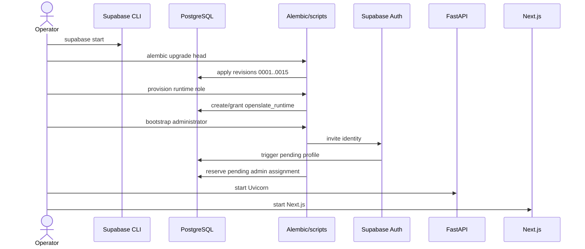
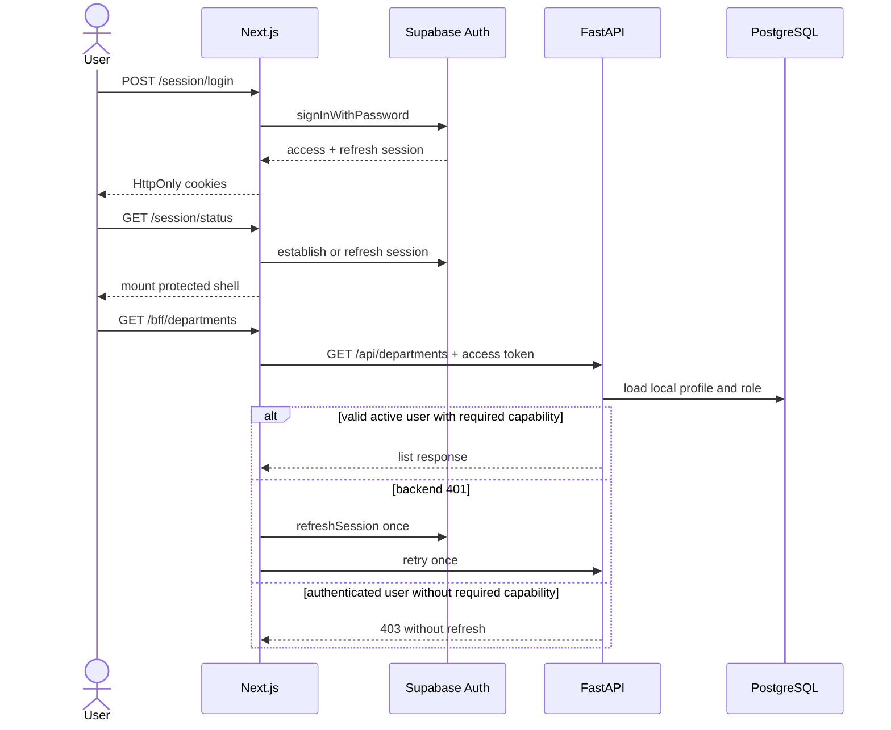
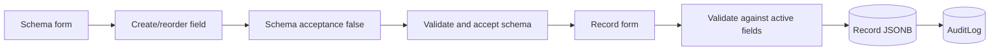
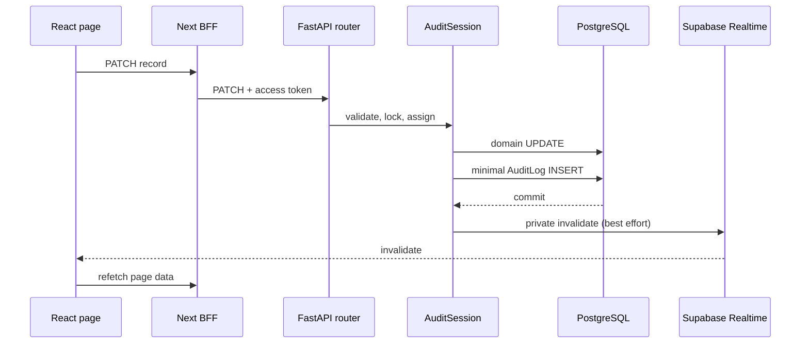

# Runtime Flows

> **Scope:** Six verified end-to-end operations traced through the frontend, backend, database, Supabase services, and audit/realtime side effects.
> **Audience:** Developers debugging behavior across component boundaries.
> **Related documents:** [Backend architecture](04-backend-architecture.md), [Frontend architecture](05-frontend-architecture.md), [Lifecycle](09-lifecycle-and-state-management.md), [Infrastructure](11-infrastructure.md)

## 1. Local startup and database preparation

1. `supabase start` reads `supabase/config.toml` and starts PostgreSQL, Auth, Realtime, Storage, Studio, and Mailpit. Supabase migrations and seeds are disabled.
2. The operator maps backend/migration values from `supabase status -o env` to
   the ignored root environment file, then configures `frontend/.env.local`
   separately with only `BACKEND_URL` and public Supabase values.
3. `backend/migrations/env.py` uses the owner-capable migration URL, imports the model registry, excludes external `auth.users`, and applies the linear chain through `20260831_0015` (`canonical_decimal_strings`).
4. `scripts/provision_database_role.py` creates or alters the constrained `openslate_runtime` login and grants `openslate_app` membership.
5. `scripts/bootstrap_admin.py` reserves a pending single-use administrator assignment through Supabase Auth, relies on the Auth profile trigger, and leaves the profile `pending` until verified post-password acceptance; only the exact same pending reservation is idempotent.
6. Uvicorn imports `app.main:app`; Next.js starts separately with its public/backend settings. Neither process performs migration or provisioning automatically.

Failures include occupied ports, missing owner privileges, preexisting profiles at migration `0010`, missing seeded roles, Auth configuration failure, or an existing administrator reservation (any non-deleted pending/active admin assignment). A destructive reset requires `supabase db reset`, Alembic again, and possibly role/bootstrap repetition.

## 2. Login, protected request, and token refresh

`login/page.tsx` posts to the same-origin session handler. Zod validates the request, Supabase authenticates, and `auth-cookies.ts` writes HttpOnly, SameSite=Lax cookies. `AppPage` later calls `/session/status`; only a valid Supabase session mounts protected content.

Domain pages call `apiFetch`, which targets the BFF. The BFF buffers the request, forwards selected headers plus the access token, and preserves query parameters. FastAPI validates JWT signature, issuer, audience, expiry, and UUID subject, then reloads an active local user and role. The selected domain read or write capability is required; the exact `admin` role is implicitly granted all capabilities. Users, roles, invitations, audit, and purge remain literal-admin-only.

On backend `401`, the BFF refreshes once and retries the identical request. Failure or a second `401` clears cookies; `apiFetch` navigates to login. A `403` is not refreshed.

Evidence: frontend login/session/BFF files, `backend/app/core/security/supabase.py`, `backend/app/common/dependencies/auth.py`.

## 3. Administrator invitation and password setup

1. Administration UI sends entered email, username, and role ID to `POST /bff/users`; backend schemas/services normalize identity values.
2. `users.router:create_user` requires an administrator and delegates to `users.service:invite_user`.
3. `SupabaseAdminClient.invite_user` uses the server-only secret to call Auth.
4. Migration `0010`'s Auth trigger inserts a pending local member profile with the same UUID.
5. The service verifies the exact trigger placeholder profile state, applies the requested email/username/role, keeps it `pending` with `invitation_sent_at`, and commits; after Auth success it never destructively compensates and leaves the trigger profile pending on finalization failure.
6. The email link reaches `/auth/callback`, which exchanges a code or invite token, sets cookies, and redirects to `/auth/setup`.
7. Password setup performs same-origin and minimum/equality validation, establishes the session, calls `auth.updateUser`, then directly calls private `POST /api/auth/invitations/accept` with the fresh access token and flips the matching pending invite to `active`. The generic BFF denies `auth/invitations/accept`, so `/session/password` is the only browser-facing acceptance path; FastAPI stays private because direct exposure would bypass that BFF acceptance guard.

The first-administrator script reserves a pending single-use admin assignment through the same invitation path (any non-deleted pending/active assignment blocks, only the exact same pending reservation is idempotent, finalization rechecks under the admin-role lock, and a concurrent loser remains a pending member with no destructive compensation) and leaves the profile `pending` until the verified post-password acceptance above. No local password hash is stored.

## 4. Field creation, schema acceptance, and record mutation

Field creation validates name, type, position, configuration, and relationship metadata. Relationship fields lock and validate source/target modules in the same department. Field creation, effective API field updates, and changed reorders invalidate schema acceptance; lifecycle close/reopen does not. Each mutation is audited.

Acceptance validates at least one active field, unique names, contiguous positions, supported types/configuration, and relationship metadata. Invalid schemas return `409`; accepted modules allow record creation.

Record creation locks the active module, requires acceptance, parses field UUID keys, rejects inactive/unknown/relationship keys, enforces required and type-specific values, then stores primitive data in JSONB. Record update does not require acceptance: it locks module and record, replaces active data, preserves closed-field values, and rejects changes to those values. Validation errors are deterministic and structured, capped at 20; ordinary failures are `422`, while closed-field mutations are `409`.

The frontend new-record page may request fields including deleted rows, but it filters closed fields from rendering and serialization and submits active primitive fields only. Relationship fields are excluded and managed after creation.

## 5. Department close and reopen

The complete close sequence is documented in [Lifecycle and state management](09-lifecycle-and-state-management.md). At runtime:

1. A user with the target resource's write capability requests close preview.
2. Planner loads department, descendant modules/fields/records, and touching edges; returns impact/blockers/digest.
3. Service commits a hashed, actor/target/digest-bound challenge.
4. The authorized target writer submits token, exact name, and password.
5. Password verification reserves and commits a lease, uses a temporary Supabase password grant, revokes it, and consumes the challenge.
6. Planner recomputes; execution locks complete scope in stable order, replans, rejects drift/blockers, applies one closed timestamp, and commits domain plus audit rows.
7. Edges remain but become hidden through dependency visibility.
8. After commit, Realtime invalidation is attempted.

Reopen requires explicit confirmation but not password. It checks ancestor/name/position/schema/record blockers, locks and replans, then clears deletion state. Reopen audit actions are updates. Realtime failure never reverses committed state.

## 6. Audited mutation and client invalidation

`get_db` creates `AuditSession` with request metadata. Authentication sets the actor in session context. Before flush, listeners identify audited new/changed/deleted models and compute changed fields. After flush, internal audit rows are added to the same transaction. Integrity or execution failure rolls back both business and audit state.

After commit, the listener calls Supabase Broadcast with an opaque data invalidation. The frontend provider dispatches a browser event; `AppPage` changes the shell key and remounts the protected subtree, causing broad refetch. Broadcast errors are swallowed and there is no durable retry or polling fallback.

## Flow-to-source index

| Flow          | Principal source chain                                                                                                          |
| ------------- | ------------------------------------------------------------------------------------------------------------------------------- |
| Startup       | `supabase/config.toml` → `migrations/env.py` → migrations → provisioning/bootstrap scripts → `app/main.py` and frontend scripts |
| Login/request | login/session handlers → BFF → JWT verifier → auth dependency → domain router                                                   |
| Invitation    | users UI → users router/service → Supabase admin client → migration Auth trigger → callback/password handlers                   |
| Schema/record | schema page → fields/modules routers → record page → records router/validation → audit listeners                                |
| Lifecycle     | lifecycle UI → lifecycle router → planner → challenge/password service → executor → audit                                       |
| Invalidation  | audited commit → `audit/listeners.py` → Supabase client → `realtime-provider.tsx` → `AppPage`                                   |
