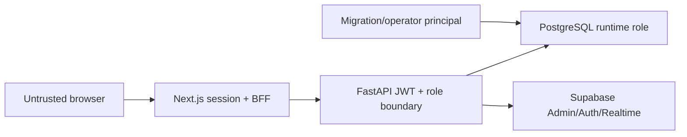

# Security Architecture

> **Scope:** Implemented security controls, trust boundaries, and controls that are partial, absent, or deployment-dependent.
> **Audience:** Developers, security reviewers, and operators evaluating present-day protection.
> **Related documents:** [Authentication and authorization](08-authentication-authorization.md), [Data architecture](06-data-architecture.md), [Infrastructure](11-infrastructure.md), [Architecture risks](20-architecture-risks.md)

## Security posture summary

The checked-in local system has strong application-level identity verification, an explicit FastAPI data boundary, same-origin mutation checks, private Realtime invalidation, constrained runtime database role attributes, and transactional audit capture. It is not evidence of production readiness: hosted network exposure, TLS, secret delivery, tenancy, backup, monitoring, and ingress controls are **Unknown**.

No unconditional critical vulnerability is established from repository evidence alone. Direct SQL access is an operational trust boundary, not a vulnerability through normal HTTP; shared-tenancy or a publicly reachable database would materially change that conclusion.

## Trust boundaries

- Browser input and tokens are untrusted at the Next.js boundary.
- FastAPI independently validates identity and local authorization; the frontend gate is not authoritative.
- Runtime database credentials permit broad application-table operations and must remain private.
- Migration/database owners and the Supabase server secret are higher-trust principals outside application audit guarantees.

## Implemented controls

### Authentication and session protection

- `verify_supabase_jwt` restricts algorithms and verifies JWKS signature, issuer, audience, expiry, and UUID subject.
- `get_current_user` reloads the local profile and role on every protected API request and rejects missing, deleted, disabled, pending, or role-less users.
- Access/refresh cookies are HttpOnly, host-only, SameSite=Lax, and Secure in production.
- Session and BFF mutations use `isSameOriginRequest`; the BFF forwards an allowlist of headers and never forwards the refresh token.
- Global public signup and anonymous sign-in are disabled; local password minimum and complexity are configured in `supabase/config.toml`.

Sources: `backend/app/core/security/supabase.py`, `backend/app/common/dependencies/auth.py`, `frontend/src/lib/auth-cookies.ts`, `frontend/src/lib/request-security.ts`, `frontend/src/app/bff/[...path]/route.ts`.

### Authorization

All current domain routers require exact role name `admin`; `/api/auth/me` is the limited authenticated exception. This is a global role check, not resource ownership or tenant authorization. Stored `Role.permissions` is not evaluated and therefore grants nothing.

### Browser and request controls

- React's normal escaped rendering is used; no unsafe HTML sink was identified in the reviewed source.
- `frontend/src/proxy.ts` generates a nonce-based CSP and limits connection origins.
- `frontend/next.config.ts` sets frame denial, MIME sniffing protection, referrer policy, and permissions policy.
- Pydantic schemas, UUID parsing, sort allowlists, field validation, and SQLAlchemy expressions constrain inputs; no confirmed SQL, command, path-traversal, open-redirect, or SSRF injection path was found.

### Database privilege boundary

Migration `0010` begins the application-role/RLS/grant boundary, with later revisions extending it. `supabase/config.toml` excludes the application schema from the local Data API. Provisioning creates `openslate_runtime` without superuser, create-db, create-role, replication, or bypass-RLS attributes, but does not remove unexpected pre-existing memberships.

This is not row-level tenant isolation: runtime policies use true predicates and the role has broad application CRUD. FastAPI is the effective authorization and audit boundary.

The confirmed boundary is that a provisioned `openslate_runtime` connection can issue direct SQL within its granted tables. PostgreSQL structural constraints still apply, but direct SQL bypasses FastAPI dynamic validation and `AuditSession` audit capture. The Data API exclusion and browser-facing role revocations remain protected, so runtime and owner database credentials and network access to PostgreSQL must stay private. This does not imply a vulnerability through normal HTTP: browser requests still traverse FastAPI. See the [dynamic field validation test plan](../dynamic-field-validation-test-plan.md) for the application-owned validation boundary.

### Audit and lifecycle controls

- Normal `AuditSession` mutations create same-transaction minimal before/after logs.
- ORM attempts to mutate audit logs or run bulk/raw mutation statements are rejected.
- Lifecycle confirmation stores a token hash, binds actor/operation/target/digest, expires after five minutes, rate-limits failures, and performs password verification outside long-held DB transactions.
- Audit immutability is application-scoped, not cryptographic or owner-proof.

### Realtime, Storage, containers, and CI

- Realtime uses a private Broadcast topic with opaque invalidation payloads and no application-table publication.
- The Storage bucket is private, but file behavior is not operational.
- Backend and frontend images run as non-root users; `.env` is excluded from Docker build context.
- CI uses read-only repository permissions and disposable local Supabase services.

## Partial or absent controls

| Control                                     | State                       | Evidence-based qualification                                                                                             |
| ------------------------------------------- | --------------------------- | ------------------------------------------------------------------------------------------------------------------------ |
| Tenant isolation                            | **Absent / intent Unknown** | No tenant key or tenant predicate exists. Safe use requires one trust domain per deployment unless architecture changes. |
| Fine-grained permissions                    | **Absent**                  | Permissions JSON is stored but unused.                                                                                   |
| Token revocation introspection              | **Absent**                  | Signed JWTs remain acceptable until expiry unless local profile/role state blocks them.                                  |
| Request body limits/general API rate limits | **Absent in repository**    | BFF buffers full bodies; only Supabase Auth and lifecycle password controls have scoped limits.                          |
| Hosted TLS/HSTS/network policy              | **Unknown**                 | Images serve HTTP and no ingress is checked in.                                                                          |
| Per-service hosted secret delivery/rotation | **Unknown**                 | Only process environment consumption is defined.                                                                         |
| File security controls                      | **Partially Implemented**   | No ownership policy, upload checks, malware scan, MIME validation, retention, or API exists.                             |
| Dependency/SBOM/image scanning              | **Absent**                  | Lockfiles exist; CI does not run dedicated supply-chain security checks.                                                 |
| Monitoring/alerting/forensic sink           | **Absent / Unknown hosted** | No metrics, tracing, alerts, DB audit, or external immutable audit sink.                                                 |
| Backup/PITR/restore testing                 | **Absent / Unknown hosted** | No policy or runbook is checked in.                                                                                      |

## Sensitive-data handling

Configuration models wrap server keys in `SecretStr`, `.env` is ignored, examples contain placeholders, and browser code reads only public Supabase variables. However, the documented local frontend command exports the complete root environment into the Next/npm process, including backend-only names. This exposes secrets to the server process and dependency lifecycle scripts; it does not show that those values are bundled into browser JavaScript.

Audit redaction matches sensitive serialized key names. Dynamic record values are nested under field UUID keys, so a business field named “password” or “secret” is not recognized by name during record snapshotting. Such values can remain in audit history after record/field purge. Data classification and retention policy are not defined.

## Deployment-dependent security gates

Before treating a hosted system as secure, repository evidence leaves these decisions unresolved:

1. single-trust-domain versus shared-tenant intent;
2. public/private exposure of Next.js, FastAPI, PostgreSQL, Studio, Auth, Realtime, and Storage;
3. TLS/HSTS, internal encryption, trusted proxy/Host configuration, and production CORS/redirects;
4. per-service secrets, rotation, revocation, and short-lived migration credentials;
5. body, timeout, connection, WAF, and rate limits;
6. hosted Realtime publication and Storage object policies;
7. backup, restore, disaster recovery, monitoring, and forensic retention.

These are **Unknown**, not implemented controls. Detailed consequences and recommended directions are kept in [Architecture risks](20-architecture-risks.md).
