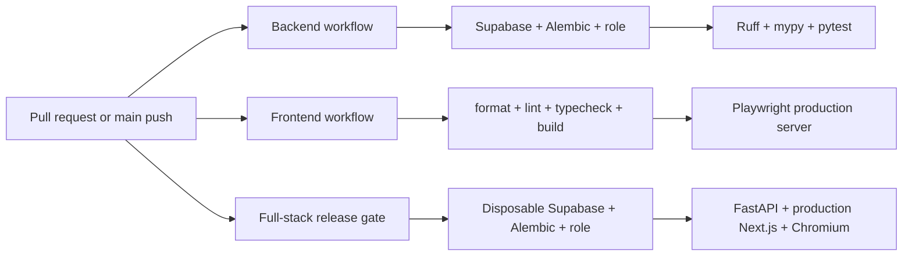

# Testing Architecture

> **Scope:** Automated verification layers, fixtures, CI execution, and evidenced coverage gaps.
> **Audience:** Developers deciding where and how to verify a change.
> **Related documents:** [Backend architecture](04-backend-architecture.md), [Frontend architecture](05-frontend-architecture.md), [Deployment](12-deployment-architecture.md), [Architecture risks](20-architecture-risks.md), [Dynamic-field validation test plan](../dynamic-field-validation-test-plan.md)

## Test layers

| Layer                           | State                                      | What it verifies                                                                                                                                  |
| ------------------------------- | ------------------------------------------ | ------------------------------------------------------------------------------------------------------------------------------------------------- |
| Backend unit/API tests          | **Implemented**                            | Schemas, request context, auth seams, list behavior, domain routes/services, audit snapshots/listeners, lifecycle and relationships, plus expanded dynamic field/record validation. |
| PostgreSQL integration tests    | **Implemented but environment-gated**      | Real constraints, transactions, JSONB persistence, audit behavior, list behavior, relationships, lifecycle, deterministic NOWAIT races, runtime-role trust boundaries, and migration contracts when `TEST_DATABASE_URL` is set. |
| Migration drift/contract tests  | **Implemented**                            | Alembic head, revision SQL/contracts—including decimal migration 0015—and model-to-schema drift in CI.                                           |
| Frontend browser tests          | **Implemented, mostly mocked integration** | Public pages plus dynamic-field schema/record, relationship, and lifecycle UI behavior through mocked session/BFF routes; these tests are not backend/DB integration. |
| Frontend unit/component tests   | **Absent**                                 | No Vitest/Jest/component-test framework is configured.                                                                                            |
| Disposable full-stack release gate | **Implemented**                         | `.github/workflows/fullstack.yml` invokes `backend/tests/fullstack_runner.py` to create a fresh Supabase stack, production Next.js, FastAPI, and browser path. It is not a hosted-control or Realtime-delivery test. |
| Security/performance/load tests | **Absent**                                 | No dedicated automated suites are checked in.                                                                                                     |

## Backend verification

`backend/pyproject.toml` configures pytest with coverage over `app`, an 80% failure threshold, and an `integration` marker. `backend/tests/conftest.py` supplies shared seams and guards PostgreSQL integration use.

Test modules cover:

- health and request context;
- Supabase JWT and admin adapters;
- auth/user invitation and user routes;
- departments/modules, fields/records, relationships;
- expanded field/record unit and API validation, with the shared
  `contracts/record-field-validation-cases.json` fixture consumed by the
  split field/record suites (`backend/tests/test_fields.py`,
  `backend/tests/test_records.py`, `backend/tests/test_fields_api_contract.py`,
  and `backend/tests/test_record_validation.py`) and
  `frontend/tests/field-schema.spec.ts`;
- real PostgreSQL dynamic-field validation in
  `backend/tests/test_dynamic_field_database_integration.py`,
  `backend/tests/test_dynamic_field_persistence_integration.py`, and
  `backend/tests/test_dynamic_field_concurrency_integration.py`, including
  JSONB normalization, runtime-role direct-SQL trust characterization, schema
  acceptance, and deterministic field uniqueness contention;
- relationship PostgreSQL coverage in
  `backend/tests/test_relationships_api.py`,
  `backend/tests/test_relationships_http_integration.py`,
  `backend/tests/test_relationships_races_integration.py`, and
  `backend/tests/relationships_integration/test_concurrency.py`,
  `backend/tests/relationships_integration/test_lifecycle.py`,
  `backend/tests/relationships_integration/test_migration.py`, and
  `backend/tests/relationships_integration/test_mutations.py`,
  including deterministic contention (`503` then committed-state `409`);
- standard list schemas/query/API/integration;
- audit context, snapshots, listeners, service, API, integration;
- lifecycle security, routes, service, integration, and registered API expiry checks in
  `backend/tests/test_lifecycle_expiry_api_integration.py` (including pending and
  already-`expired` stored challenge states, with no password-provider call);
- migration contracts for Supabase cutover, relationships, schema acceptance,
  decimal migration 0015, and lifecycle revisions.
- registered RBAC route tests in `backend/tests/rbac/`, including the role,
  user, invitation, lifecycle-capability, and authentication seams;
- migration 0015/0016 contracts in `backend/tests/migration_0015/` and
  `backend/tests/migration_0016/`, plus security-event API/model tests in
  `backend/tests/security_events/`;
- reset utility contracts in `backend/tests/reset_application_data/` and
  API seeding contracts in `backend/tests/test_seed_sample_data.py`. The
  seeding tests verify contiguous zero-based field positions and acceptance
  of each populated module before records are created;
- field-impact API integration in `backend/tests/test_field_impact_integration.py`
  exercises 1,001 records across the fixed 250-row streaming boundary.

The dynamic-field and relationship integration fixtures track their committed
departments, modules, fields, records, relationships, and audit entities by
UUID. Cleanup releases the test transaction and deletes only those UUIDs
through a guarded owner-capable connection, preferring
`MIGRATION_DATABASE_URL` and falling back to an owner-capable
`TEST_DATABASE_URL`; it does not perform a table-wide reset. Reset utility
tests use dry-run and rollback-protected execution paths and do not authorize
a committed database reset.

The backend CI workflow starts local Supabase, verifies public signup is blocked, applies Alembic, runs `alembic check`, provisions a disposable runtime role, and sets `TEST_DATABASE_URL` before Ruff, mypy, and pytest. This is the authoritative backend integration path.

The full-stack workflow supplies the cross-system release gate. Its one stable
**Full-stack release gate** job performs relevant-change detection inside the
workflow, so the job still completes for irrelevant changes. For relevant
changes, `backend/tests/fullstack_runner.py` creates an isolated Supabase
project on dedicated ports; runs the current Alembic head, drift check,
runtime-role provisioning, backend suite and coverage gate; then starts
FastAPI and production Next.js and runs `frontend/playwright.fullstack.config.ts`
with disposable identities. Its only retained artifact is a sanitized summary.
The runner does not reuse developer identities or an existing stack.

The workflow exists, but branch protection is not source-controlled here. A
repository maintainer must require the stable check after landing before it is
an enforced merge gate.

### Isolated Python compatibility checks

Run the non-integration backend suite in a disposable uv environment for each supported interpreter. Run this snippet from the repository root in Bash or Zsh; it uses shell arrays and is not a POSIX `sh` script. This is a local verification command only; it does not change CI configuration or the shared project environment.

```sh
temp_envs=()
cleanup() {
  for env_dir in "${temp_envs[@]}"; do
    rm -rf "$env_dir"
  done
}
trap cleanup EXIT

for py in 3.12 3.13 3.14; do
  env_dir="$(mktemp -d "/tmp/openslate-python-${py}-XXXXXX")"
  temp_envs+=("$env_dir")
  UV_PROJECT_ENVIRONMENT="$env_dir" \
    UV_CACHE_DIR=/tmp/openslate-workflow-uv-cache \
    uv sync --locked --project backend --python "$py"
  UV_PROJECT_ENVIRONMENT="$env_dir" \
    UV_CACHE_DIR=/tmp/openslate-workflow-uv-cache \
    uv run --project backend pytest -m "not integration" --no-cov
done
```

An interpreter or dependency-resolution failure is a blocked compatibility check and must be recorded as such; it must not be reported as a passing test run.

### Handwritten Python size guard

`backend/tests/test_python_file_size.py` scans handwritten `*.py` files under
`backend/app`, `backend/scripts`, and `backend/tests`, excluding generated
environments, caches, and migrations, and fails any file over 500 lines. Run
the focused guard from `backend/` with:

```sh
UV_CACHE_DIR=/tmp/openslate-workflow-uv-cache uv run pytest --no-cov tests/test_python_file_size.py
```

## Frontend verification

Playwright configuration runs against a development server locally and a standalone production server in CI. Local projects include Chromium/mobile; CI installs and runs Chromium, Firefox, and WebKit. Failure artifacts and the HTML report are uploaded by `.github/workflows/frontend.yml`.

Current default specs include:

- `home.spec.ts`: landing/setup/login/invited-account password setup and one home-page axe scan;
- `field-schema.spec.ts`, `date-time.spec.ts`, and `record-form-invalidation.spec.ts`: dynamic schema parity, date/time behavior, record serialization, and invalidation handling;
- `request-security.spec.ts`: BFF/request security behavior;
- `relationships.spec.ts`: schema acceptance, field/cardinality behavior, record editing, linking/unlinking, and hidden/incoming relationships;
- `lifecycle.spec.ts`: closed-entity presentation, ordering, close/reopen confirmation UI, and hidden relationship behavior.

Opt-in specifications under `frontend/tests/live/` cover local platform foundation, schema seeding, relationship integrity, and teardown/support behavior.

Default domain tests mock `/session/status`, `/session/realtime-token`, and `/bff/**`. They verify frontend behavior against fixtures, not the deployed cross-system contract. The separate local-only live suite uses real local Auth and backend calls; it is deliberately excluded from `npm run verify` and CI.

## CI gates



Backend and frontend workflows use path filters and cancel superseded runs. The
full-stack workflow uses internal relevant-change detection to preserve its
stable check name. None of these workflows publishes images or deploys.

## Known coverage gaps

- Realtime authorization and invalidation delivery; the release harness does not
  establish Broadcast delivery guarantees.
- Priority 4 Next.js SecurityEvent producers and their durable ingestion
  visibility; current full-stack and BFF coverage does not add those producers.
- Administration users/roles/audit UI, workspace/onboarding correctness, appearance persistence, pagination, and protected-page accessibility.
- Concurrent last-administrator mutations and additional multi-connection scenarios beyond the covered field/relationship races.
- Load limits beyond the application bounds, hosted TLS/network policy,
  aggregate ingress limiting, log-alert delivery, backup/restore, and disaster
  recovery. These are Priority 3 production gates.
- Storage, reports, views, and file workflows because those capabilities are not implemented.

## Choosing a test location

- Put pure schema/service/listener behavior in backend unit tests.
- Use PostgreSQL integration tests for constraints, locks, RLS, migrations, concurrency, rollback, and audit transaction guarantees.
- Use Playwright fixture tests for isolated UI state and rendering.
- Run the opt-in live Playwright suite only when the complete local platform, backend, and frontend are running; use the full-stack runner for the disposable production-style release path. Neither replaces hosted-control verification.

Sources: `backend/pyproject.toml`, `backend/tests/`, `frontend/playwright.config.ts`, `frontend/tests/`, `.github/workflows/`.
