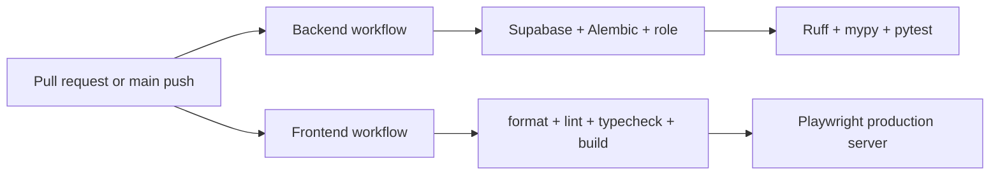

# Testing Architecture

> **Scope:** Automated verification layers, fixtures, CI execution, and evidenced coverage gaps.
> **Audience:** Developers deciding where and how to verify a change.
> **Related documents:** [Backend architecture](04-backend-architecture.md), [Frontend architecture](05-frontend-architecture.md), [Deployment](12-deployment-architecture.md), [Architecture risks](20-architecture-risks.md)

## Test layers

| Layer                           | State                                      | What it verifies                                                                                                                                  |
| ------------------------------- | ------------------------------------------ | ------------------------------------------------------------------------------------------------------------------------------------------------- |
| Backend unit/API tests          | **Implemented**                            | Schemas, request context, auth seams, list behavior, domain routes/services, audit snapshots/listeners, lifecycle and relationships.              |
| PostgreSQL integration tests    | **Implemented but environment-gated**      | Real constraints, transactions, audit behavior, list behavior, relationships, lifecycle, and migration contracts when `TEST_DATABASE_URL` is set. |
| Migration drift/contract tests  | **Implemented**                            | Alembic head, revision SQL/contracts, and model-to-schema drift in CI.                                                                            |
| Frontend browser tests          | **Implemented, mostly mocked integration** | Public pages plus schema/relationship/lifecycle UI behavior through mocked session/BFF routes.                                                    |
| Frontend unit/component tests   | **Absent**                                 | No Vitest/Jest/component-test framework is configured.                                                                                            |
| Live full-stack browser tests   | **Absent**                                 | Current Playwright domain tests do not exercise real Auth, BFF, FastAPI JWT, PostgreSQL, or Realtime delivery.                                    |
| Security/performance/load tests | **Absent**                                 | No dedicated automated suites are checked in.                                                                                                     |

## Backend verification

`backend/pyproject.toml` configures pytest with coverage over `app`, an 80% failure threshold, and an `integration` marker. `backend/tests/conftest.py` supplies shared seams and guards PostgreSQL integration use.

Test modules cover:

- health and request context;
- Supabase JWT and admin adapters;
- auth/user invitation and user routes;
- departments/modules, fields/records, relationships;
- standard list schemas/query/API/integration;
- audit context, snapshots, listeners, service, API, integration;
- lifecycle security, routes, service, integration;
- migration contracts for Supabase cutover, relationships, schema acceptance, and lifecycle revisions.

The backend CI workflow starts local Supabase, verifies public signup is blocked, applies Alembic, runs `alembic check`, provisions a disposable runtime role, and sets `TEST_DATABASE_URL` before Ruff, mypy, and pytest. This is the authoritative integration path.

During this documentation session, a local run without the integration environment reported 221 passing and 31 skipped tests, but the command failed its coverage gate at 70.84%. This is a point-in-time verification result, not a permanent repository property. Ruff and mypy passed in the same run.

## Frontend verification

Playwright configuration runs against a development server locally and a standalone production server in CI. Local projects include Chromium/mobile; CI installs and runs Chromium, Firefox, and WebKit. Failure artifacts and the HTML report are uploaded by `.github/workflows/frontend.yml`.

Current specs:

- `home.spec.ts`: landing/setup/login/invited-account password setup and one home-page axe scan;
- `relationships.spec.ts`: schema acceptance, field/cardinality behavior, record editing, linking/unlinking, hidden/incoming relationships;
- `lifecycle.spec.ts`: closed-entity presentation, ordering, close/reopen confirmation UI, and hidden relationship behavior.

Domain tests mock `/session/status`, `/session/realtime-token`, and `/bff/**`. They verify frontend behavior against fixtures, not the deployed cross-system contract.

## CI gates

Backend and frontend workflows use path filters and cancel superseded runs. They verify changes but do not publish images or deploy.

## Known coverage gaps

- Real invitation email through callback/password setup and cookie persistence; session-handler, cookie, same-origin, BFF refresh, AppPage redirect, and successful Realtime paths lack code-level tests.
- BFF refresh/retry against actual Supabase Auth and backend JWT validation.
- Browser-to-Realtime authorization and invalidation delivery.
- Administration users/roles/audit UI, workspace/onboarding correctness, appearance persistence, pagination, and protected-page accessibility.
- Concurrent last-administrator mutations and other multi-connection race tests.
- Request-size/rate-limit behavior, hosted TLS/network policy, backup/restore, and disaster recovery.
- Storage, reports, views, and file workflows because those capabilities are not implemented.

## Choosing a test location

- Put pure schema/service/listener behavior in backend unit tests.
- Use PostgreSQL integration tests for constraints, locks, RLS, migrations, concurrency, rollback, and audit transaction guarantees.
- Use Playwright fixture tests for isolated UI state and rendering.
- Add live Playwright verification only when the complete local platform, backend, and frontend are running; it complements rather than replaces code-level tests.

Sources: `backend/pyproject.toml`, `backend/tests/`, `frontend/playwright.config.ts`, `frontend/tests/`, `.github/workflows/`.
