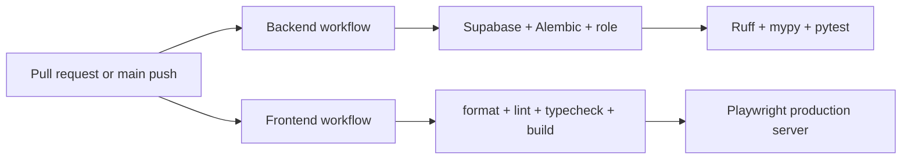

# Testing Architecture

> **Scope:** Automated verification layers, fixtures, CI execution, and evidenced coverage gaps.
> **Audience:** Developers deciding where and how to verify a change.
> **Related documents:** [Backend architecture](04-backend-architecture.md), [Frontend architecture](05-frontend-architecture.md), [Deployment](12-deployment-architecture.md), [Architecture risks](20-architecture-risks.md), [Dynamic-field validation test plan](../dynamic-field-validation-test-plan.md)

## Test layers

| Layer                           | State                                      | What it verifies                                                                                                                                  |
| ------------------------------- | ------------------------------------------ | ------------------------------------------------------------------------------------------------------------------------------------------------- |
| Backend unit/API tests          | **Implemented**                            | Schemas, request context, auth seams, list behavior, domain routes/services, audit snapshots/listeners, lifecycle and relationships, plus expanded dynamic field/record validation. |
| PostgreSQL integration tests    | **Implemented but environment-gated**      | Real constraints, transactions, JSONB persistence, audit behavior, list behavior, relationships, lifecycle, deterministic NOWAIT races, runtime-role trust boundaries, and migration contracts when `TEST_DATABASE_URL` is set. |
| Migration drift/contract tests  | **Implemented**                            | Alembic head, revision SQL/contracts—including decimal migration 0015—and model-to-schema drift in CI.                                           |
| Frontend browser tests          | **Implemented, mostly mocked integration** | Public pages plus dynamic-field schema/record, relationship, and lifecycle UI behavior through mocked session/BFF routes; these tests are not backend/DB integration. |
| Frontend unit/component tests   | **Absent**                                 | No Vitest/Jest/component-test framework is configured.                                                                                            |
| Live full-stack browser tests   | **Implemented, opt-in/local-only**         | Separate live Playwright specs exercise the browser→Next/BFF→FastAPI→PostgreSQL path with real local Auth and manifest-scoped cleanup; excluded from the default suite and CI, and not a Realtime-delivery test. |
| Security/performance/load tests | **Absent**                                 | No dedicated automated suites are checked in.                                                                                                     |

## Backend verification

`backend/pyproject.toml` configures pytest with coverage over `app`, an 80% failure threshold, and an `integration` marker. `backend/tests/conftest.py` supplies shared seams and guards PostgreSQL integration use.

Test modules cover:

- health and request context;
- Supabase JWT and admin adapters;
- auth/user invitation and user routes;
- departments/modules, fields/records, relationships;
- expanded field/record unit and API validation, with the shared
  `contracts/record-field-validation-cases.json` fixture consumed by both
  `backend/tests/test_fields_records.py` and
  `frontend/tests/field-schema.spec.ts`;
- real PostgreSQL dynamic-field validation in
  `backend/tests/test_dynamic_field_validation_integration.py`, including
  JSONB normalization, runtime-role direct-SQL trust characterization, schema
  acceptance, and deterministic field uniqueness contention;
- relationship PostgreSQL coverage in
  `backend/tests/test_relationships_integration.py`, including deterministic
  contention (`503` then committed-state `409`);
- standard list schemas/query/API/integration;
- audit context, snapshots, listeners, service, API, integration;
- lifecycle security, routes, service, integration;
- migration contracts for Supabase cutover, relationships, schema acceptance,
  decimal migration 0015, and lifecycle revisions.

The dynamic-field and relationship integration fixtures track their committed
departments, modules, fields, records, relationships, and audit entities by
UUID. Cleanup releases the test transaction and deletes only those UUIDs
through a guarded owner-capable connection, preferring
`MIGRATION_DATABASE_URL` and falling back to an owner-capable
`TEST_DATABASE_URL`; it does not perform a table-wide reset.

The backend CI workflow starts local Supabase, verifies public signup is blocked, applies Alembic, runs `alembic check`, provisions a disposable runtime role, and sets `TEST_DATABASE_URL` before Ruff, mypy, and pytest. This is the authoritative integration path.

The dynamic-field validation results recorded on 2026-08-31 are:

| Check | Result |
| --- | --- |
| Focused field/record/module/relationship tests | **116 passed** |
| Runtime-role PostgreSQL integration tests | **33 passed** |
| Owner-role PostgreSQL integration tests | **27 passed** |
| Full backend pytest | **382 passed, 2 skipped, 82.08% coverage** |
| Ruff | **Passed** |
| mypy | **Passed** |
| Alembic | **Passed**; no new upgrade operations |

The exact commands, PostgreSQL role split, and environment-isolation note are recorded in the [dynamic-field validation test plan](../dynamic-field-validation-test-plan.md).

## Frontend verification

Playwright configuration runs against a development server locally and a standalone production server in CI. Local projects include Chromium/mobile; CI installs and runs Chromium, Firefox, and WebKit. Failure artifacts and the HTML report are uploaded by `.github/workflows/frontend.yml`.

Current default specs include:

- `home.spec.ts`: landing/setup/login/invited-account password setup and one home-page axe scan;
- `field-schema.spec.ts`, `date-time.spec.ts`, and `record-form-invalidation.spec.ts`: dynamic schema parity, date/time behavior, record serialization, and invalidation handling;
- `request-security.spec.ts`: BFF/request security behavior;
- `relationships.spec.ts`: schema acceptance, field/cardinality behavior, record editing, linking/unlinking, and hidden/incoming relationships;
- `lifecycle.spec.ts`: closed-entity presentation, ordering, close/reopen confirmation UI, and hidden relationship behavior.

Opt-in specifications under `frontend/tests/live/` cover local platform foundation, schema seeding, relationship integrity, and teardown/support behavior.

Default domain tests mock `/session/status`, `/session/realtime-token`, and `/bff/**`. They verify frontend behavior against fixtures, not the deployed cross-system contract. The separate local-only live suite uses real local Auth and backend calls; it is deliberately excluded from `npm run verify` and CI.

## CI gates

Backend and frontend workflows use path filters and cancel superseded runs. They verify changes but do not publish images or deploy.

## Known coverage gaps

- Real invitation email through callback/password setup and cookie persistence; session-handler, cookie, same-origin, BFF refresh, AppPage redirect, and successful Realtime paths lack code-level tests.
- BFF refresh/retry against actual Supabase Auth and backend JWT validation.
- Browser-to-Realtime authorization and invalidation delivery.
- Administration users/roles/audit UI, workspace/onboarding correctness, appearance persistence, pagination, and protected-page accessibility.
- Concurrent last-administrator mutations and additional multi-connection scenarios beyond the covered field/relationship races.
- Request-size/rate-limit behavior, hosted TLS/network policy, backup/restore, and disaster recovery.
- Storage, reports, views, and file workflows because those capabilities are not implemented.

## Choosing a test location

- Put pure schema/service/listener behavior in backend unit tests.
- Use PostgreSQL integration tests for constraints, locks, RLS, migrations, concurrency, rollback, and audit transaction guarantees.
- Use Playwright fixture tests for isolated UI state and rendering.
- Run the opt-in live Playwright suite only when the complete local platform, backend, and frontend are running; it complements rather than replaces code-level tests.

Sources: `backend/pyproject.toml`, `backend/tests/`, `frontend/playwright.config.ts`, `frontend/tests/`, `.github/workflows/`.
