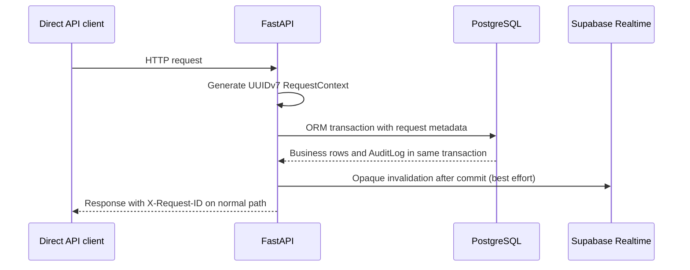

# Observability Architecture

> **Scope:** Health, request correlation, audit, logs, CI artifacts, and absent metrics, tracing, alerting, and healthchecks.
> **Audience:** Developers and operators diagnosing requests, mutations, CI failures, or current signal limits.
> **Related documents:** [Infrastructure](11-infrastructure.md), [Deployment](12-deployment-architecture.md), [Configuration](17-configuration.md), [Architecture index](README.md)

## State classifications

- **Implemented** means the signal is emitted or exposed by checked-in code.
- **Partially implemented** means a signal exists for a bounded path but has no external collection or full-request coverage.
- **Absent** means no checked-in implementation or configured sink exists.
- **Unknown** means no hosted monitoring or operational policy is defined.

## Health surface — Implemented, shallow

`backend/app/main.py:create_app` exposes `GET /api/health` with the exact
response:

```json
{ "status": "ok", "service": "openslate-api" }
```

The handler is an in-process constant response and does not check PostgreSQL,
Supabase Auth, Realtime, Storage, migrations, or the runtime role. The direct
backend URL is `http://localhost:8000/api/health` in the documented local
workflow. `frontend/next.config.ts` also has a general `/api/:path*` rewrite to
the backend URL, but the application health implementation belongs to
FastAPI.

There is no separate readiness endpoint, dependency check, health probe route,
or Docker `HEALTHCHECK` instruction in either image:

- **Health endpoint:** Implemented.
- **Dependency-aware readiness:** Absent.
- **Container healthcheck:** Absent.
- **Hosted uptime check:** Unknown.

The endpoint is covered by `backend/tests/test_health.py`.

## Request identity and correlation — Partially implemented

`backend/app/core/middleware/request_context.py:RequestContext` creates a
UUIDv7 request identifier with the method and path. The HTTP middleware in
`backend/app/main.py` returns it as `X-Request-ID` on the normal response path.
It generates a new identifier rather than accepting an incoming identifier.
Because there is no global exception middleware, the header is not guaranteed
when request processing raises before the normal response path completes.

For an `AuditSession`, `backend/app/core/database/session.py:get_db` transfers
the request identifier, method, path, and actor context into the SQLAlchemy
session. Normal audited ORM changes write those fields into `audit_logs`; the
audit model has an index on `request_id` and the audit read service accepts a
request-id filter.



The frontend BFF does not create a request ID and its response-header allowlist
does not forward `X-Request-ID` in `frontend/src/app/bff/[...path]/route.ts`.
The value remains available in backend responses and audit rows, but browser
application callers through `/bff` cannot read it.

## Audit trail — Implemented for application ORM mutations

`backend/app/systems/audit/listeners.py` captures auditable new, dirty, and
deleted ORM instances before flush, inserts immutable `AuditLog` rows after
flush, and commits those rows in the same transaction as the business change.
`backend/app/systems/audit/snapshots.py` stores minimal before/after diffs and
redacts sensitive keys. `AuditLog` is not recursively audited. Its request
metadata includes request ID, method, and path where the mutation has a
request context.

The administrator-only audit router exposes read access to the stored audit
trail. Audit coverage is bounded to normal audited application ORM sessions;
Supabase Auth, Studio, Alembic, direct SQL, Data API operations, and external
database clients are outside this capture boundary. Rollback clears staged
audit state, so a rolled-back business mutation does not retain its audit row.

After a successful commit, the backend sends an opaque private Broadcast
invalidation through `SupabaseAdminClient.broadcast`. Realtime failure is
swallowed because PostgreSQL remains canonical. The frontend
`RealtimeProvider` uses the event to invalidate/refetch; it does not expose row
snapshots as an observability payload.

## Default logs — Implemented, unstructured

- Uvicorn, FastAPI, Python, Next.js, and container process output use their
  default stdout/stderr behavior. `backend/app/main.py` contains no
  application logging configuration, request log middleware, structured
  formatter, or exception log sink.
- `backend/alembic.ini` configures a `StreamHandler` to stderr, root and
  SQLAlchemy loggers at `WARN`, Alembic at `INFO`, and a generic timestamped
  text formatter. This applies to Alembic runs, not to a centralized runtime
  collector.
- Operational scripts emit short terminal messages such as role-provisioned or
  sample-data-seeded status. Administrator bootstrap suppresses database,
  Auth, and configuration details on failure.
- The backend CI workflow redirects Supabase start and stop command output to
  `/tmp/openslate-supabase-start.log` and `/tmp/openslate-supabase-stop.log`.
  Those files are not uploaded as workflow artifacts.

The resulting log state is **Implemented locally / Absent as centralized
collection**. No log format, retention, aggregation, or hosted sink is
defined.

## CI test artifacts — Implemented

`frontend/playwright.config.ts` configures:

- `trace: "on-first-retry"`;
- screenshots only on failure;
- video retained on failure;
- CI HTML reporting in addition to the list reporter; and
- the production server path in CI.

`frontend.yml` uploads `frontend/playwright-report/` as `playwright-report`
after every frontend job and uploads `frontend/test-results/` as
`playwright-test-results` on failure. These are test diagnostics, not runtime
telemetry. The backend workflow emits terminal Ruff, mypy, Alembic, and pytest
output but has no artifact-upload step.

## Explicitly absent or unspecified signals

| Signal or control                        | Classification                      | Evidence                                                                                                           |
| ---------------------------------------- | ----------------------------------- | ------------------------------------------------------------------------------------------------------------------ |
| Application metrics                      | Absent                              | No Prometheus/OpenTelemetry metrics library, exporter, or metrics route is present.                                |
| Distributed tracing                      | Absent                              | No tracing SDK, span instrumentation, trace exporter, or trace-context middleware is present.                      |
| Structured application logs              | Absent                              | No structured formatter or logging setup is present in `backend/app` or the image definitions.                     |
| Log aggregation and retention            | Unknown for hosted / absent locally | No collector, sink, retention setting, or hosted logging integration is checked in.                                |
| Alerting                                 | Absent                              | No alert rules, notification integration, or on-call configuration is present.                                     |
| External monitoring and uptime checks    | Unknown                             | No hosted monitoring target or provider is defined.                                                                |
| Dependency-aware readiness               | Absent                              | `/api/health` does not inspect dependencies and no readiness route exists.                                         |
| Container healthchecks                   | Absent                              | Neither `infra/docker/backend.Dockerfile` nor `infra/docker/frontend.Dockerfile` declares `HEALTHCHECK`.           |
| Realtime delivery monitoring             | Partially implemented               | Broadcast failures are handled as optional enhancement and are not surfaced as a metric, log, or alert.            |
| Audit completeness outside ORM mutations | Absent by boundary                  | The audit implementation intentionally excludes Auth, Studio, Alembic, Data API, direct SQL, and external clients. |
