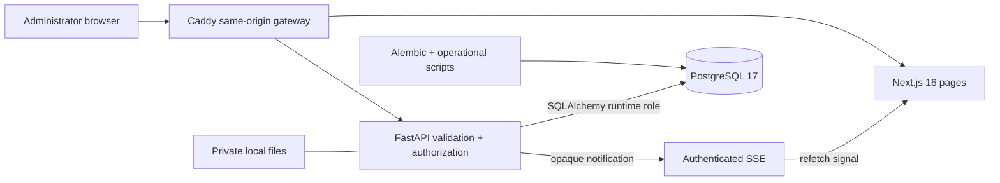

# OpenSlate Architecture

> **Scope:** Index, reading guide, and verified high-level map for the complete OpenSlate architecture documentation set.
> **Audience:** Developers and operators who need to become productive in this repository.
> **Related documents:** [System overview](01-system-overview.md), [Runtime flows](13-runtime-flows.md), [Glossary](21-glossary.md)

OpenSlate is a self-hosted foundation for configurable business operations. Authorized users work with departments, modules, fields, records, and relationships through a Next.js frontend backed by FastAPI, PostgreSQL, private filesystem files, and authenticated SSE. The implemented system uses deployment-global capability authorization, administrator-only management controls, application-level validation, lifecycle planning, and ORM audit capture.

## Purpose and accuracy

This set explains the system as checked into this repository, not a typical or proposed version of it. Claims were derived from manifests, entry points, routes, models, all Alembic revisions, platform configuration, scripts, workflows, and tests; six core flows were traced end to end. Capability labels distinguish **Implemented**, **Partially Implemented**, **Planned / Documented Only**, **Absent**, and **Unknown** behavior.

[Deployment architecture](12-deployment-architecture.md) also contains a separately labeled target design for future Windows and macOS server apps and customer installation. That design is not an implemented release path.

To keep the set accurate, update the relevant document with the source change, use paths/symbols as evidence, and rerun the checks in [Testing architecture](16-testing-architecture.md). The final audit rechecked security/auth/data claims, source paths, diagrams, links, and terminology.

## High-level architecture

The browser does not write application data directly. FastAPI issues HttpOnly session cookies, verifies local identity and capability state, and performs SQLAlchemy operations against PostgreSQL. Audit rows share the domain transaction; authenticated SSE only signals clients to refetch.

## Recommended reading order

1. [System overview](01-system-overview.md) — purpose, capabilities, components, and boundaries.
2. [System context](02-system-context.md) — actors, external services, and trust boundaries.
3. [Domain architecture](03-domain-architecture.md) — entities, rules, and mutation ownership.
4. [Data architecture](06-data-architecture.md) — tables, constraints, migrations, and transactions.
5. [Backend architecture](04-backend-architecture.md) — startup, packages, request handling, and persistence path.
6. [API architecture](07-api-architecture.md) — endpoint groups, list conventions, status behavior, and request sequences.
7. [Authentication and authorization](08-authentication-authorization.md) — cookies, JWTs, profiles, roles, invitations, and step-up checks.
8. [Frontend architecture](05-frontend-architecture.md) — routes, sample feature state, async boundaries, sessions, and UI status.
9. [Lifecycle and state management](09-lifecycle-and-state-management.md) — close, reopen, restore, visibility, and purge.
10. [Audit and history](10-audit-and-history.md) — listener mechanics, snapshots, immutability, and capture boundary.
11. [Runtime flows](13-runtime-flows.md) — six concrete end-to-end traces.
12. [Infrastructure](11-infrastructure.md) and [Deployment architecture](12-deployment-architecture.md) — current local topology, hosted boundary, and proposed Windows/macOS customer installation.
13. [Security architecture](14-security-architecture.md) and [Error handling and recovery](15-error-handling-and-recovery.md).
14. [Testing](16-testing-architecture.md), [Configuration](17-configuration.md), and [Observability](18-observability.md).
15. [Architecture decisions](19-architecture-decisions.md), [Architecture risks](20-architecture-risks.md), and the [Glossary](21-glossary.md).

## Document index

| Document                                                                    | Description                                                                              |
| --------------------------------------------------------------------------- | ---------------------------------------------------------------------------------------- |
| [01 — System overview](01-system-overview.md)                               | Whole-system purpose, capability state, components, principles, and change map.          |
| [02 — System context](02-system-context.md)                                 | Human actors, local processes, CI, and trust boundaries.                                  |
| [03 — Domain architecture](03-domain-architecture.md)                       | Departments, modules, fields, records, relationships, users, roles, and invariants.      |
| [04 — Backend architecture](04-backend-architecture.md)                     | FastAPI assembly, capability packages, request/session flow, and application layering.   |
| [05 — Frontend architecture](05-frontend-architecture.md)                   | Next.js routes, protected shell, FastAPI sessions, and async sample features.             |
| [06 — Data architecture](06-data-architecture.md)                           | PostgreSQL entities, FKs, constraints, indexes, JSONB, grants, and Alembic.               |
| [07 — API architecture](07-api-architecture.md)                             | Route groups, validation, list/query conventions, transactions, and sequences.           |
| [08 — Authentication and authorization](08-authentication-authorization.md) | Local identity, JWT/session checks, roles, invitations, and failures.                     |
| [09 — Lifecycle and state management](09-lifecycle-and-state-management.md) | Open/closed/purged state, previews, challenges, locks, cascades, and visibility.         |
| [10 — Audit and history](10-audit-and-history.md)                           | ORM capture, minimal redacted diffs, transaction behavior, and audit limits.             |
| [11 — Infrastructure](11-infrastructure.md)                                 | Local PostgreSQL and host-process topology, ports, services, and startup order.           |
| [12 — Deployment architecture](12-deployment-architecture.md)               | Current release state and proposed Windows/macOS server-app installation and operations. |
| [13 — Runtime flows](13-runtime-flows.md)                                   | Startup, login, invitation, schema/record, lifecycle, and invalidation traces.           |
| [14 — Security architecture](14-security-architecture.md)                   | Implemented controls, partial/absent controls, trust boundaries, and deployment gates.   |
| [15 — Error handling and recovery](15-error-handling-and-recovery.md)       | Error origins, HTTP mapping, rollback, retry, and caller recovery.                       |
| [16 — Testing architecture](16-testing-architecture.md)                     | Backend, PostgreSQL, Playwright, CI coverage, and verified gaps.                         |
| [17 — Configuration](17-configuration.md)                                   | Environment and platform setting names, sensitivity, defaults, and read sites.           |
| [18 — Observability](18-observability.md)                                   | Health, request IDs, audit/log signals, CI artifacts, and absent telemetry.              |
| [19 — Architecture decisions](19-architecture-decisions.md)                 | Evidence-backed design choices and their technical effects.                              |
| [20 — Architecture risks](20-architecture-risks.md)                         | Current problems, consequences, affected components, and recommendations.                |
| [21 — Glossary](21-glossary.md)                                             | Canonical project terms used throughout this set.                                        |

## Observed architectural principles

- FastAPI is the canonical application data API; browsers never access application tables directly.
- Alembic exclusively owns application schema evolution.
- Backend code is organized by capability, without a repository abstraction.
- FastAPI Identity owns credentials, sessions, invitations, and local application access.
- Normal domain mutations use audited ORM sessions and explicit commits.
- Close/reopen is the default hierarchical lifecycle; purge is explicit and disabled by default.
- Authenticated SSE carries private invalidation events, never row snapshots.
- Local infrastructure is a disposable PostgreSQL container plus host-run application processes; Dockerfiles do not constitute deployment orchestration.

## System boundaries

### In this repository

- Next.js application and same-origin API client
- FastAPI application and domain behavior
- SQLAlchemy models and Alembic migrations
- Local identity configuration and invitation template
- Runtime-role/admin/sample-data scripts
- Standalone backend/frontend Dockerfiles
- Verification-only GitHub Actions and test suites

### External or undefined

- Hosted control plane and native customer installer
- Production email provider
- Hosted platform, ingress/TLS, secret manager, network policy
- Backup/PITR, disaster recovery, monitoring, and alerting services
- Shared-tenant isolation model

Files use the private Storage bucket through FastAPI. Upload, quarantine, durable
automatic scanning, download and cleanup are implemented; the private ClamAV
engine and worker require the operator setup described in
[infrastructure](11-infrastructure.md#automatic-file-scanning--container-operating-procedure).

## Structure choice

The full 21-document structure is retained because each subject has substantive verified content or an important explicit absence boundary. Audit remains separate because its transactional listener behavior and capture limits are central. Infrastructure and deployment remain separate to avoid presenting the implemented local topology as a hosted deployment. Lifecycle defines reusable state rules; Runtime Flows applies those rules in traced operations.
