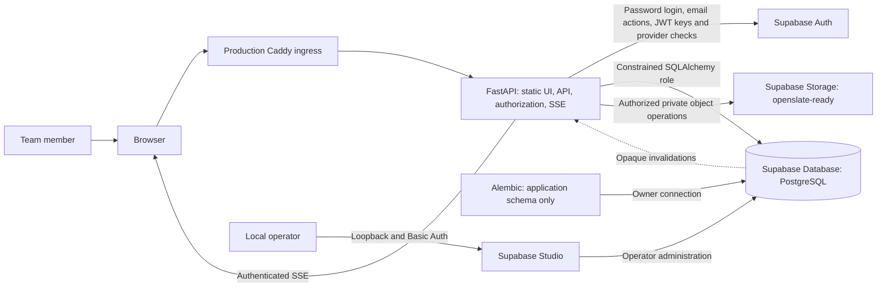

# OpenSlate Architecture

> **Scope:** Reading guide and source-backed map of the OpenSlate architecture documents.
> **Audience:** Developers and operators working in this repository.
> **Related documents:** [System overview](01-system-overview.md), [Runtime flows](13-runtime-flows.md), [Glossary](21-glossary.md)

OpenSlate is a self-hosted application installed separately for each client. The selected Compose topology uses self-hosted Supabase Database (PostgreSQL), Auth, Storage, and Studio. FastAPI remains the application API and authorization authority; it serves the statically exported Next.js UI, accesses application data through SQLAlchemy, and mediates private file operations. Caddy is part of the production overlay. Full production acceptance is still in progress, and Windows runtime acceptance remains pending.

The intended server platforms are Linux and Windows running Linux containers through Docker Desktop and WSL2. macOS remains available for workstation development but is not a supported server target. Existing application data is not imported into the fresh Supabase installation. Supabase Realtime is a future integration; authenticated SSE remains the current invalidation transport.

## Purpose and accuracy

These documents describe the source-backed system and distinguish implemented application behavior from deployment paths that still need acceptance. Use source paths and symbols to trace contracts. Supabase provider schemas and services are owned by Supabase; Alembic owns the OpenSlate application schema only.

Capability and deployment status should remain explicit: **Implemented**, **Partially Implemented**, **Planned / Documented Only**, **Absent**, or **Unknown**. Do not treat checked-in Compose wiring as proof that production TLS, Windows startup and restart, or a complete release has been accepted. Read [Self-hosted Supabase](../../infra/supabase/README.md) for the operator topology and [its implementation plan](../../infra/supabase/PLAN.md) for scope and acceptance criteria.

## High-level architecture

Supabase Auth establishes provider identity. FastAPI verifies the provider token and session, resolves its subject to an explicitly bound OpenSlate user, checks the local revocable session, then applies OpenSlate roles, groups, permissions, and domain rules. Provider metadata does not grant application roles. The browser does not write application rows or access Storage objects directly. OpenSlate file downloads and uploads pass through FastAPI authorization and file-type validation. Supabase Studio replaces the prior pgweb console in this stack and has broader operator privileges than the old read-only inspector, so it remains loopback-bound and password protected.

## Recommended reading order

1. [System overview](01-system-overview.md) — purpose, capabilities, components, and boundaries.
2. [System context](02-system-context.md) — actors, provider services, and trust boundaries.
3. [Domain architecture](03-domain-architecture.md) — entities, rules, and mutation ownership.
4. [Data architecture](06-data-architecture.md) — application tables, provider ownership, Storage bytes, and Alembic.
5. [Backend architecture](04-backend-architecture.md) — startup, packages, request/session flow, and persistence path.
6. [API architecture](07-api-architecture.md) — endpoint groups, list conventions, status behavior, and request sequences.
7. [Authentication and authorization](08-authentication-authorization.md) — Supabase identity, local sessions, roles, invitations, and step-up checks.
8. [Frontend architecture](05-frontend-architecture.md) — routes, protected shell, FastAPI sessions, and UI status.
9. [Lifecycle and state management](09-lifecycle-and-state-management.md) — close, reopen, restore, visibility, and purge.
10. [Audit and history](10-audit-and-history.md) — listener mechanics, snapshots, immutability, and capture boundary.
11. [Runtime flows](13-runtime-flows.md) — development startup, sign-in/authorization, invitation/recovery, file upload, and invalidation.
12. [Infrastructure](11-infrastructure.md) and [Deployment architecture](12-deployment-architecture.md) — Compose services, server targets, startup boundaries, and acceptance still required.
13. [Security architecture](14-security-architecture.md) and [Error handling and recovery](15-error-handling-and-recovery.md).
14. [Testing](16-testing-architecture.md), [Configuration](17-configuration.md), and [Observability](18-observability.md).
15. [Architecture decisions](19-architecture-decisions.md), [Architecture risks](20-architecture-risks.md), and the [Glossary](21-glossary.md).

## Document index

| Document | Description |
| --- | --- |
| [01 — System overview](01-system-overview.md) | System boundaries, provider roles, application ownership, and implementation status. |
| [02 — System context](02-system-context.md) | Human actors, Compose services, trust boundaries, and server processes. |
| [03 — Domain architecture](03-domain-architecture.md) | Departments, modules, fields, records, relationships, users, roles, and invariants. |
| [04 — Backend architecture](04-backend-architecture.md) | FastAPI assembly, capability packages, request/session flow, and application layering. |
| [05 — Frontend architecture](05-frontend-architecture.md) | Next.js routes, protected shell, FastAPI sessions, and async sample features. |
| [06 — Data architecture](06-data-architecture.md) | Supabase PostgreSQL ownership, application schema, private Storage, and Alembic. |
| [07 — API architecture](07-api-architecture.md) | Route groups, validation, list/query conventions, transactions, and sequences. |
| [08 — Authentication and authorization](08-authentication-authorization.md) | Supabase Auth identity, FastAPI session admission, and application authorization. |
| [09 — Lifecycle and state management](09-lifecycle-and-state-management.md) | Open/closed/purged state, previews, challenges, locks, cascades, and visibility. |
| [10 — Audit and history](10-audit-and-history.md) | ORM capture, minimal redacted diffs, transaction behavior, and audit limits. |
| [11 — Infrastructure](11-infrastructure.md) | Development Compose, Supabase services, production overlay, storage, and startup order. |
| [12 — Deployment architecture](12-deployment-architecture.md) | Linux and Windows Compose target, deployment status, and operator acceptance requirements. |
| [13 — Runtime flows](13-runtime-flows.md) | Development startup, sign-in/authorization, invitation/recovery, file upload, and invalidation. |
| [14 — Security architecture](14-security-architecture.md) | Implemented controls, partial/absent controls, trust boundaries, and deployment gates. |
| [15 — Error handling and recovery](15-error-handling-and-recovery.md) | Error origins, HTTP mapping, rollback, retry, and caller recovery. |
| [16 — Testing architecture](16-testing-architecture.md) | Backend, PostgreSQL, Playwright, CI coverage, and verified gaps. |
| [17 — Configuration](17-configuration.md) | Environment and platform setting names, sensitivity, defaults, and read sites. |
| [18 — Observability](18-observability.md) | Health, request IDs, audit/log signals, CI artifacts, and readiness boundaries. |
| [19 — Architecture decisions](19-architecture-decisions.md) | Evidence-backed design choices and their technical effects. |
| [20 — Architecture risks](20-architecture-risks.md) | Current problems, consequences, affected components, and recommendations. |
| [21 — Glossary](21-glossary.md) | System dictionary: one meaning per term, its other names in code and plans, and the word to use. |

## Observed architectural principles

- FastAPI is the canonical application data API; browsers never access application tables directly.
- Supabase Database is PostgreSQL. Alembic exclusively owns OpenSlate application schema evolution; Supabase owns provider schemas and initialization.
- Supabase Auth authenticates. FastAPI owns explicit provider-subject binding, revocable application sessions, and all application authorization decisions.
- Application roles and group access, Board groups, and report-run eligibility remain OpenSlate data; Auth metadata is never an authorization source. The Workspace profile stores shared settings, not an access policy. Server-backed Views and Reports are shared with module readers; each retained Report run records its eligible readers and still checks current module access when read.
- Normal domain mutations use audited ORM sessions and explicit commits. Provider Auth and Storage operations are separate service boundaries.
- Private file bytes live in the Supabase Storage `openslate-ready` bucket; FastAPI authorizes each operation and validates each upload's file type. There is no antivirus scan.
- Close/reopen is the default hierarchical lifecycle; purge is explicit and enabled in new-installation examples. Existing installations retain their required `LIFECYCLE_PURGE_ENABLED` value.
- Authenticated SSE carries private invalidation events, never row snapshots. OpenComms also uses private Supabase Realtime topics for opaque invalidations, presence and typing; message content still loads through FastAPI.
- Supabase Studio is an operator-only database console that replaces pgweb in the Compose topology; it is more privileged than the former read-only inspector.
- The selected production overlay uses one FastAPI application upstream behind Caddy. Next.js is a static-export build tool and a local development server.
- The Compose stack is the per-client deployment direction. Production and Windows runtime acceptance remain pending; there is no native Windows/macOS installer contract.

## System boundaries

### In this repository

- Static Next.js export and same-origin API client
- FastAPI API, Supabase Auth integration, local application authorization, and authenticated SSE
- SQLAlchemy models and a fresh Alembic application-schema lineage
- Supabase PostgreSQL, Auth, Storage, Studio Compose services and the production application overlay
- Private Storage adapter, file-type validation, Caddy configuration, and operator workflows
- Verification-only GitHub Actions and test suites

### External or still pending

- Customer-specific SMTP service and production mail configuration
- Complete production TLS, restart, backup/restore, and release acceptance
- Windows-host runtime acceptance; Linux container support on Windows is the target path
- Live production acceptance of the implemented Database/Auth/Storage/SMTP-configuration readiness report
- Supabase Realtime application integration; current authenticated event delivery uses SSE
- Native server installers, managed hosted control plane, and cross-organization tenancy
- Customer backup destination, retention schedule, monitoring, and alerting operations

OpenSlate stores private file bytes in Supabase Storage. Validation, authorization, upload, download, reconciliation, and cleanup continue through the FastAPI file-service boundary. See [storage](11-infrastructure.md#storage).

## Structure choice

The 21-document structure is retained because each subject has substantive source-backed behavior or an important explicit absence boundary. Audit remains separate because its transactional listener behavior and capture limits are central. Infrastructure and deployment remain separate so the Compose service definitions are not confused with operating-system acceptance. Lifecycle defines reusable state rules; Runtime Flows applies those rules in traced operations.
